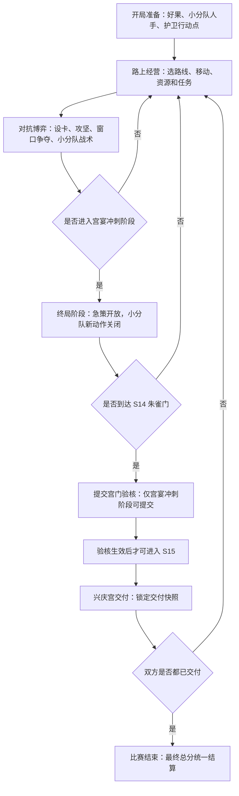
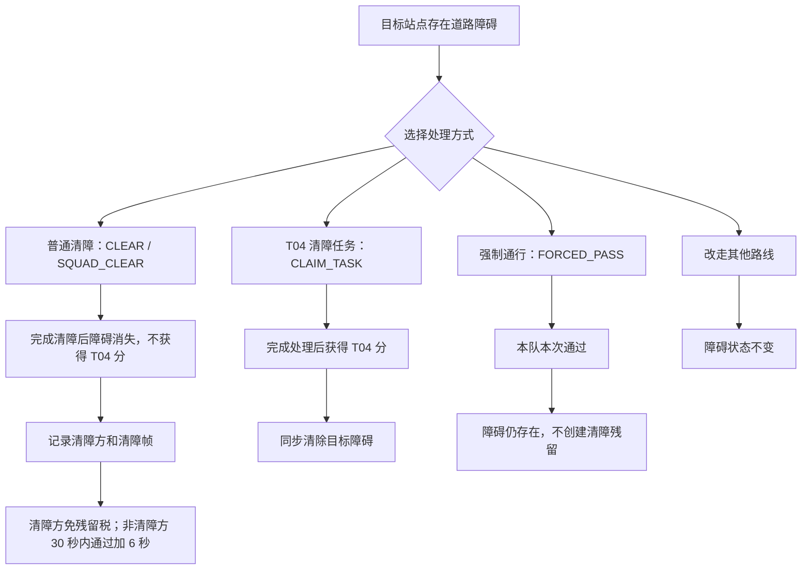
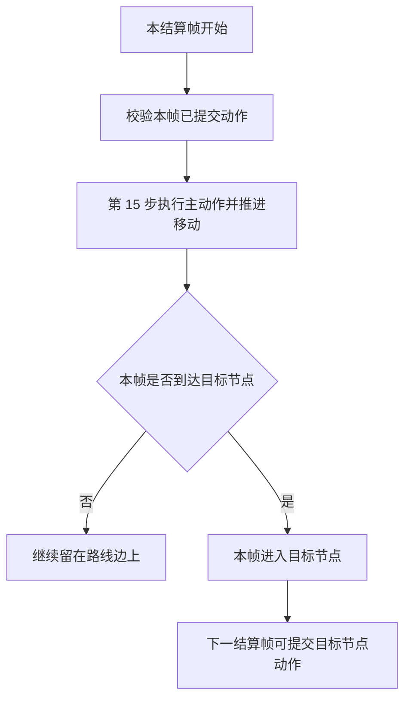
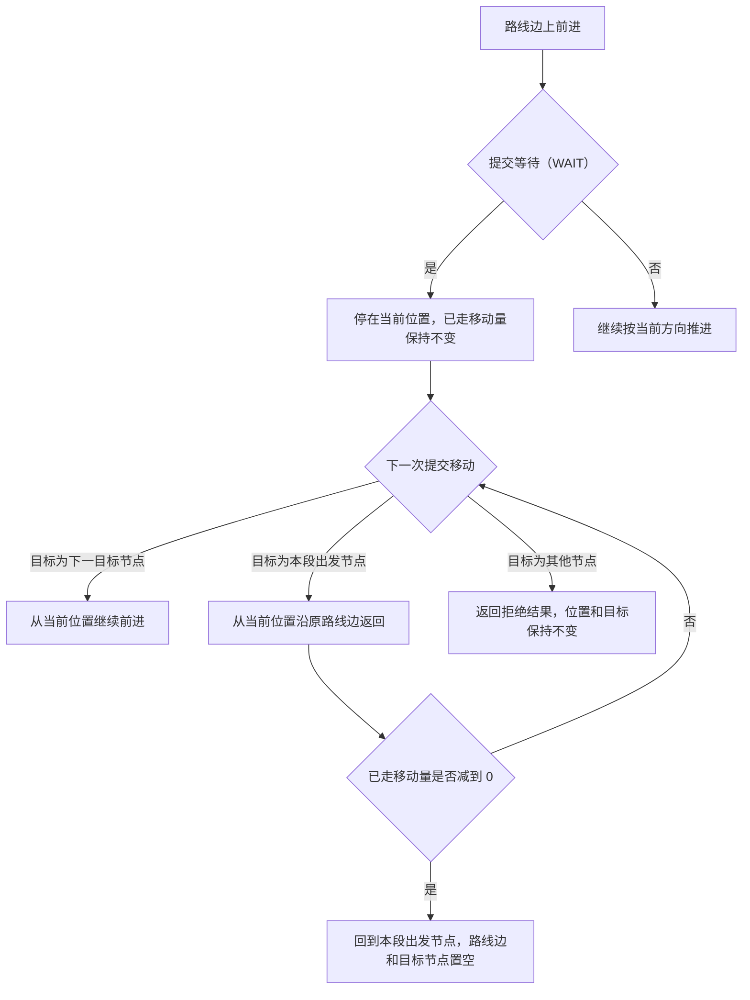
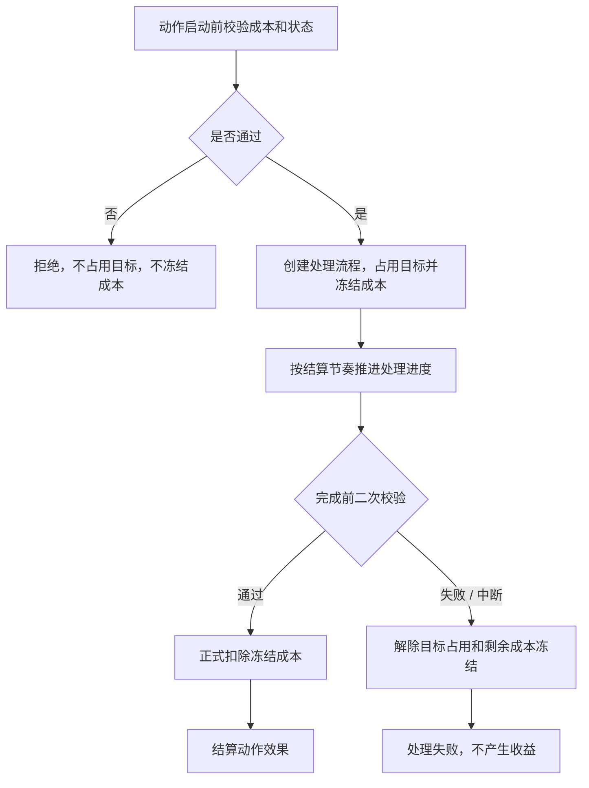
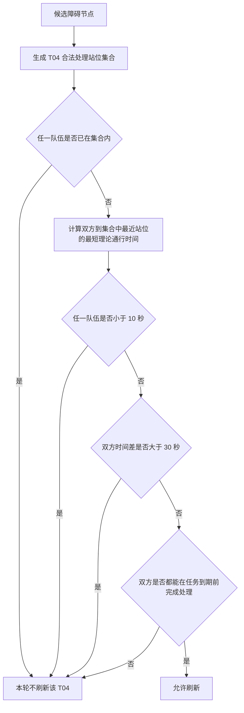
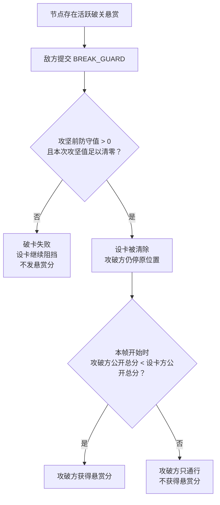
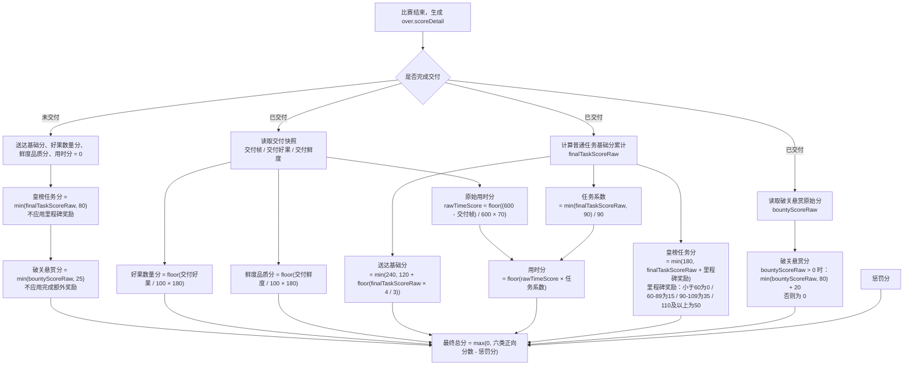

# 《一骑红尘：荔枝争运战》游戏逻辑设计文档

版本：V4.8.12
定位：游戏逻辑定稿；覆盖计分规则、逻辑距离、回放格式与前端落地要求；通信协议独立成文
日期：2026-06-15
通信协议：见 [《一骑红尘：荔枝争运战》通信协议](<./一骑红尘：荔枝争运战 通信协议.md>)

---

# 1. 游戏概述

## 1.1 游戏定位

《一骑红尘：荔枝争运战》是一场双队伍、600 秒限时的贡运策略对抗赛。红方和蓝方各控制一支贡运队，从岭南出发，将荔枝运抵长安兴庆宫；胜负由交付结果、鲜度、用时、任务与悬赏等规则统一计分。

参赛程序只根据服务端下发的当前公开状态提交动作；比赛按服务端结算结果推进，前端负责观战与回放表现。

| 边界 | 说明 |
|---|---|
| 当前可见 | 帧编号、队伍位置与状态、资源、设卡、障碍、天气、任务、悬赏、窗口争夺、本帧事件 |
| 当前不可见 | 未来天气、未来任务刷新、隐藏随机种子、对方尚未提交的本帧动作 |
| 动作约束 | 移动时只能选择当前合法相邻站点；不移动时可处理任务、资源、窗口、等待或心跳 |
| 结算约束 | 下一帧状态由服务端完成本帧结算后生成 |

## 1.2 游戏目标

每支队伍的目标是在 600 秒内完成长安交付，并获得更高总分。

总分由以下内容构成：

- 是否完成交付；
- 交付好果数量；
- 交付鲜度；
- 交付用时；
- 皇榜任务得分；
- 破关悬赏得分；
- 惩罚扣分。

---

## 1.3 初始状态

| 项目 | 固定值 |
|---|---:|
| 好果 | 100 篓 |
| 坏果 | 0 篓 |
| 鲜度 | 100 |
| 小分队人手 | 8 人 |
| 护卫行动点 | 4 点 |
| 比赛时长 | 600 秒 |
| 逻辑结算帧 | 1 秒 / 结算帧 |

初始资源用途：

| 资源 | 主要用途 | 备注 |
|---|---|---|
| 好果 | 交付计分、设卡、攻坚、献贡、终局急策 | 消耗后会降低可交付数量 |
| 坏果 | 攻坚破卡、支付破关令成本 | 不计入交付分，不记录鲜度 |
| 小分队人手 | 小分队探路、清障、增援、削弱 | 派出后不返还 |
| 护卫行动点 | 窗口争夺中的兵争牌（BING_ZHENG） | 不代表小兵死亡 |

---

## 1.4 得分公式

总分由六类正向得分减去惩罚项构成，具体换算、取整和未交付限制统一见 6.2。

皇榜任务分基础规则：
| 名称 | 规则 |
|---|---|
| 最终任务基础分（finalTaskScoreRaw） | 只来自普通皇榜任务 T01、T02、T04、T06、T08、T11、T12、T13、T14；T01/T02/T04/T06/T08/T11 每个 30 分，T12/T13/T14 每个 15 分 |
| 任务参与折扣 | 最终任务基础分低于 90 时，送达基础分和用时分会被折减 |
| 用时任务系数 | min(1, 最终任务基础分 / 90) |
| 任务里程碑奖励 | 最终任务基础分达到 60 / 90 / 110 时，皇榜任务分额外 +15 / +20 / +15 |

任务参与折扣满额阈值保持 90。当前任务分值下，稳定路线低风险任务链通常约 75 原始任务分，能明显优于纯直冲但不会直接拿满送达和用时收益；高阶路线需要通过转线、清障、资源检查、关键关口处理或窗口争夺等客观成本，才有机会冲到 90+ 原始任务分。这样可以压低纯直冲收益，同时避免“只做少量低成本任务就满收益”成为新标准答案。

| 得分项 | 上限 | 规则 |
|---|---:|---|
| 皇榜任务分 | 180 | 最终任务基础分 + 任务里程碑奖励，封顶 180 |
| 送达基础分 | 240 | 成功交付后计算；任务基础分不足 90 时折减，若任务基础分为 0，送达基础分仍有 50% 保底 |
| 用时分 | 69 | 先按交付帧算原始用时分，再乘用时任务系数；当前公式下最高为 69 |
| 好果数量分 | 180 | 按交付好果数量计算 |
| 鲜度品质分 | 180 | 按交付鲜度计算 |
| 破关悬赏分 | 100 | 基础悬赏最高 80，完成任意悬赏后额外 20 |
| 惩罚项 | 扣分 | 非法动作、交付后违规动作 |

普通设卡、普通攻坚、普通窗口争夺、普通资源获取和普通资源使用不直接给分。

非退赛结束时，最终胜负以服务端结算的 `totalScore` 为准。双方最终总分不同时，分高者获胜；双方最终总分相同时，本局直接判定平局，`over.resultType = "DRAW"`，`over.overReason = "SCORE_TIE"`，`over.winnerPlayerId = null`。单方退赛按退赛规则判负，不按 `totalScore` 比较胜负。当前服务端不使用阵营、playerId、交付先后、分项明细或 TCP 到达顺序做二级破平。

---

## 1.5 一局比赛流程

这是宏观比赛流程，不代表单个结算帧的实际执行顺序。



宫门验核固定在 S14 朱雀门提交，但只有进入宫宴冲刺后才开放。已完成验核的队伍不能重复提交宫门验核。宫门验核本身不发任务分，只标记为已验核并解锁前往 S15。

交付发生在 S15 兴庆宫。交付成功只让该队伍进入已交付（DELIVERED）状态，并锁定交付帧、交付好果和交付鲜度；单方交付不结束整局比赛。若双方都已交付，服务端在当前结算帧生成 `over`，不再继续后续结算帧。最终总分在比赛结束时统一结算，届时会合并皇榜任务分、悬赏分和惩罚项。

---

## 1.6 结算帧、tick 与时间口径

服务端每 1 秒结算一次。协议里的结算帧编号（round）从 1 开始；内部编号（tick）从 0 开始，只给服务端和回放定位使用。

结算帧口径如下：

| 规则 | 说明 |
|---|---|
| 1 个结算帧 | 1 秒 |
| 结算帧编号（round） | 从 1 开始；第 1 结算帧表示比赛第 1 秒结算帧 |
| 内部编号（tick） | 从 0 开始；内部编号 = 结算帧编号 - 1 |
| 第 N 个结算帧触发 | 在第 N 帧的结算中处理 |
| 比赛结束 | 双方都完成交付、单方退赛、双方同时退赛，或第 600 结算帧时间上限到达时结束；比赛结束帧记录为 overRound |

规则触发统一使用结算帧编号（round）判断，不直接使用真实墙钟时间。

| 结算帧 | 覆盖时间区间 | 结束后已完成秒数 |
|---:|---|---:|
| 第 1 结算帧 | [0s, 1s) | 1 秒 |
| 第 2 结算帧 | [1s, 2s) | 2 秒 |
| 第 390 结算帧 | [389s, 390s) | 390 秒 |
| 第 600 结算帧 | [599s, 600s) | 600 秒 |

内部编号（tick）只用于服务端处理和回放定位。游戏规则、任务刷新、天气窗口、宫宴冲刺和比赛结束，都以结算帧编号（round）为准。

每个结算帧由服务端统一结算。客户端画面使用插值动画表现服务端结算结果。

---

## 1.7 每帧结算顺序

每个结算帧可以先按五段理解：

| 阶段 | 做什么 |
|---|---|
| 1. 系统状态 | 刷新持续效果，处理探路标记过期，结算本帧开始时已有设卡的风化，并判定宫宴冲刺、任务过期和破关悬赏 |
| 2. 校验与争夺 | 处理上一帧到期的小分队和窗口出牌，再按本帧开始状态识别公共对象争夺；资源领取可在流程未结束时被另一方打断 |
| 3. 动作推进 | 对未进入窗口的队伍执行本帧主动作、移动、处理流程、强制通行、验核、交付和交付后违规惩罚 |
| 4. 结果与环境 | 按动作结果扣除成本、结算资源、任务、宫门验核，并计算本帧鲜度损耗 |
| 5. 收尾 | 刷新普通任务，生成公开事件日志和下一帧状态 |

下面的明细是服务端执行顺序，主要用于处理同帧边界和回放校验：

| 顺序 | 结算内容 |
|---:|---|
| 1 | 收集双方提交的动作 |
| 2 | 判定超时、失联、退赛 |
| 3 | 推进已存在的持续效果，例如马类、疾行令、护果令等剩余时间 |
| 4 | 清理已过期的探路标记 |
| 5 | 记录本帧开始时已有设卡的风化前防守快照 |
| 6 | 结算本帧设卡风化；本帧新提交的设卡、攻坚、增援、削弱和清除不会反向影响这一步 |
| 7 | 判定是否进入宫宴冲刺；触发时开放终局急策、S14 宫门验核和终段压力 |
| 8 | 结算本帧开始时已经到期的普通任务 |
| 9 | 按风化前快照和风化后仍存活状态判定破关悬赏 |
| 10 | 处理本帧到达生效帧的在途小分队战术 |
| 11 | 处理已有窗口的出牌 |
| 12 | 受理本帧提交的小分队战术 |
| 13 | 识别公共对象争夺并创建窗口，包括同帧争抢；若发生资源领取打断，也在本步中断原领取流程 |
| 14 | 对未进入窗口的普通处理动作锁定本帧成本，并拒绝同帧同对象冲突 |
| 15 | 按服务端主动作结算顺序逐队执行本帧主动作；已交付队伍只做交付后违规惩罚判断 |
| 16 | 对未交付队伍结算本帧鲜度损耗 |
| 17 | 若本帧是普通任务刷新帧，尝试刷新普通任务 |
| 18 | 生成公开事件日志和下一结算帧状态 |

同一结算帧内，服务端不得按阵营、玩家编号或玩家列表顺序分配资源、任务、公开处理点、通行窗口和宫门验核权益。

破关悬赏和设卡风化落在同一结算帧时，按下表处理：

| 顺序 | 处理内容 |
|---:|---|
| 1 | 先记录本帧开始时已有设卡的风化前防守快照 |
| 2 | 再结算本帧设卡风化 |
| 3 | 用风化前快照评估“同一归属设卡防守值大于 0 连续存在 30 秒”悬赏条件 |
| 4 | 若风化后的设卡仍有效且防守值（defense）仍大于 0，创建新悬赏 |

风化后防守值已经降到 0 的设卡，不会创建悬赏。

本帧动作造成的设卡创建、攻坚、削弱、增援和清除，从后续结算帧开始参与设卡风化和破关悬赏判定。客户端如果希望设卡或小分队影响天气/悬赏，需要提前一帧部署。

公共对象争抢按下表处理：

| 场景 | 结果 | 是否扣非法动作分 |
|---|---|---|
| 双方同一结算帧争抢同一任务、资源、前段交接、登船处理、水路换运、入关交接、宫前交接、宫门验核、障碍或通行目标 | 进入窗口争夺 | 否 |
| 该资源第 1 次发生资源领取打断 | 触发窗口争夺；原领取流程中断，双方进入窗口争夺 | 否 |
| 该资源第 2 次发生资源领取打断 | 返回对象忙，不再创建窗口争夺 | 否 |
| 一方已经开始处理非资源对象，另一方后续再抢同一对象 | 已开始处理的一方继续原处理；后抢的一方被拒绝，提示对象忙，不扣成本、不占对象、不影响对方 | 否 |

对象忙只表示目标已被占用：本次动作不生效、不扣惩罚、不排队、不打断对方，也不会自动改成移动或等待。队伍本帧仍按原状态结算；下一结算帧能做什么，按当时状态和对应动作规则重新判断。

处理占用规则：

| 问题 | 规则 |
|---|---|
| 处理流程是什么 | 服务端把动作登记为持续若干秒的处理中状态，并按结算节奏推进剩余时间 |
| 处理期间锁什么 | 锁定对应对象，例如资源、任务、设卡、障碍、宫门或处理点 |
| 什么时候释放 | 处理完成、失败、中断、预留好果不足、目标丢失或退赛清理 |
| 处理期间，别人再抢同一非资源对象 | 不创建新窗口，返回对象忙拒绝；本次动作不生效、不扣成本、不计非法动作、不打断原处理，下一结算帧按当时状态重新判断 |
| 资源领取流程未结束时，另一方提交领取同一资源 | 第 1 次打断创建窗口争夺；第 2 次起返回对象忙拒绝 |
| 什么时候拿收益 | 处理完成后才结算动作收益 |

瞬发动作顺位规则：

| 动作 | 生效时点 | 特殊限制 |
|---|---|---|
| 使用资源（USE_RESOURCE） | 第 15 步主动作结算时瞬发 | 第 15 步动作校验未通过时不结算 |
| 使用冰鉴（ICE_BOX） | 第 15 步立即提高鲜度 | 鲜度小于等于 0 时不能使用；本次使用被拒绝且不消耗冰鉴 |
| 使用马类资源（FAST_HORSE / SHORT_HORSE） | 第 15 步立即生效 | 本帧及后续移动推进使用覆盖后的速度 |
| 使用情报（INTEL） | 第 15 步立即添加探路标记 | 只影响后续适用处理流程 |
| 交付（DELIVER） | 第 15 步成功后进入已交付（DELIVERED） | 不再参与本帧天气鲜度损耗和好果转坏果；若双方均已交付，本帧生成 over |

---

## 1.8 宫宴冲刺触发

宫宴冲刺（RUSH）是终局阶段。触发后开放终局急策和 S14 宫门验核，禁止新提交远程小分队战术，不生成额外得分任务。

触发规则：

- 对局已结束时不再判定。
- 第 390 结算帧前一定不触发。
- 第 450 结算帧时，若对局尚未结束，必定触发。
- 第 390-449 结算帧内，满足以下任一条件时触发：
  1. 任一队伍已经到达 `S14 朱雀门`。
  2. 任一队伍已经接近终点，且不位于终段交锋节点。当前调测地图的终段交锋节点为 `S11`、`S12`、`S13`；接近终点指到 `S14` 的最短路线距离不超过 15，或按基础最快路线估算 60 秒内可到达兴庆宫。

当前调测地图中，宫宴冲刺通常由“到达 S14”触发；接近终点判定主要为后续多地图配置预留。

判定方式：

每个结算帧开始时，系统先判断本帧是否进入 RUSH，再处理双方动作。只有本帧开始前已经满足触发条件，才会在本帧进入 RUSH；如果队伍是在本帧移动推进后才到达 `S14` 或进入触发范围，最早从下一结算帧开始进入 RUSH。这样可以保证双方在同一结算帧里使用同一套阶段规则。双方已交付并生成 `over` 后不再判定。

接近判定使用路线边距离 `edge.distance` 和地图基础路线耗时，不使用坐标距离，也不计入天气、马类、疾行令、干扰、设卡、障碍、窗口争夺、处理流程或任务处理。

宫宴冲刺触发后：

- 双方 `phase = RUSH`，持续到双方交付、退赛结束或第 600 结算帧。
- 开放终局急策；每队获得 1 次终局急策使用资格，可在疾行令、护果令、破关令中选择一种。
- 开放 S14 宫门验核；未进入宫宴冲刺前不能提交宫门验核。
- 禁止新提交远程小分队战术，已在途小分队继续按原到达帧结算。
- 双方围绕宫门窗口、终点交付和终局急策做最后决策；窗口争夺仍按原规则可提交兵争牌。

---

# 2. 地图、路线、站点与资源

## 2.1 地图逻辑方式

地图显示为 80 × 60，移动按站点和路线结算。

| 内容 | 定义 |
|---|---|
| 站点 | 主车队停靠和行动的固定节点。 |
| 路线边 | 连接两个站点的通行关系，决定哪些站点可以互相到达。 |
| 路线距离 | 路线边的固定长度值，用于计算主车队移动耗时。 |
| 主车队移动 | 主车队沿路线边从当前站点移动到相邻站点；中途只能继续前进或原路返回。 |
| 小分队距离 | 根据站点坐标计算目标远近，用于决定小分队动作延迟。 |

地图规则关键项目示例：

| 项目 | 当前地图示例 | 含义 |
|---|---|---|
| 站点（nodes） | S14 朱雀门，类型（type）为宫门（GATE），坐标 (76, 18) | 宫门验核点 |
| 路线边（edges） | E05：S09 洛阳驿 → S10 武关，路线类型（routeType）为官道（ROAD），距离（distance）为 40 | 一条后段官道边 |
| 路线折线（routePaths） | E05 折线点：(55,32) → (58,30) → (60,28) → (62,26) | 前端画线和插值用 |
| 资源（resources） | S04 江南码头：短程马（SHORT_HORSE）×1、情报（INTEL）×1，领取时间 2 秒 | 当前资源库存初始值 |
| 处理点（processNodes） | 当前基础地图示例：S02 前段交接、S04 登船、S05 水路换运、S11 入关交接、S13 宫前交接、S14 宫门验核 | 处理点配置随地图变化；固定处理点只有 S14 宫门验核 |
| 任务候选点（taskCandidates） | T04 候选点 S06、S08 | 当前任务候选点 |
| 路线任务桶（routeTaskBuckets） | ROAD / WATER / MOUNTAIN 各有稳定任务节点集合 | 当前三条主路线任务供给边界 |
| 道路障碍候选点（obstacleCandidateNodeIds） | S06、S08、S11 | 当前道路障碍候选点 |

开局下发的地图、站点、路线边、资源、处理点、任务候选点、路线任务桶、道路障碍候选点和固定角色点位就是本局真实地图规则数据。地图开局后保持固定；移动、路线判断、资源、处理、任务和障碍位置都以这份地图为准。

调测、平台对战、现场对战使用不同地图，地图的节点坐标、路线边距离（edge.distance）、资源分布和障碍分布可动态变化，主车移动、任务、清障、强制通行、交锋和计分规则不随地图改变。

服务端加载地图时会校验地图尺寸、节点、路线边、路线类型、逻辑距离和起点终点可达性。开局初始化时，还会校验资源节点、处理节点、任务候选节点、障碍固定节点、宫门、终点和终段交锋节点是否存在。

---

## 2.2 固定规则项与地图可变项

下表只列规则固定项。换地图时，这些规则项不因地图改变。

| 项目 | 固定规则 |
|---|---|
| 地图大小 | 80 × 60 |
| 节点编号集合 | 当前节点编号集合固定，不通过地图变体新增或删除站点 |
| 固定角色节点 | S01 起点、S14 宫门、S15 终点的编号、站点名、类型、图标和功能定位固定 |
| 路线类型 | 4 种：官道（ROAD）、水路（WATER）、山路（MOUNTAIN）、策略支路（BRANCH） |
| 路线类型结算 | 每种路线类型的通行成本、鲜度损耗和天气影响按规则配置结算 |
| 普通皇榜任务模板 | 9 种：T01、T02、T04、T06、T08、T11、T12、T13、T14 |
| 单局普通任务实例上限 | 最多保留 15 个任务实例；实例从 9 种模板中生成，允许同一模板在不同刷新批次重复出现 |
| 同时可直接处理普通任务上限 | 同一时刻最多 9 个可直接处理任务实例 |

下表列地图可变项。它们由当前局地图配置决定；比赛开始后，本局地图固定。

| 项目 | 当前调测地图示例 | 是否可随地图变化 |
|---|---:|---|
| 路线边数量 | 21 条 | 可变 |
| 各路线类型的路线边数量 | 官道 11 条、水路 2 条、山路 3 条、策略支路 5 条 | 可变 |
| 站点坐标 | 当前坐标见 2.4 | 可变 |
| 站点名称、类型和图标 | 除 S01、S14、S15 外，其他站点可随地图变体调整名称、类型和图标 | 可变 |
| 资源分布 | 资源投放在哪些站点、每站有哪些资源 | 可变 |
| 路线任务桶 | `gameplay.routeTaskBuckets` 决定各路线稳定刷任务的节点集合 | 可变 |
| 任务候选点 | 各任务模板可刷在哪些站点 | 可变 |
| 道路障碍候选点 | 开局道路障碍可挂在哪些站点 | 可变 |

因此，节点编号集合以及 S01、S14、S15 的身份属于固定规则。除 S01、S14、S15 外，其他站点的名称、类型、坐标和图标可以随地图配置变化。21 条路线边，以及“官道 11 条、水路 2 条、山路 3 条、策略支路 5 条”只是当前调测地图数据，不是固定规则。同一种路线类型可以出现在多条路线边上，例如 E20 是 S07 荆襄大驿通往 S08 秦岭栈道的一条山路边。

---

## 2.3 路线类型

| 路线 | 通行成本 | 每秒扣鲜度 | 规则 |
|---|---:|---:|---|
| 官道 | 1380 ms / 逻辑单位 | 0.055 / 秒 | 稳定主线，风险最低但高任务收益必须付出客观成本 |
| 水路 | 1250 ms / 逻辑单位 | 0.045 / 秒 | 速度快、保鲜强，必须承担码头处理、暴雨和转线成本 |
| 山路 | 1780 ms / 逻辑单位 | 0.07 / 秒 | 绕开部分主交锋点，任务补偿更集中，但通行仍慢 |
| 支路 | 1550 ms / 逻辑单位 | 0.065 / 秒 | 用于转线和改变交锋地点，不作为第四条主收益路线 |

每秒扣鲜度表示主车队处于该路线类型时，每经过 1 秒减少多少鲜度。例：官道扣鲜度为 `0.055 / 秒`，在官道上行驶 10 秒，基础鲜度损耗为 `10 × 0.055 = 0.55`。若当时存在天气或急策倍率，再在这个基础上乘倍率。

配置文件、实时协议和回放中的路线类型（routeType）统一如下：

| 路线类型 | 协议枚举 |
|---|---|
| 官道 | 官道（ROAD） |
| 水路 | 水路（WATER） |
| 山路 | 山路（MOUNTAIN） |
| 策略支路 | 策略支路（BRANCH） |

当前基础地图水路处理示例：

| 场景 | 规则 |
|---|---|
| S04 江南码头 | 登船处理（BOARD）7 秒，触发窗口争夺 |
| S05 洞庭水驿 | 水路换运（WATER_TRANSFER）6 秒，触发窗口争夺 |
| 暴雨期间 | 本结算帧暴雨生效时，水路每帧推进按天气通行倍率 1350 计算；码头处理时间 +4 秒 |

路线收益目标：

| 项目 | 目标 |
|---|---|
| 三条主路线稳定任务链 | 原始任务分（taskScoreRaw）约 75 |
| 高阶路线组合 | 通过转线、清障、资源检查、关键关口处理或窗口争夺，可冲 90+ 原始任务分 |
| 水路速度与保鲜红利 | 按最终结算约 +6 到 +10 分估算，上限不超过 +12 分 |
| E13 转线成本 | S05 转入 S07 后若继续回到 S09，当前调测地图下按最终结算约 16-20 分估算 |
| S07 转线收益 | S07 当前提供短程马和冰鉴等中段资源，收益应与 E13 转线成本一起看，定位为“值得抢但不必每局都抢”的转线选择 |
| 官道高收益约束 | 想拿 80+ 原始任务分，必须付出服务端可结算的时间、资源或路径成本 |

无对手时，成本可以来自清障、处理时间、资源检查、路线绕行、关键关口处理或天气压力；有对手时，还可以来自窗口争夺。

路线均衡不依赖客户端自觉分流。ROAD / WATER / MOUNTAIN 都是可稳定完成比赛的主路线，BRANCH 只作为转线和交锋位置调整使用，不作为第四条独立主收益路线。服务端通过 `gameplay.routeTaskBuckets` 和普通任务刷新配置，为 ROAD / WATER / MOUNTAIN 三条主路线稳定提供任务目标：每批默认刷新 3 个普通任务，并按 ROAD、WATER、MOUNTAIN 各 1 个路线桶尝试生成。

三条主路线的平衡口径如下：

| 路线 | 核心优势 | 必须承担的代价 | 调整目标 |
|---|---|---|---|
| 官道（ROAD） | 路线直观、处理稳定、天气波动小 | 高任务收益必须绑定清障、读条、资源检查、路线绕行、关键关口处理或窗口争夺等客观成本 | 不能和平白拿 80+ 原始任务分 |
| 水路（WATER） | 基础速度最快、保鲜压力最低 | 必经 S04 登船和 S05 换运；暴雨时水路通行和码头处理变慢；E13 转 S07 属于 BRANCH 转线成本 | 不能同时拥有最快、最稳、最低成本转线 |
| 山路（MOUNTAIN） | 可绕开部分主交锋点，任务和资源补偿更集中 | 基础移动慢、鲜度损耗高；山雾只增加通行和探路延迟，不额外放大鲜度损耗 | 不能成为陷阱路线，也不能无代价反超 |

换地图或调参时，只允许通过路线距离、路线类型、天气覆盖、处理时间、资源投放、任务候选点、路线任务桶和任务分值区间调整三条路线收益；不得为了补平衡新增动作、协议字段、资源类型、状态类型或新的结算阶段。

本章只说明路线读法和当前地图数值。移动公式、天气通行倍率和加速结算规则见 3.3。

---

## 2.4 核心站点

节点编号集合固定，不通过地图变体新增或删除站点。S01 起点、S14 宫门和 S15 终点的编号、站点名、类型、图标和功能定位固定。除 S01、S14、S15 外，其他站点的名称、类型、坐标和图标可以随地图配置变化。下表为当前基础地图示例。

| 编号 | 站点名 | 类型 | 当前坐标示例 | 当前基础地图功能定位 |
|---|---|---|---|---|
| S01 | 岭南果园 | START | (5, 50) | 起点、初始装载 |
| S02 | 南岭驿 | CHECKPOINT | (15, 44) | 前段交接、路线分流 |
| S03 | 梅关驿 | PASS | (22, 38) | 官道前段交锋、资源点、T01 候选 |
| S04 | 江南码头 | DOCK | (22, 52) | 水路入口、登船、资源点、T08 候选 |
| S05 | 洞庭水驿 | WATER_STATION | (38, 48) | 水路换运、T08 候选 |
| S06 | 五岭山道 | MOUNTAIN_NODE | (14, 32) | 山路绕行、障碍节点、T04 候选 |
| S07 | 荆襄大驿 | STATION | (40, 36) | 中段资源点、官道 / 水路 / 山路交汇、T02 候选 |
| S08 | 秦岭栈道 | MOUNTAIN_PASS | (42, 24) | 山路关键点、障碍节点、T04 / T11 候选 |
| S09 | 洛阳驿 | STATION | (55, 32) | 后段资源点、水路回主线点、T06 / T13 候选 |
| S10 | 武关 | KEY_PASS | (62, 26) | 关键关隘、核心设卡攻防、T11 / T14 候选 |
| S11 | 潼关驿 | PASS | (66, 22) | 入关前交锋、障碍节点、T12 / T14 候选 |
| S12 | 关中平原 | JUNCTION | (70, 20) | 终段汇合 |
| S13 | 灞桥驿 | PALACE_STATION | (73, 19) | 宫前交接、资源点、T12 / T13 候选 |
| S14 | 朱雀门 | GATE | (76, 18) | 宫门验核 |
| S15 | 兴庆宫 | FINISH | (78, 18) | 终点、交付（DELIVER） |

---

## 2.5 官道主线示例

官道是稳定基准路线：移动时间中等，暴雨和山雾不改变官道移动时间。

| 项目 | 当前地图示例 |
|---|---|
| 路线耗时示例（仅移动） | S01 → S02：40.5 秒；S09 → S10：54.0 秒 |
| 实际还要追加 | 当前基础地图示例：S02 前段交接、S11 入关交接、S13 宫前交接，共 14 秒 |
| 主要变量 | 设卡、窗口争夺、道路障碍 |

---

## 2.6 水路快线示例

水路快线平时快、保鲜压力低，但暴雨时受影响最大。

| 项目 | 当前地图示例 |
|---|---|
| 路线耗时示例（仅移动） | S04 → S05：52.8 秒；S05 → S09：57.6 秒 |
| 实际还要追加 | 当前基础地图示例：S04 登船 7 秒、S05 水路换运 6 秒；到 S14 前还要追加 S02、S11、S13 处理，共 14 秒 |
| 暴雨影响 | 本结算帧暴雨生效时，水路每帧推进按天气通行倍率 1350 计算；S04、S05 两个处理点各 +4 秒 |

---

## 2.7 山路绕行示例

山路绕行能避开部分主线交锋和水路处理，但移动慢、鲜度压力高。

| 项目 | 当前地图示例 |
|---|---|
| 路线耗时示例（仅移动） | S01 → S06：82.3 秒；S06 → S08：101.0 秒；S08 → S10：73.6 秒 |
| 实际还要追加 | 当前基础地图示例：到达 S14 前通常还需 S11 入关交接、S13 宫前交接，共 10 秒 |
| 山雾 / 障碍影响 | 本结算帧山雾生效时，山路每帧推进按天气通行倍率 1100 计算；S06、S08 障碍会放大风险 |

---

## 2.8 交接处理站点

处理机制是固定的：队伍到达当前局 `gameplay.processNodes` 声明的处理点后，必须完成对应处理，才能继续离站；处理动作统一提交通用处理（PROCESS）。具体哪些站点需要前段交接、登船、水路换运、入关交接、宫前交接或其他处理，由当前地图配置决定。

处理点本身是地图配置的一部分。不同地图可以通过 `gameplay.processNodes` 改变哪些站点需要处理、处理类型和处理时间；比赛开始后，本局处理点固定，不做局内热更新。固定处理点只有 S14 宫门验核，其他处理点均为当前地图配置。

下表为当前基础地图示例，不代表所有地图的固定处理点清单：
| 地图站点 | 处理 | 时间 | 是否涉及窗口争夺 |
|---|---|---:|---|
| S02 南岭驿 | 前段交接（TRANSFER） | 4 秒 | 是 |
| S04 江南码头 | 登船处理（BOARD） | 7 秒 | 是 |
| S05 洞庭水驿 | 水路换运（WATER_TRANSFER） | 6 秒 | 是 |
| S11 潼关驿 | 入关交接（PASS_TRANSFER） | 5 秒 | 是 |
| S13 灞桥驿 | 宫前交接（PALACE_TRANSFER） | 5 秒 | 是 |
| S14 朱雀门 | 宫门验核（VERIFY_GATE） | 6 秒 | 是，宫宴冲刺后 |

通用规则：

- 处理完成前不能移动离开当前站点；
- 可以等待，也可以执行该站点允许的资源、任务、清障等动作；
- 离开后再次到达同一处理站点，需要重新完成处理。
- S14 是终点前特例：队伍在 NORMAL 阶段到达 S14 时，不能提前提交宫门验核（VERIFY_GATE），只能提交等待（WAIT）或空动作心跳；服务端下发 `phase = RUSH` 后，才可以提交 VERIFY_GATE，验核完成后才可进入 S15。

---

## 2.9 兴庆宫终点

S15 兴庆宫是终点节点。交付前必须先在 S14 完成宫门验核（VERIFY_GATE）；验核成功后队伍获得 `verified = true`，之后才能进入 S15 并提交交付（DELIVER）。

| 队伍在 S15 的状态 | 可以做什么 |
|---|---|
| 未验核 | 不能交付；只能等待（WAIT）或返回 S14 重新验核 |
| 已验核但未交付 | 可以交付（DELIVER）；也可以等待（WAIT） |
| 已交付 | 允许提交等待（WAIT）、空动作心跳；重复交付（DELIVER）只作容错处理，不重复计分、不处罚；其他动作按交付后违规处理 |

S15 不挂载设卡、攻坚、资源、任务、小分队、窗口出牌或道路障碍。`S15 → S14` 的返回移动只用于未验核队伍返回验核，或修复兼容状态；不清除 S14 上的设卡或障碍。

---

## 2.10 资源分布

资源库存公开。实时查询状态会下发各节点当前资源库存（inquire.nodes[].resourceStock）。当前固定地图中，所有公开资源的初始数量都是 1，领取时间都是 2 秒。

下表为当前基础地图资源配置。

| 站点 | 资源 |
|---|---|
| S03 梅关驿 | 冰鉴（ICE_BOX）×1，过所（PASS_TOKEN）×1，情报（INTEL）×1 |
| S04 江南码头 | 短程马（SHORT_HORSE）×1，情报（INTEL）×1 |
| S06 五岭山道 | 冰鉴（ICE_BOX）×1，情报（INTEL）×1 |
| S08 秦岭栈道 | 短程马（SHORT_HORSE）×1，过所（PASS_TOKEN）×1，情报（INTEL）×1 |
| S07 荆襄大驿 | 冰鉴（ICE_BOX）×1，短程马（SHORT_HORSE）×1，情报（INTEL）×1 |
| S09 洛阳驿 | 快马（FAST_HORSE）×1，官凭（OFFICIAL_PERMIT）×1，情报（INTEL）×1 |
| S13 灞桥驿 | 过所（PASS_TOKEN）×1，官凭（OFFICIAL_PERMIT）×1，情报（INTEL）×1 |

破关悬赏只提供固定分值奖励，不发放资源。

---

## 2.11 天气规则

每局固定触发 4 次天气事件。

服务端内部天气池分布为：

| 天气 | 池中数量 |
|---|---:|
| 酷暑（HOT） | 2 |
| 暴雨（HEAVY_RAIN） | 1 |
| 山雾（MOUNTAIN_FOG） | 1 |

该表是服务端实现配置，对参赛选手不可见；不通过实时协议下发，也不作为客户端可见信息。

天气类型中文含义：

| 天气类型 | 中文含义 | 说明 |
|---|---|---|
| 酷暑（HOT） | 酷暑 | 全图天气，提升鲜度损耗，使冰鉴（ICE_BOX）策略价值上升 |
| 暴雨（HEAVY_RAIN） | 暴雨 | 水路 / 码头天气，增加水路通行和码头处理成本 |
| 山雾（MOUNTAIN_FOG） | 山雾 | 山路 / 山区天气，增加山路通行成本和小分队探路延迟 |
| 晴朗（CLEAR） | 晴朗 / 无特殊天气 | 非天气事件状态，无附加影响 |

天气生成与时间读法：

| 项目 | 规则 |
|---|---|
| 天气池 | 服务端内部配置：`HOT, HOT, HEAVY_RAIN, MOUNTAIN_FOG`；对参赛选手不可见 |
| 顺序生成 | 服务端用隐藏随机种子洗牌生成 4 次天气事件 |
| 相邻限制 | `avoidConsecutiveSame = true`，相邻两次天气不得同类 |
| 不确定性 | 开始时间窗口公开；天气池数量、完整顺序和精确 startRound 仅服务端提前可见，进入预告期后才同时告知双方 |
| 时间字段 | `startRound` 表示开始生效；`activeRound` 表示持续时长，当前为 60 秒 |
| 生效区间 | `startRound <= round < startRound + activeRound`；例如 200-259 生效，260 起结束 |

天气开始时间窗口是公开规则；具体 startRound 由服务端在窗口内生成，进入预告期后同时告知双方。

| 次序 | 公开的 startRound 取值窗口 | 赛中可见性 |
|---|---|---|
| 第 1 次天气 | 80-120 | 精确 startRound 进入预告期后可见 |
| 第 2 次天气 | 200-240 | 精确 startRound 进入预告期后可见 |
| 第 3 次天气 | 320-360 | 精确 startRound 进入预告期后可见 |
| 第 4 次天气 | 440-480 | 精确 startRound 进入预告期后可见 |

天气生命周期与可见性：

| 项目 | 规则 |
|---|---|
| 生成 | 服务端按 `weather_pool` 洗牌；相邻天气不得同类 |
| 预告 | `forecastLeadRound = 30`，提前 30 秒同时告知双方 |
| 实时可见 | 实时协议只下发当前天气和已进入预告期的天气，不下发完整序列和隐藏随机种子 |
| 回放可见 | 回放文件记录完整天气序列、作用区域和随机种子 |

天气展示与规则影响：

| 天气 | 展示配置 | 主要规则影响 |
|---|---|---|
| 酷暑（HOT） | `1 / FULLSCREEN_OVERLAY`，全屏覆盖 | 未交付队伍鲜度损耗 ×1.5；不降低移动速度 |
| 暴雨（HEAVY_RAIN） | `2 / REGION_OVERLAY`，水路区域覆盖 | 只影响水路移动、登船处理和水路换运处理：本结算帧暴雨生效时，水路每帧推进按天气通行倍率 1350 计算，水路移动鲜度损耗 ×1.3；登船和水路换运鲜度损耗 ×1.3、处理时间 +4 秒 |
| 山雾（MOUNTAIN_FOG） | `3 / REGION_OVERLAY`，山区区域覆盖 | 本结算帧山雾生效时，山路每帧推进按天气通行倍率 1100 计算；小分队探路（SQUAD_SCOUT）延迟 +2 秒；不额外放大鲜度损耗 |
| 晴朗（CLEAR） | 无特殊覆盖 | 无附加影响 |

同一结算帧最多只有 1 个天气事件生效；配置重叠时服务端拒绝加载。前端展示只看天气区域配置，规则结算看天气作用区域（region）、路线类型（routeType）和处理类型。

移动推进只看本结算帧正在生效的天气。天气结束后的结算帧按无影响天气通行倍率计算，已经走过的移动量不回算。

---

## 2.12 道路障碍

道路障碍类型、影响对象与发生场景：

| 障碍类型 | 程序字段 | 具体影响对象 | 发生场景 | 可用处理方式 |
|---|---|---|---|---|
| 落石 | ROCKFALL | 山路沿线站点、栈道站点、关隘附近站点；进入这些站点的相邻路线 | 山路、栈道、关隘附近道路被落石阻塞 | 主车队清障、小分队清障、强制通行 |
| 水涨 / 洪水 | FLOOD | 水路沿线站点、码头、水驿；进入这些站点的水路路线 | 水位上涨或洪水导致水路通行受阻 | 主车队清障、小分队清障、强制通行 |
| 泥泞 | MUD | 官道、山路、策略支路沿线站点；进入这些站点的相邻路线 | 雨后、低洼地、湿地道路泥泞，导致普通移动无法进入目标站点 | 主车队清障、小分队清障、强制通行 |
| 码头阻塞 | DOCK_BLOCK | 码头站点、登船站点、水路换运站点；进入这些站点的相邻路线 | 码头入口、登船点或换运点被阻塞 | 主车队清障、小分队清障、强制通行 |
| 关口拥堵 | PASS_CROWD | 普通关隘、关键关隘、入关交接站点；进入这些站点的相邻路线 | 关隘前通行拥堵，影响车队进入关口站点 | 主车队清障、小分队清障、强制通行 |
| 断桥 | BROKEN_BRIDGE | 含桥梁语义的站点；进入该站点的相邻路线 | 桥梁损坏，导致对应站点无法普通进入 | 主车队清障、小分队清障、强制通行 |
| 山体滑坡 | LANDSLIDE | 山路入口、山道、栈道等山路沿线站点；进入这些站点的相邻路线 | 山体滑坡覆盖山路入口、山道或山路边道路 | 主车队清障、小分队清障、强制通行 |

道路障碍生效方式：

| 规则点 | 说明 |
|---|---|
| 挂载方式 | 道路障碍按站点挂载 |
| 生成时机 | 比赛开局时生成；中途不会随机新增道路障碍 |
| 移动影响 | 障碍存在时，普通移动（MOVE）不能直接进入对应站点 |
| 主车队清障代价 | 默认处理时间 6 秒，若地图或任务配置指定清障时间则以配置为准；不消耗好果；完成后清除目标障碍 |
| 小分队清障等待 | 按本队起算位置到目标站点的切比雪夫距离计算，详见 3.7 小分队战术 |
| T04 刷新 | T04 清障任务只能刷新到当前仍存在道路障碍的站点 |

小分队清障等待时间按 3.7 小分队战术中的“小分队延迟”规则计算。本节只说明清障结果，不重复展开距离公式。

道路障碍处理路径：



处理结果说明：

| 处理路径 | 触发动作 | 障碍结果 | T04 结果 | 后续通行影响 |
|---|---|---|---|---|
| 普通清障 | 主车队清障（CLEAR） | 完成清障处理后，目标障碍消失；默认处理时间 6 秒，不消耗好果 | 不获得 T04 分；如果这个障碍已经被某个 T04 任务选为目标，但队伍没有用处理皇榜任务完成 T04，而是用普通清障把障碍清掉，则该 T04 作废，不给分，不重新刷新 | 记录清障方和清障帧，用于残留通行税 |
| 远程普通清障 | 小分队清障（SQUAD_CLEAR） | 消耗 2 名小分队人手；派出后按小分队等待时间生效：按本队起算位置到目标站点的切比雪夫距离计算，最短 3 秒、最长 15 秒；等待结束时视为小分队抵达并完成清障，目标障碍消失，没有额外清障处理时间 | 不获得 T04 分；如果这个障碍已经被某个 T04 任务选为目标，但被小分队清障清掉，则该 T04 作废，不给分，不重新刷新 | 记录清障方和清障帧，用于残留通行税 |
| T04 清障任务 | 处理皇榜任务（CLAIM_TASK，taskId 为 T04） | 完成处理后同步清除目标障碍 | 获得 T04 分；这是获得 T04 分的唯一方式 | 主车队可以停在障碍所在站点，也可以停在与该站点直接相连的相邻站点处理 T04。若从相邻站点完成，只代表隔着相邻路线把障碍清掉，不自动把主车队移动到目标站点，后续仍需按普通移动进入 |
| 强制通行 | 强制通行（FORCED_PASS） | 不清除障碍 | 不获得 T04 分 | 只允许本队本次通过，不创建清障残留 |

清障残留只由普通清障和小分队清障创建。T04 清障任务完成后不创建清障残留，后续队伍不会因为该障碍额外支付 6 秒残留通行税。普通清障或小分队清障成功后，清障方后续通过该站点不支付残留通行税；非清障方在清障后 30 秒内通过该站点，额外支付 6 秒残留通行税。残留通行税发生在路线完成后、进入目标站点前；残留期间按移动中处理，不能提交目标站点动作。残留通行税不恢复障碍，也不改变 T04 已完成或失败状态。

以下内容基于当前调测地图说明障碍如何挂载到具体站点，只作为理解本节规则的补充示例，不是固定规则。正式地图的障碍站点、相邻站点和默认障碍类型以本局地图配置为准：

| 挂载站点 | 默认障碍类型 | 相邻站点 | 设计作用 |
|---|---|---|---|
| S06 五岭山道 | 山体滑坡（LANDSLIDE） | S01、S03、S08 | 山路入口压力点，也是 T04 清障候选 |
| S08 秦岭栈道 | 落石（ROCKFALL） | S06、S07、S10 | 山路中段压力点，连接武关方向 |
| S11 潼关驿 | 关口拥堵（PASS_CROWD） | S09、S10、S12 | 终段入关压力点，所有主流路线都会接近 |

同一结算帧内 T04 与其他清障的冲突说明：

同一个道路障碍如果已经是 T04 任务目标，队伍可以选择做 T04，也可以选择普通清障，但二者不是同一个收益：做 T04 才有 T04 分；普通清障只清障。

本段只列同一结算帧内的清障冲突。这里有两类情况，不能混用：

1. 到期同帧：动作此前已经启动，本帧正好进入结果结算。用于“小分队清障到达”撞上“主车队 T04 / CLEAR 处理到期”。
2. 提交同帧：双方本帧才新提交同一障碍的 T04 / CLEAR。此时处理还没有开始，按窗口争夺处理。

小分队清障（SQUAD_CLEAR）提交时，只是把人派出去并扣除小分队人手；这一帧不会占住目标障碍，也不会立刻拉双方进入障碍窗口。等小分队到达那一帧，服务端再按 3.7 的到达校验规则检查目标是否仍然是道路障碍。

| 类型 | 同帧情况 | 结论 |
|---|---|---|
| 到期同帧 | 小分队清障本帧到达，主车队 T04 或 CLEAR 处理也在本帧到期 | 按 1.7 先处理小分队清障到达；该帧内障碍由小分队清除，主车队随后做完成检查时目标已不存在 |
| 提交同帧 | A 队本帧新提交 T04，B 队本帧新提交同一障碍的主车队清障 | 进入同一障碍窗口争夺；不按提交顺序或动作类型直接判胜 |

主车队普通清障（CLEAR）与 T04：

| 场景 | A 队结果 | B 队结果 | 说明 |
|---|---|---|---|
| A 队本帧新提交 T04，B 队本帧新提交同一障碍的主车队清障 | 不立即得分，进入同一障碍的窗口争夺 | 不立即清障，进入同一障碍的窗口争夺 | 窗口胜方按自己的动作继续：A 队胜出则处理 T04，完成后拿 T04 分；B 队胜出则普通清障，完成后只清障、不拿 T04 分 |

窗口失败方没有自动通行权，也不会因为失败立刻支付通行税。窗口结束后只由胜方继续原动作；败方后续要进入该站点时，按障碍最终状态重新移动或重新选择动作。

| 窗口胜方 | 障碍最终结果 | 失败方后续通行 |
|---|---|---|
| T04 方胜出 | 胜方完成 T04 处理后清除障碍，不创建清障残留 | 失败方后续可按普通移动进入，不支付清障残留通行税 |
| 普通清障方胜出 | 胜方完成主车队清障处理后清除障碍，并创建清障残留 | 失败方属于非清障方；若在清障后 30 秒内通过该站点，额外支付 6 秒残留通行税 |

小分队清障（SQUAD_CLEAR）与 T04：

| 场景 | A 队结果 | B 队结果 | 说明 |
|---|---|---|---|
| A 队 T04 处理在本帧到期；B 队小分队清障也在本帧到达 | A 队 T04 目标已被清掉，本次 T04 作废，不获得 T04 分 | B 队小分队完成普通清障，不获得 T04 分，并成为本次清障方 | 本帧内先处理小分队清障落地，再处理 T04 完成检查 |

主车队普通清障（CLEAR）与小分队清障（SQUAD_CLEAR）：

| 场景 | A 队结果 | B 队结果 | 说明 |
|---|---|---|---|
| A 队主车队清障处理在本帧到期；B 队小分队清障也在本帧到达 | A 队目标障碍已被清掉，本次主车队清障不再产生清障结果，不获得 T04 分 | B 队小分队完成普通清障，不获得 T04 分，并成为本次清障方 | 本帧内先处理小分队清障落地，再处理主车队清障完成检查 |

---

## 2.13 主车队碰撞规则

主车队之间不存在物理碰撞体积。

当前调测地图示例：红蓝双方可以同时停在 S10 武关，也可以同时位于 E05（S09 → S10）这条路线边上。是否被阻挡只看设卡、障碍、窗口争夺和处理占用。

规则：

- 双方主车队允许同时位于同一节点；
- 双方主车队允许同时位于同一路线边；
- 车队重叠不产生阻挡效果；
- 只有设卡、窗口争夺、道路障碍和规则处理流程产生通行影响。

---

## 2.14 策略支路

策略支路是 `routeType = BRANCH` 的路线边。它的作用不是新增主路线，而是把队伍从当前路线转向另一条路线，导向不同的资源、任务、关隘或障碍站点。

策略支路的逻辑：

| 规则 | 说明 |
|---|---|
| 从站点进入 | 主车队必须先到达支路起点站 |
| 按路线边移动 | 进入后按该边的距离和通行时间移动到终点站 |
| 改变后续选择 | 到达终点站后，队伍按终点站的相邻路线继续选择 |
| 改变目标站点 | 支路会把队伍带向另一个资源、任务、关隘或障碍站点 |
| 不改通行规则 | 策略支路不新增动作类型，也不改变移动、处理、设卡、障碍和窗口争夺规则 |

以下内容基于当前调测地图说明策略支路如何连接具体站点，只作为理解本节规则的补充示例，不是固定规则。正式地图的策略支路、连接站点和路线距离以本局地图配置为准：

| 路线边 | 路线 | 改变的路线选择 |
|---|---|---|
| E13 | S05 洞庭水驿 → S07 荆襄大驿 | 水路队伍不直接去 S09，改去 S07 抢中段资源和任务 |
| E14 | S09 洛阳驿 → S11 潼关驿 | 后段队伍跳过 S10，直接进入 S11 入关压力点 |
| E17 | S08 秦岭栈道 → S10 武关 | 山路队伍从 S08 回到 S10，参与武关攻防 |
| E18 | S03 梅关驿 → S06 五岭山道 | 官道前段队伍转入山路，提前进入 S06 / S08 障碍线 |
| E21 | S04 江南码头 → S07 荆襄大驿 | 码头队伍不经 S05，直接接入 S07 中段汇合点 |

---

# 3. 队伍、状态与运输

## 3.1 队伍结构

每支队伍包含以下内容：

| 组成 | 用途 | 消耗说明 | 后续变化说明 |
|---|---|---|---|
| 主车队 | 执行运输、移动、站点处理和交付 | 不消耗主车队本体 | 不涉及 |
| 小分队人手池 | 执行远程战术 | 远程战术会消耗人手池数量 | 消耗后不返还 |
| 护卫行动点 | 支付窗口争夺中的兵争牌（BING_ZHENG） | 兵争牌会消耗护卫行动点 | 消耗后不返还 |
| 资源库存 | 保存冰鉴、马类、过所、官凭、情报等资源 | 使用资源时消耗对应资源数量 | 已消耗资源不自行返还；新增资源按领取或规则结算进入库存 |
| 状态标签 | 标记当前是否移动、处理、休整、交付等 | 不消耗，只记录当前状态 | 按动作提交和结算结果切换 |

---

## 3.2 主车队状态枚举

主车队状态中文含义：

| 状态 | 说明 |
|---|---|
| 空闲（IDLE） | 停在节点上，可按当前位置提交合法主车队动作 |
| 移动中（MOVING） | 正在路线边上前进，或沿原路返回 |
| 主动等待（WAITING） | 队伍在路线边上主动提交等待（WAIT）后，留在当前位置，已走移动量不增不减 |
| 休整中（RESTING） | 争夺平局、攻坚失败等规则导致的短暂休整 |
| 处理中（PROCESSING） | 正在执行资源、任务、清障、换运等处理流程 |
| 窗口争夺中（CONTESTING） | 正在参与三拍窗口争夺 |
| 强制通行中（FORCED_PASSING） | 正在通过强制通行穿越设卡或障碍 |
| 宫门验核中（VERIFYING） | 正在 S14 朱雀门进行验核 |
| 预留好果不足（COST_BANKRUPT） | 冻结好果在处理完成前被鲜度清算扣掉，本次处理失败、不产生收益；下一次动作包按所在节点的空闲规则提交 |
| 已交付（DELIVERED） | 已在 S15 兴庆宫完成交付结算 |
| 已退赛（RETIRED） | 失联或退赛后不再参与正常结算 |

---

## 3.3 移动规则

主车队位置字段如下：

| 中文名 | 协议字段 | 单位 / 取值 | 停靠在节点时 | 移动中 |
|---|---|---|---|---|
| 当前节点 | currentNodeId | 节点编号 | 当前停靠节点，例如 S07 | 本段路线起点 |
| 下一目标节点 | nextNodeId | 节点编号或空 | 空，表示当前没有在路上的目标节点 | 本段路线终点 |
| 当前路线边 | routeEdgeId | 路线边编号或空 | 空，表示当前不在路线边上 | 本段正在走的路线边 |
| 推进方向 | moveDirection | 方向枚举 | 未移动（NONE） | 前进、返回或暂停 |
| 当前路线边位置 | edgeProgressPermille | 0 到 1000 | 0 | 按已走移动量换算，只用于显示 |
| 已走移动量 | edgeProgressMs | 移动量 | 0 | 前进增加，返回减少，暂停不变 |
| 到站所需移动量 | edgeTotalMs | 移动量 | 0 | 本段路线到站需要达到的移动量 |

移动中，位置只按当前路线边计算，不表示整张地图的进度。已走移动量（edgeProgressMs）达到到站所需移动量（edgeTotalMs）时，车队到达下一目标节点（nextNodeId）；当前路线边位置（edgeProgressPermille）只用于显示车队在本段路线上的位置。

路线推进方向（`moveDirection`）表示当前路线边上的推进方向：

| 方向 | 含义 |
|---|---|
| 未移动（NONE） | 未在路线边上移动，通常停靠在节点 |
| 前进（FORWARD） | 沿当前节点（currentNodeId）到下一节点（nextNodeId）前进，已走移动量（edgeProgressMs）增加 |
| 返回（RETURNING） | 沿原路返回当前节点（currentNodeId），已走移动量（edgeProgressMs）减少 |
| 暂停（PAUSED） | 主动等待（WAITING）停在路线边上，已走移动量（edgeProgressMs）暂不变化 |

移动按“到站所需移动量 + 每帧推进量”结算。

| 项目 | 规则 |
|---|---|
| 到站所需移动量（edgeTotalMs） | 移动（MOVE）通过校验后确定，计算方式为：向上取整（路线边距离 × 路线类型成本） |
| 已走移动量（edgeProgressMs） | 前进时增加，返回时减少，暂停时不变；这不是地图距离 |
| 每帧推进量 | 向下取整（当前速度 × 1000 ÷ 当前天气通行倍率） |
| 天气影响 | 每个结算帧只看本帧正在生效的天气；本帧暴雨影响水路，本帧山雾影响山路，酷暑不影响移动推进；天气结束后的结算帧按无影响天气通行倍率计算，已经走过的移动量不回算 |
| 目标节点 | 移动开始时锁定，途中不因天气或加速改变 |
| 额外通行时间 | 清障残留通行税、设卡时间税、障碍时间税单独结算，不放进路线耗时公式里相乘 |

| 路线类型 | 路线类型成本 |
|---|---:|
| 官道（ROAD） | 1380 |
| 水路（WATER） | 1250 |
| 山路（MOUNTAIN） | 1780 |
| 策略支路（BRANCH） | 1550 |

| 天气 | 当前天气通行倍率 |
|---|---:|
| 无影响天气 | 1000 |
| 暴雨作用于水路 | 1350 |
| 山雾作用于山路 | 1100 |
| 酷暑 | 1000 |

| 状态 | 当前速度（tickProgressMs） |
|---|---:|
| 无加速 | 1000 |
| 快马（FAST_HORSE） | 1200 |
| 短程马（SHORT_HORSE） | 1150 |
| 疾行令（RUSH_SPEED） | 1300 |

快马、短程马和疾行令提高当前速度；暴雨和山雾只在本结算帧天气生效且路线类型匹配时提高当前天气通行倍率。二者都只影响本帧推进量，不回算已经走过的移动量。

例：一段路线的到站所需移动量为 60000。晴天、无加速时每帧推进 1000，约 60 帧到站；本结算帧暴雨影响水路时，每帧推进为向下取整（1000 × 1000 ÷ 1350）。

当已走移动量（edgeProgressMs）大于等于到站所需移动量（edgeTotalMs）时，主车队进入目标节点（nextNodeId）。到站所在结算帧的鲜度损耗仍按本帧实际完成的路线类型计算，不因到站后路线类型被清空而回退为默认移动损耗。

到站当帧完成位置更新，目标节点动作从下一结算帧开始提交。



到站当帧的结算结果是进入目标节点。目标节点上的任务、验核、交付、处理或清障，从下一结算帧开始提交和结算。

主车队在路线边上时，本次移动只处理本段路线边的两个端点：下一目标节点（nextNodeId）和本段出发节点（currentNodeId）。

| 提交目标 | 本次结算结果 |
|---|---|
| 目标节点（targetNodeId）等于下一目标节点（nextNodeId） | 从当前位置继续前进 |
| 目标节点（targetNodeId）等于本段出发节点（currentNodeId） | 从当前位置沿原路线边返回，已走移动量逐帧减少 |
| 目标节点（targetNodeId）不是本段路线边的两个端点 | 动作结果为拒绝（ACTION_REJECTED / MOVE_IN_PROGRESS），位置和当前目标保持不变 |

主动等待会停在当前路线边上；下一次移动可继续前进，也可从当前位置返回本段出发节点。



单向边只限制从节点发起普通移动的方向；车队已经在路线边上时，可从当前位置退回本段出发节点。

| 场景 | 规则 |
|---|---|
| 双向边（bidirectional = true） | 停靠在任一端点时，可向另一端点发起普通移动 |
| 单向边（bidirectional = false） | 这条路线边有固定起点（fromNodeId）和固定终点（toNodeId）；普通移动只能从固定起点发往固定终点 |
| 推导合法目标 | 参赛程序根据当前停靠节点、相邻路线边端点和双向配置，判断可提交的目标节点 |
| 本段原路返回 | 车队已经在路线边上时，可提交本段出发节点（currentNodeId），从当前位置退回本段出发节点 |

---

## 3.4 鲜度损耗

每个结算帧结束时扣除鲜度。

本帧鲜度扣除值 = 基础鲜度扣除值 × 天气鲜度系数 × 急策鲜度系数。

| 对战阶段 | 当前状态 | 基础鲜度扣除值 |
|---|---|---:|
| 停靠 | 空闲（IDLE） | 0.05 |
| 路线移动 | 官道移动 | 0.055 |
| 路线移动 | 水路移动 | 0.045 |
| 路线移动 | 山路移动 | 0.07 |
| 路线移动 | 支路移动 | 0.065 |
| 路线移动 | 主动等待（WAITING） | 0.05 |
| 强制通行 | 为穿过设卡或障碍额外等待 | 0.05 |
| 强制通行 | 实际走路线边 | 按官道、水路、山路或支路移动取值 |
| 节点行动 | 站点处理 | 0.05 |
| 节点行动 | 宫门验核中（VERIFYING） | 0.05 |
| 窗口与休整 | 窗口争夺中（CONTESTING） | 0.05 |
| 窗口与休整 | 休整中（RESTING） | 0.05 |
| 失败提示 | 预留好果不足（COST_BANKRUPT） | 不单独扣鲜度 |

| 天气情况 | 天气鲜度系数 |
|---|---:|
| 无影响天气 | ×1 |
| 酷暑（HOT） | ×1.5 |
| 暴雨作用于水路移动、登船处理、水路换运 | ×1.3 |
| 山雾（MOUNTAIN_FOG） | ×1 |

| 急策状态 | 急策鲜度系数 |
|---|---:|
| 疾行令（RUSH_SPEED）生效中 | ×1.25 |
| 护果令（RUSH_PROTECT）生效中 | ×0.2 |
| 其他情况 | ×1 |

鲜度结算后限制在 0-100。低于 0 记为 0，高于 100 记为 100。

---

## 3.5 好果转坏果

鲜度只表示好果品质。坏果只记录数量，不记录鲜度。

每个鲜度阈值第一次被跌破时，触发好果转坏果。阈值为 90、80、70、60、50、40、30、20、10。每个阈值整局最多触发一次。

冰鉴（ICE_BOX）提高当前鲜度，但不重置已触发阈值。鲜度先跌破 90 并触发转坏后，即使通过冰鉴回升到 90 以上，后续再次跌破 90 也不重复触发该阈值。

本节的好果总量指可支配好果和冻结好果之和。

| 情况 | 处理 |
|---|---|
| 鲜度第一次低于 90、80、70、60、50、40、30、20 或 10 | 每低于一个值，1 篓好果转为坏果 |
| 好果转坏果时 | 先扣可支配好果，不足时扣冻结好果 |
| 扣到冻结好果 | 对应处理进入预留好果不足（COST_BANKRUPT） |
| 好果总量变为 0 | 鲜度记为 0，坏果保留 |
| 本帧鲜度降为 0 后仍有好果 | 剩余好果全部报废，不增加坏果 |

冻结好果被鲜度清算扣掉时，进入预留好果不足（COST_BANKRUPT）。本次处理失败，不产生收益。已扣掉的好果不返还，剩余冻结成本释放。下一次动作包按所在节点的空闲规则提交。

---

## 3.6 资源使用

资源用途如下：

| 资源 | 用途 |
|---|---|
| 冰鉴（ICE_BOX） | 鲜度 +10，上限 100；鲜度小于等于 0 时不能使用；不影响坏果 |
| 快马（FAST_HORSE） | 使用后持续 20 秒，移动效率提升 20%；也可支付强行（QIANG_XING）的出牌成本 |
| 短程马（SHORT_HORSE） | 使用后持续 14 秒，移动效率提升 15%；也可支付强行（QIANG_XING）的出牌成本 |
| 过所（PASS_TOKEN） | 支付验牒（YAN_DIE）的出牌成本 |
| 官凭（OFFICIAL_PERMIT） | 支付验牒（YAN_DIE）的出牌成本 |
| 情报（INTEL） | 给近距离目标节点添加己方探路标记，本队后续适用处理时间 -3 秒，最低 2 秒 |

窗口出牌成本见 4.8。本节只说明资源用途。

一次领取资源（CLAIM_RESOURCE）只领取目标节点上的一种资源类型。资源争夺对象由目标节点（targetNodeId）和资源类型（resourceType）共同决定。

资源有两处记录：节点资源库存表示还在地图上的资源，队伍资源库存表示队伍已经拿到手的资源。领取成功时，节点库存减少，队伍库存增加。

| 记录 | 字段 | 含义 | 变化 |
|---|---|---|---|
| 节点资源库存 | nodes[].resourceStock | 当前节点还剩哪些资源 | 领取成功时，对应资源 -1 |
| 队伍资源库存 | players[].resources | 队伍已持有、尚未消耗的资源 | 领取成功时，对应资源 +1；使用成功时，对应资源 -1 |

资源领取规则：

| 场景 | 处理 |
|---|---|
| 主车队停靠在目标资源节点，且目标节点等于当前节点 | 可以提交领取资源（CLAIM_RESOURCE） |
| 领取成功 | 目标节点该资源库存 -1，本队该资源 +1 |
| 位置不符 | 返回动作拒绝 / 不在目标节点（ACTION_REJECTED / NOT_AT_TARGET_NODE），不进入处理 |
| 库存不足 | 返回动作拒绝 / 资源不足（ACTION_REJECTED / RESOURCE_NOT_ENOUGH），不进入处理 |
| 同一队伍领取不同资源类型 | 每种资源类型分别提交领取动作，最多各成功 1 次 |
| 背包上限 | 没有额外背包上限；持有数量由地图库存、领取结果和使用消耗决定 |

资源领取争夺规则：

| 场景 | 处理 |
|---|---|
| 同一节点同一资源类型 | 争夺同一资源，触发资源窗口 |
| 同一节点不同资源类型 | 分别处理，不互相争夺 |
| 一方正在领取某资源，另一方后续到达同一节点并领取同一资源类型 | 当前领取中断，进入资源窗口；胜方从头开始领取 |
| 同一资源已经被打断过 1 次 | 第 2 次起返回对象忙（OBJECT_BUSY） |

情报（INTEL）用于在近距离公开节点放置本队探路标记。探路标记的持续时间、消耗和减时规则见 3.8。

| 规则点 | 说明 |
|---|---|
| 提交要求 | 使用情报必须填写目标节点（targetNodeId），目标节点必须公开存在 |
| 从哪算起 | 停靠时从当前节点算，移动中从本段路线起点算 |
| 距离算法 | 按当前公开路线图的最短路线距离计算，只累计路线距离（edge.distance），不看坐标直线距离 |
| 距离上限 | 当前上限为 15。超过时返回动作拒绝 / 目标不可达（ACTION_REJECTED / TARGET_NOT_REACHABLE），不消耗情报 |
| 成功效果 | 目标节点获得本队探路标记。本队后续在该节点处理时，处理时间减少 3 秒，最低 2 秒 |
| 可见性 | 探路标记是公开节点状态。对方能看到标记归属，但不能使用本队标记 |
| 信息范围 | 不揭示隐藏信息，不改变资源库存可见性 |

马类增益覆盖规则：

| 场景 | 规则 |
|---|---|
| 当前没有马类增益 | 使用快马或短程马时，消耗 1 个对应资源，获得对应增益 |
| 当前已有马类增益 | 再使用快马或短程马时，消耗新资源，替换为新马类增益。旧增益失效，旧资源不返还 |
| 生效时机 | 使用成功后，若本帧有移动推进，就使用新速度；后续移动也使用新速度 |
| 与疾行令关系 | 马类增益和疾行令不能同时生效。已有其中一种时，使用另一种会失败，且不消耗对应成本 |

马类资源数值：

| 资源 | 持续时间 | 移动速度加成 |
|---|---:|---:|
| 快马（FAST_HORSE） | 20 秒 | +20% |
| 短程马（SHORT_HORSE） | 14 秒 | +15% |

---

## 3.7 小分队战术

每队初始小分队人手池为 8。战术表里的 1、2、2、2 是单次提交成本，不是把 8 人分成 4 份。

每个结算帧最多提交 1 个小分队动作。提交 2 个及以上时，本帧小分队动作都不执行，不消耗小分队人手，并记录同类动作冲突（INVALID_ACTION_CONFLICT）。

提交成功后立即扣除小分队人手，并进入在途状态。人手不足时返回资源不足（RESOURCE_NOT_ENOUGH），不扣人手，也不进入在途队列。

单次战术规则：

| 战术 | 消耗人手 | 到达时必须满足 | 成功结果 |
|---|---:|---|---|
| 小分队探路（SQUAD_SCOUT） | 1 | 目标节点存在 | 目标节点获得本队探路标记 |
| 小分队清障（SQUAD_CLEAR） | 2 | 目标仍为道路障碍 | 目标道路障碍被清除，本队成为清障方。对方 30 秒内通过该节点，加 6 秒残留通行税 |
| 小分队增援（SQUAD_REINFORCE） | 2 | 目标为本队有效设卡节点 | 目标本队有效设卡防守值 +2，不超过该节点防守值上限 |
| 小分队削弱（SQUAD_WEAKEN） | 2 | 目标为敌方有效设卡节点 | 目标敌方有效设卡防守值 -2。不足 2 时降为 0，设卡不再阻挡通行 |

增援、削弱只作用于防守值大于 0 的有效设卡。小分队提交成功时就按下表确定几帧后生效，派出小分队不会移动主车队。

计算方式：

| 项目 | 规则 |
|---|---|
| 可派范围 | 不设额外距离上限。目标节点满足对应战术条件即可提交 |
| 起算位置 | 停靠时用当前节点坐标，移动中用本段路线起点坐标 |
| 目标位置 | 目标节点坐标 |
| 距离 D | 切比雪夫距离公式，取横向坐标差和纵向坐标差的最大值，D = max(|x1 - x2|, |y1 - y2|) |
| 基础延迟 | min(15, max(3, ceil(D / 3)))。距离超过 45 时仍按 15 帧计算 |
| 山雾影响 | 提交时目标节点处于山雾作用区域，且战术是小分队探路（SQUAD_SCOUT）时，基础延迟 +2 帧，仍不超过 15 帧 |
| 其他天气 | 暴雨、酷暑和晴朗不影响小分队生效帧 |
| 生效帧 | 提交帧 + 最终延迟。提交成功后，后续天气变化不重算 |

下表为当前基础地图示例，只说明小分队延迟计算，不代表固定点位：

| 提交位置 | 目标节点 | 坐标差 | 距离 D | 锁定延迟 | 读法 |
|---|---|---:|---:|---:|---|
| S10 武关 (62,26) | S11 潼关驿 (66,22) | 横向 4，纵向 4 | 4 | 3 | 公式算出 2 帧，低于下限，最终按 3 帧生效 |
| S07 荆襄大驿 (40,36) | S08 秦岭栈道 (42,24) | 横向 2，纵向 12 | 12 | 4 | 公式算出 4 帧，最终按 4 帧生效 |
| S01 岭南果园 (5,50) | S10 武关 (62,26) | 横向 57，纵向 24 | 57 | 15 | 公式算出 19 帧，高于上限，最终按 15 帧生效 |

到达生效帧时，按“单次战术规则”表重新校验目标。目标不满足时，本次战术失败，已消耗人手不返还。

已经在途的小分队落地，不占用本帧新提交小分队动作名额。某帧有小分队落地时，本帧仍可新提交 1 个小分队动作。

同一结算帧有多个已在途小分队在同一节点生效时，按以下顺序处理：

| 顺序 | 战术 |
|---:|---|
| 1 | 小分队增援（SQUAD_REINFORCE） |
| 2 | 小分队削弱（SQUAD_WEAKEN） |
| 3 | 小分队清障（SQUAD_CLEAR） |
| 4 | 小分队探路（SQUAD_SCOUT） |

小分队落地校验早于本帧主车队处理完成。因此，本帧才完成的设卡不能被同帧小分队增援。设卡完成后的下一结算帧起，才可作为增援目标。

---

## 3.8 探路标记

探路标记可以由情报（INTEL）或小分队探路（SQUAD_SCOUT）生成。

| 规则点 | 规则 |
|---|---|
| 持续时间 | 标记生成后保留 45 秒。期限内主车队到达该节点并开始适用动作，本次动作耗时减少 |
| 减时效果 | 适用动作耗时减少 3 秒，最低 2 秒。宫门验核绑定破关令时按 5.5 处理 |
| 多个标记 | 同队同节点可保留多个探路标记。一次动作只使用 1 个，只减 3 秒，多个标记不会累加减时。剩余标记可用于后续适用动作，45 秒内未使用则过期 |
| 使用顺序 | 适用动作成功完成时，消耗最早获得的 1 个探路标记 |
| 未成功完成 | 动作失败、中断或平局时不消耗探路标记。标记未过期时，后续适用动作仍可使用 |
| 标记到期 | 到期后移除。已经开始并获得减时的动作，不因标记中途到期变长 |
| 可见性 | 只减少动作耗时，不揭示隐藏信息，不改变资源库存可见性 |

适用范围：

| 适用动作 / 处理类型 | 说明 |
|---|---|
| 领取资源（CLAIM_RESOURCE） | 领取节点资源 |
| 处理皇榜任务（CLAIM_TASK） | 处理指定皇榜任务 |
| 宫门验核（VERIFY_GATE） | 宫宴冲刺后在 S14 朱雀门验核 |
| 主车队清障（CLEAR） | 清理道路障碍 |
| 通用处理（PROCESS） | 执行当前节点公开处理流程 |
| 前段交接（TRANSFER） | 通用处理（PROCESS）的处理类型 |
| 登船处理（BOARD） | 通用处理（PROCESS）的处理类型 |
| 水路换运（WATER_TRANSFER） | 通用处理（PROCESS）的处理类型 |
| 入关交接（PASS_TRANSFER） | 通用处理（PROCESS）的处理类型 |
| 宫前交接（PALACE_TRANSFER） | 通用处理（PROCESS）的处理类型 |

---

## 3.9 护卫行动点

每队初始护卫行动点为 4，协议字段为护卫行动点（guardActionPoint）。护卫行动点只用于窗口出牌中的兵争牌（BING_ZHENG）。

| 规则项 | 处理 |
|---|---|
| 兵争牌成本 | 每提交 1 次兵争牌（BING_ZHENG），消耗 1 点护卫行动点 |
| 护卫行动点不足 | 兵争牌失效，本拍按弃权（ABSTAIN）处理 |
| 已消耗护卫行动点 | 不会恢复 |
| 和小分队人手的区别 | 护卫行动点只支付兵争牌，小分队人手只支付小分队战术，二者不能互相替代 |

---

# 4. 争斗规则

## 4.1 争斗类型

争斗入口分为两类：

| 类型 | 处理方式 | 规则 |
|---|---|---|
| 设卡争斗 | 攻坚破卡（BREAK_GUARD） | 攻坚值大于等于防守值时清除设卡。清除相邻节点设卡后，车队仍停在原节点；要进入该节点，之后还要提交移动。 |
| 设卡争斗 | 强制通行（FORCED_PASS） | 不清除设卡，只争取本队本次通过。遇到敌方有效设卡时进入通行窗口（PASS）；攻方胜出后自动支付时间税并继续走路线，守方胜或平局时留在原节点并休整。 |
| 普通窗口争夺 | 同帧争抢 / 资源打断 | 双方同一结算帧争抢同一资源、任务、处理点、宫门验核或障碍清理时生成窗口。资源领取流程未结束时，第 1 次领取打断也生成资源窗口；第 2 次起返回对象忙。 |

边界说明：

- 攻坚破卡只处理设卡本身，不移动车队。
- 强制通行遇到敌方有效设卡时，先进入通行窗口；攻方胜出后继续通行，守方胜或平局时留在原节点并休整。
- 资源领取是唯一可被后续动作打断的处理流程；任务、宫门、码头或障碍开始处理后，另一方不能打断。

---

## 4.2 固定处理动作成本结算

以下动作开始处理后，会先占用本次目标；有成本的，同时冻结对应成本：

| 动作 | 占用目标 | 冻结成本 |
|---|---|---|
| 设卡（SET_GUARD） | 目标节点的设卡位 | 节点基础好果 + 强化投入好果 |
| 领取资源（CLAIM_RESOURCE） | 目标资源 | 无 |
| 处理皇榜任务（CLAIM_TASK） | 任务实例 | 按任务规则 |
| 宫门验核（VERIFY_GATE） | 宫门验核对象 | 绑定破关令时冻结急策次数和对应果品 |
| 主车队清障（CLEAR） | 目标障碍 | 无 |
| 通用处理（PROCESS） | 当前节点处理点 | 按处理点规则 |

参赛程序只提交通用处理（PROCESS）。具体处理内容由当前节点的处理类型（processType）决定。

锁定成本的含义：

动作开始处理时，系统占用本次目标，并冻结本次成本。处理期间，目标不能被重复处理，冻结成本也不能用于其他动作；处理完成、失败、中断或释放时，再按结果扣除或解除冻结。



锁定期间，公开状态里的可支配好果（goodFruit）只表示还能使用的好果；冻结好果（frozenGoodFruit）表示已经被当前处理流程占用的好果。

| 情况 | 处理 |
|---|---|
| 处理成功完成 | 正式扣除冻结成本 |
| 处理被打断、平局、状态非法、目标丢失或退赛清理 | 解除目标占用；未正式扣除的成本解除冻结 |
| 冻结好果在处理期间被鲜度清算转坏或报废 | 本次处理进入预留好果不足（COST_BANKRUPT）；已损失的好果不返还 |
| 坏果、资源或急策次数作为绑定成本 | 按该动作自己的规则冻结或预留；窗口失败或平局时解除，胜出并正式开始处理时扣除 |

完成前二次校验检查：

| 检查项 | 要求 |
|---|---|
| 目标对象 | 仍然存在 |
| 队伍状态 | 仍允许完成该处理 |
| 位置 | 仍满足本动作的位置要求 |
| 成本 | 冻结成本仍可扣除；若成本是好果，冻结好果仍能支付本次处理 |
| 对象匹配 | 任务、资源、障碍、宫门、处理点等对象仍与本次处理匹配 |

中断情况：

| 中断原因 | 中断后处理 |
|---|---|
| 窗口争夺打断、窗口平局、状态切换中断、状态非法、预留好果不足、退赛 | 处理进度清零；解除目标占用和剩余成本冻结；不产生动作收益 |

公共对象占用表：

| 动作 | 占用对象（objectKey） | 含义 |
|---|---|---|
| 处理皇榜任务（CLAIM_TASK） | 任务对象（TASK:{taskId}） | 对应任务实例 |
| 领取资源（CLAIM_RESOURCE） | 资源对象（RESOURCE:{targetNodeId}:{resourceType}） | 目标节点上的对应资源 |
| 宫门验核（VERIFY_GATE） | 宫门对象（GATE:{targetNodeId}） | 目标节点的宫门验核 |
| 通用处理（PROCESS） | 处理点对象（PROCESS:{targetNodeId}:{processType}） | 目标节点的对应处理点 |
| 主车队清障（CLEAR） | 障碍对象（OBSTACLE:{targetNodeId}） | 目标节点障碍 |
| 强制通行（FORCED_PASS）穿过设卡 | 通行对象（PASS:{targetNodeId}:{guardOwnerTeamId}） | 目标节点的敌方设卡通行权 |
| 强制通行（FORCED_PASS）穿过道路障碍 | 障碍通行对象（PASS:{targetNodeId}:OBSTACLE:{teamId}） | 本队本次障碍通行权 |

T04 占用补充：

T04 属于处理皇榜任务（CLAIM_TASK）；当 T04 目标是道路障碍时，本次处理同时占用任务对象和目标障碍。

---

## 4.3 设卡（SET_GUARD）

设卡提交与生效规则：

| 项目 | 规则 |
|---|---|
| 基础成本 | 按目标节点类型支付好果 |
| 强化投入（extraGoodFruit） | 提交时可额外投入 0、1 或 2 篓好果 |
| 设卡耗时 | 提交后等待 4 秒，完成后生成设卡 |
| 完成后防守值 | 基础防守值 2 + 强化投入 × 2 |

道路障碍和主动设卡是两种阻挡：

| 类型 | 来源 | 处理方式 |
|---|---|---|
| 道路障碍 | 地图或系统生成，例如落石、泥泞、关口拥堵 | 清障、强制通行或绕路 |
| 主动设卡 | 队伍提交设卡（SET_GUARD）生成 | 攻坚破卡、强制通行，或等待防守值随风化降到 0 后失效 |

主动设卡规则：

| 站点情况 | 当前基础地图触发位置 | 是否允许设卡 | 基础成本 |
|---|---|---|---:|
| 普通可设卡站点 | 沿途非关键关隘、非宫门、非终点的站点 | 允许 | 0 篓好果 |
| 关键关隘 | S10 武关 | 允许 | 1 篓好果 |
| 宫门 | S14 朱雀门 | 允许 | 1 篓好果 |
| 终点 | S15 兴庆宫 | 禁止 | - |

设卡提交规则：

- 设卡目标必须是主车队当前所在节点。
- 道路障碍不算已有设卡；有道路障碍的站点仍可主动设卡。
- 每个节点同一时间最多有 1 个有效设卡；目标节点已有有效设卡时，本次设卡返回对象忙，不扣成本，不进入处理。
- 双方同一结算帧在同一空节点设卡时，双方都返回对象忙，本帧不产生设卡。

防守值上限：

| 主动设卡位置 | 设卡防守值上限 |
|---|---:|
| 普通可设卡站点设卡 | 6 |
| 关键关隘设卡 | 7 |
| 宫门设卡 | 4 |
| 已有道路障碍的站点设卡 | 5 |

每队有效设卡节点上限为 2。

新设卡完成后，若本队有效设卡数量超过 2，系统移除本队最早完成的有效设卡；被移除设卡已扣除的设卡成本不返还。

设卡完成当帧不拦截敌方，从下一结算帧开始阻挡敌方；完成当帧进入该站点的敌方车队不会被本次设卡拦停，设卡仍生成并扣除成本。

普通移动（MOVE）遇到目标节点存在敌方有效设卡时，返回动作拒绝 / 设卡阻挡（ACTION_REJECTED / MOVE_BLOCKED_BY_GUARD），不计非法动作。普通移动被设卡挡住不累计破关悬赏的有效防守事件；悬赏只统计攻坚失败或强制通行被守住 / 失败等规则指定事件。

---

## 4.4 攻坚破卡（BREAK_GUARD）

投入范围：

| 资源 | 单次可投入数量 | 不满足时 |
|---|---|---|
| 好果 | 0-2 篓整数 | 动作拒绝，不计算攻坚值，不扣资源 |
| 坏果 | 0-2 篓整数 | 动作拒绝，不计算攻坚值，不扣资源 |

攻坚值：

攻坚值 = 好果投入 × 2 + 坏果投入 × 3 + 破关令攻坚加成。

| 来源 | 计入方式 |
|---|---:|
| 本次攻坚投入的好果 | 好果投入 × 2 |
| 本次攻坚投入的坏果 | 坏果投入 × 3 |
| 本次攻坚绑定破关令（BREAK_ORDER），且破关令成本可支付 | +3 |
| 本次攻坚未绑定破关令 | +0 |

绑定破关令但成本不足时，整个攻坚动作返回资源不足，不计算攻坚值。

破关令在哪些场景可以使用、使用后分别产生什么效果，归 5.6 终局急策 / 破关令（BREAK_ORDER）定义。

攻坚提交校验：

| 检查项 | 规则 | 不满足时 |
|---|---|---|
| 投入成本 | 当前可用好果、坏果必须足够支付本次声明投入 | 返回资源不足（RESOURCE_NOT_ENOUGH），不扣资源，不改变设卡，不进入休整 |
| 攻坚距离 | 目标节点必须是当前节点或相邻节点 | 动作拒绝 |
| 攻坚目标 | 目标节点必须存在敌方有效设卡 | 动作拒绝 |

攻坚进入结算后，投入的好果、坏果正式扣除；无论攻坚成功、失败或只扣掉部分防守值，已扣成本都不返还。

结算结果：

| 条件 | 结果 |
|---|---|
| 攻坚值 ≥ 防守值 | 攻坚成功，清除目标设卡；主车队仍停留在原位置 |
| 0 < 攻坚值 < 防守值 | 攻坚失败，目标设卡防守值减少攻坚值，攻方休整 5 秒 |
| 攻坚值 = 0 且防守值 > 0 | 攻坚没有造成效果；目标设卡防守值不变，攻方仍停留在原位置 |

攻坚失败会持续削减目标设卡防守值。休整结束后，只要目标设卡仍有效且位置合法，攻方可以按剩余防守值继续攻坚。

防守值为 0 的设卡不是有效设卡，不能作为攻坚破卡（BREAK_GUARD）的目标，也不触发窗口争夺。

---

## 4.5 强制通行（FORCED_PASS）

强制通行（FORCED_PASS）用于强行进入相邻节点。只有相邻节点存在敌方有效设卡或道路障碍时，才能提交强制通行。

基础规则：

| 规则点 | 规则 |
|---|---|
| 目标要求 | 目标节点必须是相邻节点，且存在敌方有效设卡或道路障碍 |
| 通行窗口 | 目标有敌方有效设卡时，先进入通行窗口（PASS）；目标只有道路障碍时，不创建通行窗口 |
| 阻挡保留 | 强制通行不清除设卡或道路障碍，只解决本队本次能否进入目标节点 |
| 通行耗时 | 强制通行总耗时 = 时间税 + 当前节点到目标节点的正常路线移动耗时 |
| 移动结果 | 时间税和路线移动都完成后，主车队进入目标节点 |

强制通行必须从目标节点的相邻节点发起。时间税等待段内，主车队仍停在发起节点；时间税结束后，主车队沿发起节点到目标节点的路线边移动。

普通任务处理要求主车队位于任务目标节点。若任务目标节点存在敌方有效设卡或道路障碍，主车队必须先处理阻挡，再进入任务目标节点，之后才能提交任务处理。攻坚破卡只清除设卡、不移动车队；强制通行胜出后，先结算时间税，再走完路线边进入目标节点。任务本身不产生时间税。

提交判定顺序：

| 顺序 | 处理 | 结果 |
|---:|---|---|
| 1 | 校验目标节点 | 必须是相邻节点，否则动作拒绝 |
| 2 | 识别目标阻挡 | 必须存在敌方有效设卡或道路障碍，否则动作拒绝 |
| 3 | 记录本次阻挡对象 | 记录提交时目标节点上的敌方有效设卡和 / 或道路障碍 |
| 4 | 计算初始时间税 | 按下方时间税公式计算；同时存在设卡和道路障碍时，取较大值 |
| 5 | 判断是否进入通行窗口 | 有敌方有效设卡则创建通行窗口（PASS）；目标只有道路障碍时，直接开始强制通行 |

通行窗口中，攻方胜出后继续强制通行；守方胜出时，本次强制通行失败，攻方留在发起节点并休整 `min(8 秒, max(3 秒, ceil(通行窗口创建时时间税 × 0.25)))`；平局时，本次强制通行失败，攻方留在发起节点并休整 3 秒。

时间税（timeTax）是强制通行在正常路线移动之外增加的等待时间，按结算帧计算；1 点时间税 = 1 个结算帧 = 1 秒。

时间税公式：

| 场景 | 时间税 |
|---|---|
| 通过主动设卡 | min(时间税上限, 基础时间税 + 当前防守值 × 5) |
| 通过道路障碍 | min(时间税上限, 障碍基础时间税) |
| 同时存在主动设卡和道路障碍 | 分别计算主动设卡时间税和道路障碍时间税，取较大值 |

主动设卡时间税参数：

| 主动设卡位置 | 基础时间税 | 时间税上限 |
|---|---:|---:|
| 普通可设卡站点设卡 | 10 秒 | 40 秒 |
| 关键关隘设卡 | 15 秒 | 50 秒 |
| 宫门设卡 | 12 秒 | 32 秒 |
| 已有道路障碍的站点设卡 | 8 秒 | 28 秒 |

道路障碍时间税参数：

| 阻挡类型 | 障碍基础时间税 | 时间税上限 |
|---|---:|---:|
| 道路障碍 | 8 秒 | 28 秒 |

强制通行成立后，不再提交 MOVE。后续由服务端自动推进。

| 阶段 / 情况 | 车队位置 / 推进 | 参赛程序提交 | 服务端处理 |
|---|---|---|---|
| 时间税等待段 | 主车队停在发起节点，等待时间税结束 | actions: [] | 本帧继续结算时间税 |
| 正常走路段 | 主车队沿当前节点到目标节点的路线边自动推进 | actions: [] | 本帧继续推进路线移动 |
| 提交 MOVE 或其他主车队动作 | 不改变强制通行进度 | MOVE 或其他主车队动作 | 返回 ACTION_REJECTED；该动作不生效、不扣成本、不计非法动作，强制通行继续结算 |

路线移动完成后，主车队进入目标节点。

鲜度损耗也分两段：

| 阶段 | 鲜度扣除 |
|---|---|
| 额外时间税段 | 基础鲜度扣除值为 0.05 |
| 正常走路段 | 按目标路线边类型和本帧天气鲜度系数计算 |

阻挡失效后的重算规则：

| 变化 | 处理 |
|---|---|
| 锁定设卡仍有效，只是防守值变化 | 本次时间税不重算 |
| 锁定设卡失效或障碍被清除 | 按剩余仍有效的锁定阻挡重新计算时间税 |
| 已经支付的时间税 | 不返还 |
| 新出现的阻挡对象 | 不能抬高本次时间税 |
| 所有锁定阻挡都失效 | 取消尚未支付的时间税，但正常走路段仍必须完成 |

连续强制通行限制：成功强制通行并进入目标节点后，队伍必须先普通移动离开该节点，才能再次提交强制通行；失败留在发起节点，不触发该限制。未离开前再次提交强制通行，返回强制通行重复（FORCED_PASS_REPEAT），不生效、不锁定成本；离开后再次满足条件时，可以重新提交强制通行。

---

## 4.6 节点风化

每个有效主动设卡按固定节奏风化。每次风化时，设卡防守值减少 1 点：

风化后防守值 = max(0, 当前防守值 - 1)。

风化时间：

| 主动设卡位置 | 首次风化 | 后续风化间隔 |
|---|---|---|
| 普通可设卡站点设卡 | 设卡完成后 30 秒 | 每 30 秒 |
| 关键关隘设卡，且完成时防守值 ≥ 4 | 设卡完成后 45 秒 | 每 30 秒 |
| 关键关隘设卡，且完成时防守值 < 4 | 设卡完成后 30 秒 | 每 30 秒 |
| 宫门设卡 | 设卡完成后 30 秒 | 每 30 秒 |
| 已有道路障碍的站点设卡 | 设卡完成后 30 秒 | 每 30 秒 |

防守值降至 0 的结算帧，该设卡失效并移除：不再阻挡通行，不累计悬赏创建时间，不能作为小分队增援或削弱的目标，也不能被后续增援重新激活。

若小分队增援或削弱到达的同一结算帧，目标设卡先因风化降至 0，本次小分队动作失败，已消耗人手不返还。

---

## 4.7 窗口争夺触发

窗口类型：

| 窗口类型 | 含义 | 适用场景 |
|---|---|---|
| 资源窗口（RESOURCE） | 资源争夺 | 双方争抢同一节点资源 |
| 任务窗口（TASK） | 任务处理权争夺 | 双方争抢同一皇榜任务处理权 |
| 宫门窗口（GATE） | 宫门验核争夺 | 双方同时争夺宫门验核处理 |
| 路线处理窗口（DOCK） | 公开处理点争夺 | 双方同时争夺同一公开处理点；当前基础地图示例包括前段交接、登船处理、水路换运、入关交接和宫前交接 |
| 通行窗口（PASS） | 设卡通行争夺 | 强制通行与设卡防守之间的特殊争夺 |
| 障碍窗口（OBSTACLE） | 道路障碍处理争夺 | 双方同时争夺同一道路障碍处理 |

窗口触发速查：

| 对象 / 场景 | 是否生成窗口 | 处理结果 | 是否扣非法动作分 |
|---|---|---|---|
| 双方同一结算帧争抢同一任务、资源、公开处理点、宫门验核或道路障碍清理 | 是 | 生成对应窗口争夺，不按阵营、玩家编号或动作到达顺序分配权益 | 否 |
| 同一节点、同一资源类型的库存被争抢 | 是 | 可争夺库存固定为 1，不存在“双方各取一份”的分支 | 否 |
| 资源领取中被另一方第 1 次打断 | 是 | 原领取流程中断，资源库存进入窗口保护 | 否 |
| 同一资源第 2 次被打断 | 否 | 返回对象忙，不再创建窗口争夺 | 否 |
| 已开始处理的非资源对象被后续再抢 | 否 | 后提交方返回对象忙；原处理继续推进 | 否 |
| 已验核队伍再次提交宫门验核 | 否 | 返回已验核拒绝（ALREADY_VERIFIED），不创建宫门窗口，不锁宫门对象 | 否 |
| 同一空节点同帧设卡（SET_GUARD） | 否 | 双方均返回对象忙，不生成设卡，不按提交顺序选边 | 否 |
| 同一道路障碍上 T04 与 CLEAR 同帧提交 | 是 | 按同一障碍争夺处理；窗口胜方继续自己的原动作 | 否 |
| 强制通行遇敌方有效设卡 | 是 | 创建通行窗口（PASS），守方为设卡归属方 | 否 |
| 强制通行目标只有道路障碍 | 否 | 不创建 PASS 窗口；按本队本次强制通行处理，不清除障碍 | 否 |
| 破关悬赏 | 否 | 不作为直接争抢对象；只随攻坚破卡结算是否完成悬赏 | 否 |

窗口争夺固定为 3 拍，每拍 1 个结算帧，总时长 3 个结算帧。

窗口拍数起算：

| 时点 | 处理 |
|---|---|
| 第 T 帧 | 窗口创建，并下发窗口开始事件（WINDOW_CONTEST_START） |
| 第 T+1 帧 | 第 1 拍出牌 |
| 第 T+2 帧 | 第 2 拍出牌 |
| 第 T+3 帧 | 第 3 拍出牌，并在亮牌结算后产生窗口结果 |

窗口结算与保护：

| 场景 | 处理 |
|---|---|
| 任务进入窗口 | 暂停过期判定；窗口结束后按胜负结果处理 |
| 资源进入窗口 | 本次争夺库存锁定；窗口结束前不归属任何一方 |
| 窗口产生胜方 | 胜方不需要重新提交原动作；窗口结束当帧只记录胜方，下一结算帧自动开始或继续对应处理 |
| 资源领取打断窗口产生胜方 | 胜方从头开始领取资源 |
| 任务窗口产生胜方 | 胜方只获得任务处理权；任务处理完成后才获得任务分 |
| 其他队伍再抢同一对象 | 返回对象忙（OBJECT_BUSY）；任务保护期间返回任务保护中（TASK_PROTECTED） |
| 窗口结束时已到达任务原截至帧，且任务窗口产生胜方 | 胜方获得一次胜方保护（CLAIM_PROTECTED）处理机会 |
| 保护处理成功 | 胜方获得任务分 |
| 保护处理失败、中断、目标丢失、胜方离开合法站位或退赛 | 任务进入保护期中断后过期（EXPIRED_AFTER_PROTECTION_INTERRUPT） |

胜方续接处理时，普通任务、资源、公开处理点和宫门要求主车队位于目标节点；T04 清障任务和主车队清障要求主车队位于目标障碍节点或相邻节点。续接处理期间离开合法站位时，处理失败；若是任务保护处理，任务进入保护期中断后过期。

普通窗口平局与冷却（不含 PASS / GATE）：

| 场景 | 处理 |
|---|---|
| 普通窗口平局 | 双方均不获得保护机会 |
| 任务窗口平局 | 先结算本次平局次数 |
| 平局时任务已到达原截至帧 | 任务过期，不进入平局冷却 |
| 平局时任务未到达原截至帧 | 可以因重复平局达到上限进入平局冷却 |
| 任务进入平局冷却 | 冷却期间暂停过期判定；冷却结束后按冷却开始时记录的剩余时间恢复 |
| 资源窗口平局 | 本次争夺结束，资源库存继续留在对应节点 |

若在结算帧 R 触发平局冷却，冷却从下一结算帧开始，持续 `drawRetryCooldownRounds` 个结算帧；冷却结束后的下一个结算帧，该对象恢复为新的连续争夺周期。

通行窗口（PASS）是强制通行遇到敌方有效设卡时生成的特殊争夺。攻方为提交强制通行的队伍；守方为目标设卡归属方。目标只有道路障碍时，没有守方，不创建通行窗口。

守方被拉入通行窗口时，守方本帧已提交动作照常结算，下一次 inquire 同时返回动作结果和窗口信息；窗口信息由 events 中的 WINDOW_CONTEST_START 和 contests 中的窗口编号、类型、当前拍、剩余拍、参与方确认，守方角色为 DEFENDER，并按 contestId 提交 WINDOW_CARD。

通行窗口按创建时的有效设卡快照保留参战关系；窗口三拍期间即使设卡后续失效，已创建的通行窗口也不取消。

通行窗口守方出牌规则：

| 守方情况 | 本拍处理 |
|---|---|
| 空闲、等待中、移动中、窗口争夺中 | 可以提交窗口出牌（WINDOW_CARD） |
| 处理中、宫门验核中、强制通行中、休整中、已交付、已退赛 | 固定按弃权（ABSTAIN）处理；即使提交本窗口出牌，也不生效、不扣成本、不计非法动作，不增加失联计数 |
| 允许出牌但未提交 WINDOW_CARD，或提交 actions: [] | 按弃权（ABSTAIN）处理；actions: [] 计为有效心跳，不增加失联计数 |
| 同一出牌拍参与多个窗口 | 本队最多提交 1 张 WINDOW_CARD。只提交 1 张时，该牌绑定的 contestId 生效，其他本队参与的窗口按弃权（ABSTAIN）处理；提交 2 张及以上时，全部窗口牌不生效，本队在相关窗口均按弃权处理，并记录窗口出牌类别冲突 |

通行窗口结果：

| 结果 | 处理 |
|---|---|
| 攻方胜利 | 强制通行原动作继续推进；继续前按锁定阻挡对象当前有效性重算时间税 |
| 守方胜利 | 攻方强制通行失败，留在发起节点并休整 `min(8 秒, max(3 秒, ceil(通行窗口创建时时间税 × 0.25)))` |
| 平局 | 攻方本次强制通行注销，留在发起节点并休整 3 秒；守方保持原状态，不暂停原移动、处理、强制通行、休整或原窗口；本次平局计入该通行对象的重复平局抑制 |
| 攻方胜利后全部锁定阻挡失效 | 取消尚未支付的额外通行时间，但正常路线边仍要走完 |

---

## 4.8 窗口出牌

参赛程序只提交窗口牌，不指定成本来源；同一张牌存在多个可支付来源时，服务端按下表顺序自动扣除。

窗口牌出牌成本：

| 窗口牌 | 即时成本 |
|---|---|
| 验牒（YAN_DIE） | 消耗 1 个过所（PASS_TOKEN）或官凭（OFFICIAL_PERMIT）；同时拥有时，服务端先扣过所 |
| 强行（QIANG_XING） | 优先消耗 1 个快马（FAST_HORSE）；快马不足时消耗 1 个短程马（SHORT_HORSE）。快马和短程马都不足，且疾行令本结算帧有效时，可由疾行令代付本拍强行成本。疾行令每队每局最多使用 1 次，且最多代付 1 次强行成本 |
| 献贡（XIAN_GONG） | 鲜度 ≥ 80 且消耗 1 篓好果 |
| 兵争（BING_ZHENG） | 消耗 1 点护卫行动点（guardActionPoint） |
| 弃权（ABSTAIN） | 不消耗资源 |

弃权（ABSTAIN）不克制任何牌；参赛程序可以显式提交弃权，本拍未提交 WINDOW_CARD 或提交 actions: [] 也按弃权处理；一方出有效牌、另一方弃权时，有效牌方获得本拍胜点，双方都弃权时本拍为平点。

窗口出牌成本结算：

| 结算步骤 | 规则 |
|---|---|
| 出牌提交时 | 只记录本拍提交的 WINDOW_CARD，不预扣、不锁定成本 |
| 亮牌结算时 | 服务端校验并即时扣除该牌成本 |
| 成本不足时 | 该牌失效，本拍按弃权（ABSTAIN）处理 |
| 成本已扣除后 | 已扣成本不返还；已扣好果不参与本结算帧末尾好果转坏果清算 |

---

## 4.9 窗口克制关系

窗口克制表：

先找到自己出的牌所在行，再找到对方出的牌所在列，交叉格就是自己本拍的结果。

| 自己出的牌 \ 对方出的牌 | 验牒 | 强行 | 献贡 | 兵争 |
|---|---|---|---|---|
| 验牒 | 平 | 胜 | 负 | 负 |
| 强行 | 负 | 平 | 胜 | 负 |
| 献贡 | 胜 | 负 | 平 | 胜 |
| 兵争 | 胜 | 胜 | 负 | 平 |

每拍按克制表产生 1 个拍胜点；3 拍结束后，拍胜点高的一方获得窗口权益。

如果本队不能出兵争牌（BING_ZHENG），只能在验牒、强行、献贡和弃权中选择；验牒、强行、献贡之间仍按克制表结算。破关令（BREAK_ORDER）不能用于窗口出牌，也不改变窗口胜负。

---

## 4.10 重复平局兜底

窗口争夺 3 拍结束后，双方拍胜点相同，本次窗口结果记为平局（DRAW）。平局没有胜方，不分配资源、任务、宫门、路线处理点、障碍处理权或通行结果。服务端不得再通过鲜度、好果数、玩家编号、行动顺序或其他二级规则强行判胜。

平局固定处理：

| 窗口类型 | 队伍状态 | 对象结果 | 平局计数与冷却 |
|---|---|---|---|
| 普通窗口（RESOURCE / TASK / DOCK / OBSTACLE） | 双方主车队进入休整 3 秒 | 本次争夺动作作废；已锁定但尚未正式扣除的成本按规则释放；资源不发放，任务不完成，路线处理点 / 障碍处理不结算 | 计入重复平局；达到 `maxDrawRepeatsPerObject = 2` 后，对象进入 `drawRetryCooldownRounds = 18` 个结算帧平局冷却 |
| 通行窗口（PASS） | 攻方强制通行失败并休整 3 秒；守方不休整，也不暂停原动作 | 本次强制通行失败 | 计入重复平局；达到 `maxDrawRepeatsPerObject = 2` 后，通行对象进入 `drawRetryCooldownRounds = 18` 个结算帧平局冷却 |
| 宫门窗口（GATE） | 双方主车队进入休整 3 秒 | 本次宫门验核动作注销 | 计入重复平局；达到 `maxDrawRepeatsPerObject = 2` 后，宫门对象进入 `gateDrawRetryCooldownRounds = 6` 个结算帧短冷却 |

平局导致的休整不算非法动作，不扣分。

重复平局按“连续争夺周期”统计。一个连续争夺周期从该对象首次进入窗口争夺开始，到窗口产生胜方、对象被处理、对象过期，或平局冷却结束后重置。

平局冷却：

| 窗口对象 | 冷却长度 | 冷却期间 |
|---|---:|---|
| 任务（TASK） | `drawRetryCooldownRounds = 18` 个结算帧 | 不能处理或争夺；任务过期判定暂停，不占“可直接处理普通任务上限 9”名额 |
| 资源（RESOURCE） | `drawRetryCooldownRounds = 18` 个结算帧 | 不能领取或争夺该资源 |
| 路线处理点（DOCK） | `drawRetryCooldownRounds = 18` 个结算帧 | 不能处理该路线处理点 |
| 障碍（OBSTACLE） | `drawRetryCooldownRounds = 18` 个结算帧 | 不能清障或处理对应 T04；普通移动仍被挡；仍可绕路或强制通行，强制通行不清除障碍，也不产生清障残留 |
| 通行（PASS） | `drawRetryCooldownRounds = 18` 个结算帧 | 不能继续争夺该通行对象；队伍可以改做其他合法动作 |
| 宫门（GATE） | `gateDrawRetryCooldownRounds = 6` 个结算帧 | 不能提交宫门验核（VERIFY_GATE） |

对象进入平局冷却后，冷却只冻结该对象，不冻结队伍。冷却期内提交该对象动作，返回 ACTION_REJECTED / WINDOW_DRAW_RETRY_LIMIT，不创建窗口、不锁定对象，不计非法动作，不扣分，不消耗资源，不启动处理。对象本身不消失，不改归属；服务端不按玩家编号、阵营或行动顺序判给任何一方。

普通任务冷却结束后，按冷却开始时记录的剩余时间恢复；若恢复后普通任务暂时超过 9 个，服务端不删除旧任务，后续刷新等数量低于 9 后再生成新任务。

冷却结束后，该对象连续争夺周期清零；之后单方提交按普通单方动作处理，双方同帧争夺则重新创建窗口，上一周期的平局次数不再沿用。

平局冷却如何公开：

| 选手看到什么 | 含义 |
|---|---|
| 对象仍在地图或任务列表里 | 对象没有消失，只是暂时不能处理 |
| 窗口列表中该对象显示平局冷却（SUPPRESSED） | 该对象正在平局冷却；若任务仍显示 ACTIVE，也必须以 SUPPRESSED 判断为不可处理 |
| 本帧事件出现窗口平局 | 本帧刚判出一次窗口平局 |
| 本帧事件出现重复平局抑制 | 本帧该对象进入或仍处于平局冷却 |
| 冷却期内提交该对象动作 | 收到 ACTION_REJECTED / WINDOW_DRAW_RETRY_LIMIT，不计非法动作 |
| 冷却结束 | 冷却记录移除，服务端按新的争夺周期重新判断 |

事件列表（events）只说明本帧发生了什么；持续中的冷却要看窗口列表（contests）。

---

# 5. 皇榜任务与宫宴冲刺

## 5.1 皇榜任务

皇榜任务默认只从 9 种普通任务模板刷新：T01、T02、T04、T06、T08、T11、T12、T13、T14。

T01、T02 等是任务模板编号（taskTemplateId）。每次刷新会生成全局唯一的任务实例编号（taskId）；同一模板可以在不同刷新批次重复出现，但同一个任务实例完成后，另一队不能再完成同一个实例。

固定项包括任务模板、统一完成动作、提交位置、完成结果和模板分值。普通任务统一由主车队提交处理皇榜任务（CLAIM_TASK(taskId)）完成。

动态项包括目标候选点和路线任务桶。目标候选点以本局 `gameplay.taskCandidates` 为准；路线任务桶以本局 `gameplay.routeTaskBuckets` 为准。两者都随地图配置动态变化。

下表只列当前基础地图的目标候选点示例：

| 编号 | 名称 | 提交位置 | 完成结果 | 模板分值 | 目标候选点示例（随地图配置动态变化） |
|---|---|---|---|---:|---|
| T01 | 限时过关 | 任务目标节点 | 获得任务分 | 30 | S03 |
| T02 | 抵驿催运 | 任务目标节点 | 获得任务分 | 30 | S07 |
| T04 | 清障任务 | 目标障碍节点或相邻节点 | 获得任务分，并清除该障碍 | 30 | S06,S08 |
| T06 | 争马换乘 | 任务目标节点 | 获得任务分 | 30 | S09,S04 |
| T08 | 码头争船 | 任务目标节点 | 获得任务分 | 30 | S04,S05 |
| T11 | 栈道复核 | 任务目标节点 | 获得任务分 | 30 | S08,S10 |
| T12 | 官道关验 | 任务目标节点 | 获得任务分 | 15 | S11,S13 |
| T13 | 水陆联运 | 任务目标节点 | 获得任务分 | 15 | S13,S09 |
| T14 | 山口急递 | 任务目标节点 | 获得任务分 | 15 | S10,S11 |

下表只列当前基础地图的路线桶节点示例：

| 路线桶 | 节点集合示例（随地图配置动态变化） | 设计目的 |
|---|---|---|
| 官道（ROAD） | S03,S07,S09,S11,S13 | 官道稳定任务链，但高收益需要处理时间、资源检查或关键关口成本 |
| 水路（WATER） | S04,S05,S09,S13 | 水路保留速度和保鲜优势，同时承担码头与天气风险 |
| 山路（MOUNTAIN） | S06,S08,S10,S11 | 山路通过清障、山路资源和关键节点任务获得补偿，避免成为陷阱路线 |

一局比赛不会一次性刷出全部普通任务。当前固定刷新节奏为第 1 / 100 / 200 / 300 / 400 帧各尝试刷新 3 个普通任务，计划上限为 15 个任务实例；实际任务以公开任务列表为准。

宫宴冲刺不刷新额外得分任务。

同一时间最多保留 9 个空闲、可直接提交处理的普通任务。正在窗口争夺、窗口胜方继续处理或重复平局冷却中的任务，暂时不计入这 9 个。

任务供给均衡目标：

| 目标 | 说明 |
|---|---|
| 基础参与 | 完成 2 个普通任务通常获得 60 原始任务分，明显优于纯直冲 |
| 正常任务流 | 稳定路线完成 3 个普通任务通常约 75 原始任务分，送达基础分和用时分仍有折减 |
| 高任务流 | 完成 3 个高价值任务加 1 个轻量任务，或通过转线 / 清障 / 资源检查 / 窗口争夺补足任务链，通常可达到 90+ 原始任务分 |
| 供给节奏 | 第 1 / 100 / 200 / 300 / 400 帧各尝试刷新 3 个普通任务，默认面向官道、水路、山路各提供 1 个任务 |
| 路线覆盖 | 每个待刷任务会分配到一条路线；目标点必须同时属于该任务模板的目标候选点和该路线的路线桶节点，避免单一路线天然垄断任务收益 |
| 主线 90 分链路 | 三条主路线都应具备冲 90+ 原始任务分的高阶路线选择；官道不能平白拿高收益，水路和山路也必须有稳定任务桶与资源补偿；高收益仍需要支付任务处理时间、资源检查、路线转换、清障或窗口争夺成本 |

普通任务完成规则：

| 规则点 | 规则结果 |
|---|---|
| 完成主体 | 皇榜任务必须由主车队到达合法提交位置，并完成处理皇榜任务（CLAIM_TASK(taskId)）后获得分数 |
| 小分队 | 小分队战术不直接获得皇榜任务分 |
| T04 特例 | 小分队清障可以破坏或清除 T04 清障任务目标，但不能领取 T04 的 30 分奖励 |
| 单方提交 | 只有一方提交可处理状态（ACTIVE）的普通任务时，按普通单方处理 |
| 同帧争抢 | 双方同一结算帧争抢同一普通任务时，进入任务窗口（TASK） |

T06、T08 的任务分只由处理皇榜任务（CLAIM_TASK(taskId)）触发；领取资源（CLAIM_RESOURCE）、通用处理（PROCESS）或码头登船别名（dock）本身不发任务分。

任务刷新帧只需要关注以下结果：

| 场景 | 规则结果 |
|---|---|
| 本帧新生成普通任务 | 最早下一结算帧才能提交处理 |
| 普通任务到达截至帧（expireRound） | 还没结算成功就过期（EXPIRED），不发任务分；任务有效期见 5.2 |
| 普通任务进入窗口争夺 | 任务有效期暂停；窗口胜方继续处理该任务，败方不能再抢这次任务；平局按下表处理 |
| 普通任务进入重复平局冷却 | 冷却期间任务有效期暂停；双方不能处理或争夺该任务，冷却结束后按剩余有效时间继续计算 |

任务窗口平局处理规则：

| 平局情况 | 规则结果 |
|---|---|
| 未达到平局上限 | 本次争抢作废；双方休整 3 秒。任务有效期不暂停，任务仍有效时，休整后可以再次争夺 |
| 达到平局上限 | 任务进入平局冷却；冷却期间任务有效期暂停，双方不能处理或争夺该任务 |
| 平局时任务已到截至帧 | 任务过期，不进入平局冷却 |

T04 清障任务目标丢失规则：

| 触发场景 | 结果 | 是否给分 | 是否补刷 |
|---|---|---|---|
| T04 处于可处理状态（ACTIVE）时，目标障碍被普通清障、小分队清障、系统事件或其他非 T04 任务方式清除 | 任务进入目标丢失失败（FAILED_TARGET_LOST） | 不给任何队伍加分 | 不重新刷新 |

最终结算统一使用最终任务基础分计算送达系数和用时分中的任务系数。当前配置下，最终任务基础分达到 90 后，送达基础分和用时分不再因任务参与被折减。具体计算见 6.2 分项得分。

---

## 5.2 任务目标公平校验

刷新普通任务目标时，目标站点必须同时满足以下条件：

| 规则点 | 刷新要求 |
|---|---|
| 不能刷在脚下 | 目标站点不能等于任一队伍当前站点 |
| 不能太近 | 任一队伍到目标站点的最短理论通行时间必须 ≥ 10 秒 |
| 双方距离差 | 双方到目标站点的最短理论通行时间差必须 ≤ 30 秒 |
| 截至前可完成 | 双方都能在任务到期前到达并完成处理 |
| 同批目标不重复 | 同一刷新批次内，两个任务不能使用同一目标站点 |
| 无合法候选 | 候选站点没有一个满足以上条件时，该任务本轮不刷新 |

T04 清障任务使用更严格的公平校验。T04 可以在目标障碍节点或相邻节点提交处理皇榜任务（CLAIM_TASK），所以刷新 T04 时，先把这些可提交位置合成合法处理站位集合：目标障碍节点 + 与目标障碍节点存在公开路线边的相邻节点。

T04 目标校验顺序如下：



例如开局双方位于 S01 时，若 S06 是障碍节点且 S01 与 S06 相邻，T04@S06 不能刷新成开局即可直接处理的任务。

刷新任务时，公平校验使用最短理论通行时间。该时间由服务端计算；设计文档不定义具体路径算法，参赛选手无需关注这项规则。算出的时间只用于判断目标站点是否满足本节的刷新条件。

| 队伍位置 | 计算口径 |
|---|---|
| 停靠在节点 | 按当前停靠节点到目标站点的最短理论通行时间计算 |
| 正在路线边上 | 按车队在当前路线边上的真实位置计算 |
| T04 清障任务 | T04 可以站在障碍所在节点处理，也可以站在旁边相连的节点处理。判断距离时，哪个可处理位置离队伍更近，就按哪个算 |

普通任务可处理时长：

| 任务出现批次 | 可处理时长 |
|---|---:|
| 第 1 / 100 / 200 / 300 次结算时出现的普通任务 | 220 秒 |
| 第 400 次结算时出现的普通任务 | 200 秒 |

普通任务到期前没有结算成功，就过期（EXPIRED），不发任务分。

窗口争夺和重复平局的通用机制见 4.7、4.10；普通任务到期、窗口争夺和平局冷却后的任务结果见 5.1。

---

## 5.3 任务处理时间

普通任务处理时间属于任务模板规则，固定如下：

| 任务 | 处理时间 |
|---|---:|
| T01 | 3 秒 |
| T02 | 4 秒 |
| T04 | 6 秒 |
| T06 | 3 秒 |
| T08 | 4 秒 |
| T11 | 4 秒 |
| T12 | 5 秒 |
| T13 | 5 秒 |
| T14 | 5 秒 |

---

## 5.4 破关悬赏

破关悬赏分为普通悬赏和关键关隘悬赏。悬赏类型、分值和生成条件是固定规则；普通可设卡节点和关键关隘节点以本局地图配置为准。

| 悬赏类型 | 适用节点 | 分值 |
|---|---|---:|
| 普通悬赏（NORMAL_BOUNTY） | 普通可设卡节点 | 10 |
| 关键关隘悬赏（KEY_BOUNTY） | 关键关隘节点 | 18 |

当前基础地图中，关键关隘节点示例为 S10 武关。

有效设卡指防守值 > 0 的设卡。防守值降到 0 后，该设卡不再阻挡通行，也不再累计悬赏生成条件；正在累计的条件立即清零。

下表中的 30 秒、60 秒、2 次、3 次都是固定规则，不由设卡方选择。任一条件满足时，该节点生成破关悬赏；多个条件同时满足时，同一节点也只生成 1 个悬赏。悬赏被领取（CLAIMED）或失效（EXPIRED）后，该节点进入 120 秒冷却；冷却期间不生成新悬赏。冷却结束后，只有再次满足悬赏生成条件，才会生成新的悬赏。

| 触发情况 | 生成结果 |
|---|---|
| 某支队伍在该节点设卡后，连续 30 秒没有被清除，且第 30 秒结束时防守值仍 > 0 | 生成破关悬赏 |
| 某支队伍在该节点设卡后，连续 60 秒没有被清除，且这 60 秒内防守值始终 > 0 | 生成破关悬赏 |
| 某支队伍在该节点设卡后，敌方累计 2 次有效进攻失败 | 生成破关悬赏 |
| 某支队伍在关键关隘设卡后，敌方对该关隘累计发起 3 次有效攻坚，或累计 3 次因强制通行触发通行窗口 | 生成关键关隘悬赏 |

有效进攻失败计数：

| 情况 | 计数结果 |
|---|---|
| 敌方对可设卡节点上的有效设卡发起攻坚破卡，攻坚失败 | +1 |
| 敌方对可设卡节点上的有效设卡发起强制通行，守方胜出或平局导致敌方未通过 | +1 |
| 敌方成功攻破可设卡节点上的设卡 | 不计 |
| 敌方成功强制通行通过可设卡节点上的设卡 | 不计 |
| 普通移动（MOVE）被设卡挡住 | 不计 |

关键关隘攻防计数（keyPassCombatCount）：

| 情况 | 计数结果 |
|---|---|
| 对关键关隘有效设卡完成一次合法攻坚破卡结算 | +1，成功和失败都计 |
| 对关键关隘有效设卡发起合法强制通行，并创建通行窗口 | +1，窗口胜负不影响计数 |
| 非法动作、平局冷却拒绝、目标防守值为 0、目标不是关键关隘有效设卡 | 不计 |

悬赏完成与得分：

设卡方只获得阻挡和拖慢收益，不直接获得悬赏分。敌方通过攻坚破卡（BREAK_GUARD）清零悬赏节点的有效设卡后，按下图判断是否发放悬赏分：



悬赏得分使用本帧开始状态的分数预览（scorePreview[teamId]）判断攻破方是否落后；该分数只用于悬赏发分判断，不是最终分。攻坚破卡成功只清除设卡，主车队仍停在原位置；若要进入该节点，后续还要按移动规则提交移动。破关悬赏只发悬赏分，不发放随机资源。若悬赏对应设卡在被成功攻破前已经不存在，或防守值已经为 0，该悬赏立即失效；不发分，不转移给其他节点，也不生成替代奖励。

---

## 5.5 宫门验核

宫门验核是 S14 朱雀门的终局验核动作，对应宫门验核（VERIFY_GATE）。

提交宫门验核必须同时满足：

| 提交要求 | 规则结果 |
|---|---|
| 比赛阶段 | 只能在宫宴冲刺阶段提交；普通阶段提交会被拒绝，不进入处理，不创建宫门窗口，不消耗破关令或探路标记 |
| 队伍位置 | 主车队位于 S14 |
| 验核状态 | 队伍尚未完成验核 |
| 队伍状态 | 不在移动、窗口争夺、休整、强制通行、通用处理或宫门验核中 |

双方同一结算帧提交宫门验核时，进入宫门窗口（GATE）。宫门窗口按 4.7 的窗口争夺规则结算，固定 3 拍；平局和短冷却规则见 4.10。

宫门验核基础处理时间以本局地图配置为准；比赛开始后，本局固定。当前基础地图示例为 6 秒。

宫门验核处理方式：

| 处理方式 | 规则结果 |
|---|---|
| 直接提交宫门验核（VERIFY_GATE） | 按基础处理时间完成 |
| 提交宫门验核，且 S14 有本队可用探路标记 | 处理时间 -3 秒，最低 2 秒 |
| 提交宫门验核，并绑定破关令（BREAK_ORDER） | 处理时间 -3 秒，最低 3 秒 |
| 提交宫门验核，同时满足探路标记和破关令 | 两项减时同时生效，但最终处理时间最低 3 秒 |

当前基础地图中，宫门验核基础处理时间为 6 秒；因此无减时为 6 秒，只有探路标记为 3 秒，只有破关令为 3 秒，同时满足探路标记和破关令仍为 3 秒。

宫门验核完成后，已验核状态从下一结算帧生效；已验核生效后，才允许从 S14 前往 S15，并在 S15 提交交付。宫门验核不发任务分。

已验核队伍重复提交宫门验核（VERIFY_GATE）时，返回动作拒绝 / 已验核（ACTION_REJECTED / ALREADY_VERIFIED），并记录已完成验核事件（VERIFY_GATE_ALREADY_DONE）；该动作不创建宫门窗口（GATE）、不锁定宫门对象、不进入处理、不消耗破关令（BREAK_ORDER）或探路标记，也不计非法动作。

若宫门验核在第 600 结算帧完成，由于已验核需要下一结算帧才生效，而比赛在第 600 结算帧完成后结束，该队伍已无后续交付机会，最终按未交付结算。

---

## 5.6 终局急策

终局急策不是地图资源，不需要领取，也不会在资源点刷新。进入宫宴冲刺后，每队获得 1 次终局急策使用资格，可用于疾行令（RUSH_SPEED）、护果令（RUSH_PROTECT）或破关令（BREAK_ORDER）其中一种。

未进入宫宴冲刺时，不能提交终局急策。

终局急策次数状态：

| 状态 | 规则结果 |
|---|---|
| 未使用 | 可以在疾行令、护果令、破关令中选择 1 种使用；破关令只能绑定攻坚破卡（BREAK_GUARD）或宫门验核（VERIFY_GATE） |
| 锁定中 | 破关令绑定动作进入窗口争夺时，急策次数和破关令成本先锁定；锁定期间不能再提交其他终局急策 |
| 锁定解除 | 绑定动作窗口败北、平局、保护处理未开始、目标失效或正式开始前被拒绝时，返还急策次数和成本，可重新使用终局急策 |
| 已正式使用 | 疾行令 / 护果令生效，或破关令绑定动作正式开始后，本队不能再使用任何终局急策 |
| 重复提交 | 已正式使用后再次提交任意终局急策，返回非法动作类型（INVALID_ACTION_TYPE） |

### 疾行令（RUSH_SPEED）

| 项目 | 规则结果 |
|---|---|
| 成本 | 2 篓好果 |
| 持续时间 | 15 秒 |
| 效果 | 移动效率提升 30% |
| 代价 | 疾行令生效期间，鲜度损耗 ×1.25 |
| 与马类增益互斥 | 已有快马或短程马增益时提交疾行令，使用失败，不消耗终局急策次数和好果 |
| 疾行令生效中使用马类资源 | 使用快马或短程马失败，不消耗对应马类资源 |

### 护果令（RUSH_PROTECT）

| 项目 | 规则结果 |
|---|---|
| 成本 | 不消耗果品，只消耗本队 1 次终局急策次数 |
| 持续时间 | 30 秒 |
| 效果 | 护果令生效期间，鲜度损耗 ×0.2 |

### 破关令（BREAK_ORDER）

破关令不能单独提交，只能绑定在攻坚破卡（BREAK_GUARD）或宫门验核（VERIFY_GATE）上使用。

| 规则点 | 规则结果 |
|---|---|
| 可绑定动作 | 攻坚破卡（BREAK_GUARD）、宫门验核（VERIFY_GATE） |
| 不可用场景 | 其他动作、窗口出牌（WINDOW_CARD）或单独提交破关令 |
| 不可用结果 | 返回非法动作类型（INVALID_ACTION_TYPE），不消耗终局急策次数，不消耗果品成本 |
| 成本支付 | 坏果至少 2 篓时，必须消耗 2 篓坏果；坏果不足 2 篓且好果至少 1 篓时，消耗 1 篓好果 |
| 成本不足 | 返回资源不足（RESOURCE_NOT_ENOUGH） |
| 成本选择限制 | 坏果足够时，不能改用好果支付 |

破关令绑定后的效果：

| 绑定动作 | 规则结果 |
|---|---|
| 攻坚破卡（BREAK_GUARD） | 本次攻坚值 +3 |
| 宫门验核（VERIFY_GATE） | 本次验核处理时间 -3 秒，最低处理时间为 3 秒 |

破关令（BREAK_ORDER）成本扣除规则：

| 情况 | 规则结果 |
|---|---|
| 绑定校验失败或成本不足 | 动作不生效，不消耗急策次数和果品成本 |
| 不触发窗口，绑定动作可直接开始 | 进入攻坚结算或宫门验核处理时，扣除 1 次终局急策次数和对应果品成本 |
| 绑定动作进入窗口争夺 | 先锁定 1 次终局急策次数和对应果品成本；锁定期间不能再提交其他终局急策，被锁定果品不能用于其他动作 |
| 窗口败北、平局、保护处理未开始、目标失效，或绑定动作正式开始前被拒绝 | 解除锁定，不消耗急策次数和果品成本 |
| 窗口胜出 | 胜方开始绑定动作的保护处理、攻坚结算或宫门验核处理时，正式扣除已锁定的急策次数和果品成本 |
| 绑定动作已经正式开始 | 之后处理失败、中断或预留好果不足，已消耗的急策次数和果品成本不返还 |

若破关令成本用坏果支付，锁定时从可用坏果中暂扣；若用好果支付，锁定时计入冻结好果。冻结好果被鲜度清算扣掉时，按 3.5 和 4.2 的预留好果不足（COST_BANKRUPT）处理。

攻坚破卡绑定破关令时，本次攻坚声明投入优先占用好果 / 坏果；破关令只能使用剩余果品支付，且仍按坏果优先、好果兜底判断。任一成本不足，整个动作返回资源不足（RESOURCE_NOT_ENOUGH），不结算攻坚，不进入休整，不消耗终局急策次数或果品。

宫门验核绑定破关令时，只检查破关令自身成本；若进入宫门窗口（GATE），按上表的窗口锁定和扣除规则处理。

---

# 6. 结算规则

## 6.1 交付（DELIVER）条件

提交交付（DELIVER）时，必须同时满足以下条件：

| 条件 | 不满足时反馈 |
|---|---|
| 当前位置（currentNodeId）必须为 S15 兴庆宫 | 未到终点（DELIVER_NOT_AT_TERMINAL） |
| 已验核状态（verified）必须为 true | 未验核（DELIVER_NOT_VERIFIED） |
| 已交付状态（delivered）必须为 false | 动作拒绝 / 已交付（ACTION_REJECTED / ALREADY_DELIVERED）；不触发交付后违规惩罚 |
| 好果数量（goodFruit）必须大于 0 | 交付条件不满足（DELIVER_REQUIREMENT_NOT_MET） |
| 鲜度（freshness）必须大于 0 | 交付条件不满足（DELIVER_REQUIREMENT_NOT_MET） |
| 队伍不能正在移动、窗口争夺、休整、强制通行、通用处理或宫门验核 | 非法动作类型（INVALID_ACTION_TYPE） |

---

## 6.2 分项得分

最终总分由六项正向分数减去惩罚分得到：

```text
最终总分 = max(0, 送达基础分 + 好果数量分 + 鲜度品质分 + 用时分 + 皇榜任务分 + 破关悬赏分 - 惩罚分)
```

普通任务基础分累计（finalTaskScoreRaw）按本局已完成的普通皇榜任务模板分值相加：T01、T02、T04、T06、T08、T11 每个 30 分，T12、T13、T14 每个 15 分。任务模板详见 5.1。

破关悬赏原始分（bountyScoreRaw）按本局已获得的破关悬赏基础分相加：普通悬赏 10 分，关键关隘悬赏 18 分。悬赏类型和领取条件详见 5.4。

普通任务基础分累计不是单独的一项最终得分。它只影响送达基础分、用时分和皇榜任务分。

| 分数维度 | 计算口径 |
|---|---|
| 送达基础分 | 已交付时计算。普通任务基础分累计越高，送达基础分越高；达到 90 后拿满 240 |
| 好果数量分 | 按交付时的好果数量计算 |
| 鲜度品质分 | 按交付时的鲜度计算 |
| 用时分 | 先按交付帧计算原始用时分，再按普通任务基础分累计折减 |
| 皇榜任务分 | 按普通任务基础分累计计入，并在 60 / 90 / 110 时获得里程碑奖励 |
| 破关悬赏分 | 按破关悬赏原始分计算 |
| 惩罚分 | 按非法动作和交付后违规动作扣分 |

任务与悬赏计分边界：

| 规则点 | 说明 |
|---|---|
| 计分条件 | 只有完成普通皇榜任务或破关悬赏目标才计分，普通经过任务点或悬赏相关节点不计分 |
| 分项关系 | 皇榜任务分和破关悬赏分是两个独立分项，分别封顶，分别计入最终总分 |
| 上限关系 | 皇榜任务分不包含破关悬赏分；破关悬赏分不占用皇榜任务分上限 |

已交付 / 未交付计算路径总览：



送达基础分：

未交付为 0 分；已交付可按以下公式计算送达基础分：

```text
送达基础分 = min(240, 120 + floor(finalTaskScoreRaw × 4 / 3))
```

比如：普通任务基础分累计为 0 时，送达基础分为下限 120；达到或超过 90 时，送达基础分为上限 240。

好果数量分与鲜度品质分：

这两项只在已交付时计算，使用交付成功时锁定的交付快照；未交付时均为 0。

```text
好果数量分 = floor(交付好果 / 100 × 180)
鲜度品质分 = floor(交付鲜度 / 100 × 180)
```

鲜度小数处理：

| 规则点 | 说明 |
|---|---|
| 比赛过程 | 每个结算帧按 3.4 计算本帧鲜度扣除值，并从当前鲜度中扣除；扣减后的鲜度作为下一结算帧的当前鲜度，保留小数 |
| 交付快照 | 交付成功时，系统锁定当时的好果数量和鲜度，用于计算好果数量分与鲜度品质分 |
| 计分取整 | 计算好果数量分和鲜度品质分时，都按上方公式执行 `floor` |
| 示例 | 交付鲜度为 76.5 时，鲜度品质分为 137 |

用时分：

未交付为 0 分；已交付先按交付帧计算原始用时分，再按普通任务基础分累计（finalTaskScoreRaw）折减。交付帧指交付成功所在的结算帧编号。

```text
原始用时分 = floor((600 - 交付帧) / 600 × 70)
用时分 = floor(原始用时分 × min(finalTaskScoreRaw, 90) / 90)
```

比如：普通任务基础分累计为 0 时，用时分为 0；达到或超过 90 时，用时分不再被任务基础分折减。

皇榜任务分：

未交付时，不应用里程碑奖励，皇榜任务分最高只计入 80：

```text
皇榜任务分 = min(finalTaskScoreRaw, 80)
```

已交付时，皇榜任务分按普通任务基础分累计（finalTaskScoreRaw）和里程碑奖励计算，最高 180 分：

| 普通任务基础分累计 | 里程碑奖励 |
|---:|---:|
| 小于 60 | 0 |
| 60-89 | 15 |
| 90-109 | 35 |
| 110 及以上 | 50 |

```text
皇榜任务分 = min(180, finalTaskScoreRaw + 里程碑奖励)
```

破关悬赏分：

未交付时，不应用悬赏完成额外奖励，破关悬赏分最高只计入 25：

```text
破关悬赏分 = min(bountyScoreRaw, 25)
```

已交付时，破关悬赏分按破关悬赏原始分（bountyScoreRaw）计算；若原始分大于 0，再获得 20 分完成奖励：

```text
破关悬赏分 = bountyScoreRaw > 0 ? min(bountyScoreRaw, 80) + 20 : 0
```

未交付处理汇总：

| 分项 | 未交付时处理 |
|---|---|
| 皇榜任务分 | 最高只计入 80 分，不应用里程碑奖励 |
| 破关悬赏分 | 最高只计入 25 分，不应用悬赏完成额外奖励 |
| 送达基础分 | 0 |
| 好果数量分 | 0 |
| 鲜度品质分 | 0 |
| 用时分 | 0 |

---

## 6.3 惩罚项

惩罚分分为两类：普通非法动作惩罚和交付后违规惩罚。两类惩罚分别计数、分别封顶；同一个动作只进入其中一类，不重复扣分。

| 惩罚类型 | 适用阶段 | 扣分规则 | 上限 |
|---|---|---|---:|
| 普通非法动作惩罚（INVALID_ACTION） | 队伍未交付前，或动作不属于交付后违规规则时 | 前 5 次不扣分；第 6 次起每次扣 1 分 | 20 |
| 交付后违规惩罚（POST_DELIVER_PENALTY） | 队伍已交付后，提交等待、空动作心跳、系统等待、重复交付以外的动作 | 每次扣 5 分 | 30 |

普通非法动作惩罚和交付后违规惩罚互不占用上限。已交付队伍的违规动作走交付后违规惩罚，不再计入普通非法动作次数。

普通非法动作惩罚（INVALID_ACTION）：

| 次数 | 扣分 |
|---|---:|
| 前 5 次 | 0 |
| 第 6 次起 | 每次扣 1 分 |
| 上限 | 20 分 |

普通非法动作不按具体动作名称逐个列举，而按校验失败类别判定。动作提交只要落入下表任一类别，就记录为普通非法动作（INVALID_ACTION）；不在下表类别中的业务拒绝，不进入普通非法动作计数。

| 判定类别 | 判定条件 | 示例提交 | 服务端反馈 |
|---|---|---|---|
| 动作类型不存在 | 提交的动作类型不在规则支持的动作集合中 | 提交未知 actionType | 非法动作类型（INVALID_ACTION_TYPE） |
| 当前阶段禁止 | 动作类型存在，但当前比赛阶段不允许提交 | NORMAL 阶段提交疾行令；NORMAL 阶段提交宫门验核；单独提交破关令 | 非法动作类型（INVALID_ACTION_TYPE） |
| 必填参数缺失 | 动作缺少规则要求的必要字段 | 移动缺少目标节点；领取资源缺少资源类型；窗口出牌缺少窗口编号或牌 | 参数非法（INVALID_PAYLOAD）或对应字段错误码 |
| 参数类型或取值非法 | 字段类型不对，或取值不在允许范围内 | targetNodeId 不是合法节点编号；资源类型不存在；窗口牌不在允许枚举中 | 参数非法（INVALID_PAYLOAD）或对应字段错误码 |
| 同类动作超上限 | 同一结算帧提交超过规则允许数量的同类动作 | 同一动作包同时提交移动和领取资源；同时提交两个小分队动作 | 同类动作冲突（INVALID_ACTION_CONFLICT） |
| 结算帧或时序非法 | 动作不属于当前结算帧，或超过本帧接收截止时间才到达 | 提交非当前结算帧；动作过晚到达 | 结算帧不匹配（ROUND_MISMATCH）、动作过晚（ACTION_TOO_LATE） |

以上类别统一计入普通非法动作次数；第 6 次起每次扣 1 分，普通非法动作扣分上限为 20 分。交付后违规惩罚单独计算，见下文“交付后违规惩罚（POST_DELIVER_PENALTY）”。

业务拒绝不扣惩罚分，也不增加普通非法动作次数。业务拒绝按下表类别判定：

| 业务拒绝类别 | 判定条件 | 处理 |
|---|---|---|
| 公共对象已被占用 | 目标任务、资源、宫门、处理点、障碍或通行对象已被占用，且规则没有触发窗口争夺 | 动作不生效，无惩罚 |
| 公开状态不满足动作条件 | 队伍位置、处理状态、验核状态、休整状态或移动状态不满足该动作条件；不包含当前阶段禁止的动作，也不包含已交付后的违规提交动作 | 动作不生效，无惩罚；休整拒绝不重置休整倒计时 |
| 资源或成本不足 | 队伍资源、资源库存或动作成本不足 | 动作不生效，无惩罚 |
| 公开目标不可处理 | 目标不可达、不在目标节点、任务不可处理、处理点不可用、资源当前不可生效等公开业务条件不满足 | 动作不生效，无惩罚 |
| 重复完成类动作 | 已完成验核后重复验核，或已交付后重复交付 | 动作不生效，无惩罚；重复交付不触发交付后违规惩罚 |
| 平局冷却或保护期拒绝 | 对象处于重复平局冷却，或任务处于窗口胜方保护期 | 动作不生效，无惩罚 |

交付后违规惩罚（POST_DELIVER_PENALTY）：

队伍进入已交付（DELIVERED）后，按下表判断是否扣交付后违规惩罚：

| 情况 | 动作结果 | 是否扣交付后违规惩罚 |
|---|---|---|
| 等待（WAIT） | 动作有效 | 否 |
| 空动作心跳（actions: []） | 计为有效心跳 | 否 |
| 超时未提交，由系统等待 | 按系统等待处理 | 否 |
| 重复交付（DELIVER） | 返回已交付拒绝，不重复结算 | 否 |
| 除以上情况外的任一提交动作 | 动作不生效 | 是，每次扣 5 分，上限 30 分 |

交付后违规动作不计入普通非法动作，按本类惩罚独立扣分。达到 30 分上限后，后续违规动作仍不生效，只是不再增加本类惩罚分。

已交付队伍不再主动参与通行窗口。若该队伍交付前留下的设卡后来触发通行窗口，系统直接将该队伍本拍按弃权（ABSTAIN）结算，不扣交付后违规分。若该队伍交付后主动提交窗口出牌（WINDOW_CARD），该提交属于交付后违规动作。

---

## 6.4 失联与退赛

失联按是否收到动作包（action）计算。收到动作包，失联计数清零；未收到动作包，失联计数增加 1 秒。

| 情况 | 本帧处理 | 失联计数 |
|---|---|---|
| 未收到动作包，且不在窗口出牌拍 | 服务端执行兜底处理；路线边上的主车队按当前推进方向继续前进、返回或停在路线边上 | 增加 1 秒 |
| 未收到动作包，且处于窗口出牌拍 | 本拍按弃权（ABSTAIN）结算 | 增加 1 秒 |
| 收到空动作心跳（actions: []） | 按心跳规则处理 | 清零 |
| 收到可识别的本局动作包，但动作被拒绝或规则校验失败 | 按对应拒绝、非法动作或惩罚规则处理 | 清零 |

主动提交等待（WAIT）表示本帧已收到动作包，会清零失联计数。队伍在路线边上主动提交等待时，主车队停在当前位置，已走移动量不增不减。

连续 10 秒未收到动作包，记录失联警告（DISCONNECT_WARNING）。连续 60 秒未收到动作包，队伍进入已退赛（RETIRED），并立即按退赛规则结束本局。

退赛（RETIRED）处理：

队伍进入已退赛后，清理该队伍仍在进行或留在地图上的内容：

| 清理对象 | 处理 |
|---|---|
| 主车队 | 从地图移除 |
| 未完成动作、处理中流程、窗口争夺 | 立即结束，不再结算后续收益或结果 |
| 小分队在途队列 | 清空，不再产生效果 |
| 本方设卡 | 防御值（defense）归 0 |
| 后续得分 | 不再获得后续分数 |

退赛清理后，本局按退赛结果结束：

| 退赛情况 | 比赛结果 | over 字段 |
|---|---|---|
| 只有一方进入已退赛 | 退赛方判负，未退赛方获胜；当前结算帧生成 `over` | `resultType = "FORFEIT"`；`overReason = "SINGLE_RETIRED"`；`winnerPlayerId = 未退赛方玩家编号` |
| 双方在同一结算帧进入已退赛 | 本局无效，按无胜方处理；当前结算帧生成 `over` | `resultType = "INVALID"`；`overReason = "BOTH_RETIRED"`；`winnerPlayerId = null` |

退赛不会把总分或分项分数清零。退赛时，双方按比赛结束帧已有状态生成总分和分项分数；未交付队伍的送达基础分、好果数量分、鲜度品质分和用时分仍为 0。单方退赛时，这些分数只用于结果展示、回放和统计；即使退赛方当前分数更高，也按退赛判负处理，平台侧应以 `over.winnerPlayerId` 为准，不得再按 `totalScore` 重新判胜负。

---

# 7. 公平性与兜底规则

## 7.1 同一结算帧公平结算

服务端在当前结算帧（round）截止前收集双方动作包（action）。截止后，服务端基于结算帧开始状态同时校验双方动作。

同一结算帧争夺同一资源、任务、公开处理点、宫门验核或障碍清理时，比赛进入对应窗口争夺。公开处理点以本局 `gameplay.processNodes` 和处理对象键（objectKey）为准；前段交接、登船处理、水路换运、入关交接和宫前交接只是当前基础地图示例。双方同帧提交同一种处理时进入窗口争夺，不按阵营、玩家编号或动作到达顺序分配处理权。资源领取流程被后手争抢时，第 1 次打断创建资源窗口；同一份资源第 2 次起返回对象忙（OBJECT_BUSY），不再打断原领取流程。强制通行遇到敌方有效设卡时，按通行窗口（PASS）规则生成窗口；只有道路障碍的强制通行不生成 PASS 窗口。

服务端禁止按以下顺序直接分配权益：

| 禁止依据 | 含义 |
|---|---|
| 队伍标识顺序（teamId） | 不得固定红方或蓝方优先 |
| 玩家编号（playerId） | 不得按玩家编号大小优先 |
| 玩家列表顺序（players） | 不得按数组顺序优先 |
| 动作到达顺序（action） | 不得按谁先到服务端优先 |
| 网络包到达顺序（TCP） | 不得按底层网络包先后优先 |

---

## 7.2 同类动作冲突

同一结算帧内动作类别上限：

| 类别 | 上限 |
|---|---:|
| 主车队动作 | 1 |
| 小分队动作 | 1 |
| 窗口出牌动作 | 1 |
| 终局急策动作 | 1 |

同一类别动作数量超过 1 时，该类别全部判定为非法。服务端不从中挑选合法动作。

同一结算帧内不同类别动作共享同一类资源时，服务端按 1.7 结算顺序校验、预占和扣除资源；后序动作在轮到自身结算时资源不足，按该动作的成本不足规则失败。资源数量不得变成负数。

若队伍同一结算帧同时参与多个窗口，仍然只允许提交 1 个窗口出牌（WINDOW_CARD）。该动作绑定的窗口编号（contestId）正常结算，其他未出牌窗口按弃权（ABSTAIN）处理；这种情况不算同类动作冲突。

绑定破关令（BREAK_ORDER）虽然跟随主车队动作提交，也占用终局急策类别额度。

处理：

| 冲突类别 | 处理 |
|---|---|
| 主车队类别冲突 | 主车队本结算帧按系统等待（WAIT）处理，并记录同类动作冲突（INVALID_ACTION_CONFLICT） |
| 小分队类别冲突 | 本结算帧不执行小分队动作，并记录同类动作冲突 |
| 窗口出牌类别冲突 | 本次窗口出牌按弃权（ABSTAIN）处理，并记录同类动作冲突 |
| 终局急策类别冲突 | 本结算帧不执行终局急策，并记录同类动作冲突 |

---

## 7.3 隐藏信息错误码

当前规则不维护红蓝双方独立隐藏视图。资源库存、节点设卡、道路障碍、当前任务、当前悬赏和当前天气均公开。

以下信息仍不在实时协议中公开：

| 不公开信息 | 拒绝方式 |
|---|---|
| 完整随机种子（seed） | 动作拒绝（ACTION_REJECTED） |
| 完整未来天气序列 | 动作拒绝 |
| 未刷新的未来皇榜任务 | 动作拒绝 |
| 敌方未提交动作 | 动作拒绝 |
| 未来回放帧 | 动作拒绝 |

这里的动作拒绝是协议层或安全层拒绝消息，不等同于规则结算中的非法动作扣分事件。服务端不得通过错误码泄露完整未来天气、未来任务、隐藏随机种子和敌方未提交动作。

---

## 7.4 回放可见性

实时比赛期间，参赛程序不得读取回放文件（replay.txt）。服务端不得通过实时接口下发完整回放。

正式比赛实时状态只通过查询消息（inquire）下发。

查询消息中禁止包含：

| 禁止内容 |
|---|
| 完整随机种子 |
| 完整天气序列 |
| 完整未来皇榜刷新结果 |
| 敌方未公开动作 |
| 未来回放帧 |

服务端生成回放文件。回放文件包含本局随机种子、完整天气、完整事件和最终结算。

赛前公开样例和开发回放只用于开发和回放验证，不得复用正式比赛将使用的随机种子、天气序列和任务序列。赛后公开的本局回放可以包含本局完整随机种子、完整天气序列、完整事件和最终结算。

本地运行模式固定为三类：

| 中文模式 | 模式 | 回放文件生成规则 |
|---|---|---|
| 调试模式 | DEBUG_MODE | 边跑边写回放文件 |
| 模拟模式 | SIMULATION_MODE | 边跑边写回放文件，比赛结束后包含完整对局 |
| 正式模式 | OFFICIAL_MODE | 边跑边写回放文件，参赛程序进程无读取权限 |

---

## 7.5 随机种子可见性

| 场景 | 下发内容 |
|---|---|
| 实时开始消息（start） | 只下发种子哈希（seedHash），不下发完整随机种子（seed） |
| 种子哈希用途 | 只用于赛后校验，不用于实时推算 |
| 回放开始帧 | 下发完整随机种子 |

---

## 7.6 防死锁规则

- 相邻目标节点存在敌方有效设卡或道路障碍时，必须可以通过强制通行（FORCED_PASS）处理；目标无阻挡时不能提交强制通行；
- 道路障碍必须允许主车队清障（CLEAR）、小分队清障（SQUAD_CLEAR）；强制通行（FORCED_PASS）只允许本队本次通过，不解除障碍；
- 窗口固定 3 拍，3 拍结束必须立刻给出胜、负或平局（DRAW），不得悬挂未决；
- 同一窗口编号（contestId）关闭后不得重复触发；
- 设卡只产生延误，不产生永久阻塞；
- 未交付队伍在兴庆宫（S15）时，未验核只能等待（WAIT）或返回 S14；已验核且满足交付条件时可以交付（DELIVER）；已验核但不满足交付条件时只能等待或返回 S14；
- 已交付队伍不罚的提交只有等待（WAIT）、空动作心跳、系统等待和重复交付（DELIVER）；其他动作不生效，并按交付后违规惩罚（POST_DELIVER_PENALTY）处理；
- 未完成验核（verified = false）的队伍不能从 S14 正常进入兴庆宫；验核完成并在下一结算帧生效后，才允许从 S14 前往 S15。若兼容状态中未验核队伍已经位于兴庆宫，只允许通过返回 S14 的移动回到朱雀门；该返回移动无视 S14 设卡和道路障碍，但不清除阻挡；
- 0 防守值节点不阻挡通行；
- 单方退赛立即判负并结束比赛；双方同帧退赛时本局无效；
- 主车队重叠不产生碰撞阻挡。

---

# 8. 静态地图配置规范

## 8.1 配置结构

单局地图配置为：

```text
map_config.json
```

包含配置段：

```text
schemaVersion
mapId
mapName
designVersion
grid
map
layers
legend
nodes
edges
gameplay
routePaths
weatherRegionRule
assetMapping
dynamicRenderContract
```

服务端当前实现说明：

```text
map_config.json 是单局地图与地图玩法点位绑定来源。
grid、map、layers、legend、nodes、edges、routePaths、weatherRegionRule 参与地图加载和回放展示。
资源点、处理点、任务候选点、障碍固定节点、宫门、终点等运行位置以 gameplay 为准。
计分、动作效果、天气生成策略、窗口克制、资源效果、惩罚和退赛等通用规则仍以 lychee-rule-set.json 为准。
```

地图字段闭环规则：

```text
设计文档中凡是描述“地图 JSON 字段”的内容，必须使用当前 `map_config.json` 真实存在的字段名。
当前地图 JSON 不存在的字段，不得写成地图字段；若确实需要新增字段，必须先更新地图 JSON / schema，再更新本文档和服务端加载校验。
运行时状态字段写在同步协议章节；通用规则参数写在 lychee-rule-set.json 或规则配置章节；两者都不能伪装成 map_config.json 字段。
```

不同地图配置可用于不同局比赛。任一局比赛开始后，本局地图与规则配置保持静态固定，不做局内热更新。

### 8.1.1 地图变体边界

地图变体允许改变：

- `mapId`、`mapName`、`designVersion` 等地图标识；
- 地形 / 对象 / 天气区域图层，包括 `layers.terrainData`、`layers.objectData`、`layers.weatherRegionData`；
- 除 S01、S14、S15 外的站点名称、类型、坐标和图标，即 `nodes[].name/type/x/y/icon`；
- 路线折线 `routePaths.points`，用于前端插值、回放和地图预览；
- 路线逻辑距离 `edges[].distance`，用于服务端主车移动耗时；
- 天气作用区域覆盖；
- `gameplay.resources` 中的资源投放位置；
- `gameplay.processNodes` 中的处理点位置；
- `gameplay.taskCandidates` 中的任务候选位置；
- `gameplay.routeTaskBuckets` 中的路线任务桶节点集合；
- `gameplay.obstacleCandidateNodeIds` 中的开局固定障碍位置。

地图变体不允许仅靠地图文件改变：

- 节点编号集合，当前固定为 S01-S15 共 15 个节点；
- S01 起点、S14 宫门、S15 终点的编号、站点名、类型、图标和功能定位；
- 分数、资源效果、动作效果、窗口克制关系和惩罚规则；
- 路线类型机制，例如 ROAD / WATER / MOUNTAIN / BRANCH 的结算含义；
- 主车移动、任务、资源领取、清障、强制通行、设卡、窗口争夺、验核、交付、计分等核心规则机制；
- 资源类型、任务模板、天气类型、动作枚举、错误码和协议字段。

`gameplay.roles` 必须与固定核心节点口径一致：S01 为起点，S14 为宫门，S15 为终点。改变宫门、终点或新增多终点属于规则机制变更，不能只通过地图变体完成。

### 8.1.2 gameplay 点位绑定

`gameplay` 用于声明当前地图上哪些站点承担玩法职责。

```text
roles.startNodeId：起点。
roles.terminalNodeIds：终点；当前规则固定为 S15。
roles.gateNodeId：宫门验核点；当前规则固定为 S14。
roles.reverifyNodeId：需要重新验核时返回的站点；当前规则固定为 S14。
roles.rushExcludedNodeIds：终段交锋节点。第 390-449 结算帧内，队伍位于这些节点时，不会仅因“接近终点”提前触发宫宴冲刺；到达宫门 S14 或第 450 结算帧仍会正常触发。
resources：资源初始投放点、资源类型、数量和领取时间；同一节点同一资源类型 count 固定为 1。
processNodes：通用处理（PROCESS）、登船处理（BOARD）、验核处理（VERIFY）等处理点及处理时间。
taskCandidates：各任务模板可刷新的候选站点。
routeTaskBuckets：按 ROAD、WATER、MOUNTAIN 分组的任务供给节点集合；BRANCH 只作为转线和交锋位置调整使用，不作为默认稳定任务供给桶。
obstacleCandidateNodeIds：开局固定挂载道路障碍的站点列表。
```

gameplay 点位绑定规则：

```text
服务端使用 gameplay 中的地图点位绑定。
资源点、处理点、任务候选点、路线任务桶节点、障碍固定节点、宫门和终点均必须能在当前地图节点中找到。
```

### 8.1.3 服务端动态读取文件

服务端每局启动时必须读取并绑定以下配置：

| 文件 / 来源 | 是否每局动态选择 | 服务端用途 | 局内是否热更新 |
|---|---|---|---|
| `map_config.json` 或被选择的地图变体 JSON | 是 | 读取地图网格、节点、路线边、路线折线、天气区域和 gameplay 点位绑定；校验节点 / 边 / 路径引用；下发本局地图数据 | 否 |
| `lychee-rule-set.json` | 可由比赛启动参数指定，默认线上固定 | 读取计分、动作效果、天气生成策略、窗口、资源效果、惩罚、退赛等通用规则 | 否 |
| 比赛启动参数 / match config | 是 | 指定本局使用的地图文件、规则集文件、随机种子或 seedHash、队伍信息 | 否 |

`map_config.json` 是空间、可视和地图点位绑定来源；`lychee-rule-set.json` 是通用玩法参数来源。服务端不得从前端展示文件、PNG 预览图或 Excel 导出文件反推结算规则。

默认地图文件存放在服务端工程 `server/src/main/resources/maps/map_config.json`，默认规则配置 `game-default.yaml` 指向 `classpath:maps/map_config.json`。线上启动时如果不传地图参数，服务端使用这个默认地图；如果需要换地图，可以在启动命令传入 `-m` 或 `--map` 指定地图 JSON，例如：

```bash
java -jar lychee-arena-server.jar --map /opt/lychee/maps/map_config_medium.json
```

被指定的地图文件仍必须符合本章 `map_config.json` 结构，并通过服务端地图校验。换地图只能改变地图、路线距离、资源、任务候选、路线任务桶、处理点、障碍点、天气区域和可视化配置；不得通过地图文件新增动作、协议字段、资源类型、错误码或核心结算机制。

Excel 文件仅作为策划交付、人工审阅或 QA 辅助产物；除非实现明确选择 Excel 作为配置源，否则服务端运行时不直接读取 `excel/*.xlsx`。

当前局加载完成后：

- 主车移动耗时以当前局 `edges[].distance` 为准；
- 小分队距离以当前局 `nodes[].x/y` 的切比雪夫距离为准；
- 资源、任务、障碍、宫门、终点等地图点位以当前局 `map_config.json` 的 `gameplay` 为准；
- 前端与回放展示以当前局 `routePaths.points`、节点坐标和图层为准。

---

## 8.2 layers.terrainData

当前 JSON 字段：

```text
layers.terrainData.encoding
layers.terrainData.data
```

尺寸来自 `grid.width` 和 `grid.height`：

```text
80 列 × 60 行
```

坐标：

```text
A1 = (0,0)
列 = x
行 = y
index = y × 80 + x
```

编码：

| 编码 | 含义 |
|---:|---|
| 0 | 空白背景 |
| 1 | 官道 |
| 2 | 水路 |
| 3 | 山路 |
| 4 | 支路 |

地形格子用于地图背景、道路、水路、山路、支路以及障碍地形等视觉显示。它只影响前端和回放的地图表现；真正会阻挡移动、触发清障或强制通行的道路障碍，仍以 `gameplay.obstacleCandidateNodeIds` 和服务端运行时障碍状态为准。

---

## 8.3 layers.objectData

当前 JSON 字段：

```text
layers.objectData.encoding
layers.objectData.data
```

编码：

| 编码 | 含义 |
|---:|---|
| 0 | 无对象 |
| 101 | S01 岭南果园 |
| 102 | S02 南岭驿 |
| 103 | S03 梅关驿 |
| 104 | S04 江南码头 |
| 105 | S05 洞庭水驿 |
| 106 | S06 五岭山道 |
| 107 | S07 荆襄大驿 |
| 108 | S08 秦岭栈道 |
| 109 | S09 洛阳驿 |
| 110 | S10 武关 |
| 111 | S11 潼关驿 |
| 112 | S12 关中平原 |
| 113 | S13 灞桥驿 |
| 114 | S14 朱雀门 |
| 115 | S15 兴庆宫 |

道路障碍、任务候选点、路线任务桶、资源点和处理点不写入 `layers.objectData`。这些玩法点位分别由 `gameplay.obstacleCandidateNodeIds`、`gameplay.taskCandidates`、`gameplay.routeTaskBuckets`、`gameplay.resources` 和 `gameplay.processNodes` 声明。

---

## 8.4 layers.weatherRegionData 与 weatherRegionRule

当前 JSON 字段：

```text
layers.weatherRegionData.encoding
layers.weatherRegionData.data
weatherRegionRule
```

编码：

| 天气类型 | 天气区域代码（weatherRegionCode） | 渲染方式（renderMode） |
|---|---:|---|
| 酷暑（HOT） | 1 | 全屏覆盖（FULLSCREEN_OVERLAY） |
| 暴雨（HEAVY_RAIN） | 2 | 区域覆盖（REGION_OVERLAY） |
| 山雾（MOUNTAIN_FOG） | 3 | 区域覆盖（REGION_OVERLAY） |

`layers.weatherRegionData.data` 用于前端展示天气区域覆盖。天气事件何时发生、持续多少个结算帧、抽到哪种天气，不写在地图 JSON 里，由天气规则配置生成。

---

## 8.5 nodes 配置段

字段固定为：

```text
nodeId
code
name
type
x
y
icon
```

终点、宫门、处理点、资源、任务、路线任务桶和窗口资格不写在 `nodes[]` 里。它们分别由 `gameplay.roles`、`gameplay.processNodes`、`gameplay.resources`、`gameplay.taskCandidates` 和 `gameplay.routeTaskBuckets` 声明。

---

## 8.6 edges 配置段

字段固定为：

```text
edgeId
fromNodeId
toNodeId
routeType
distance
bidirectional
pathId
```

说明：

- distance 是服务端移动耗时的逻辑距离单位；
- distance 不等于地图格子数量；
- 当前渲染按 `edges[].edgeId`、运行时 `routeEdgeId` 和 `routePaths[].edgeId` 对齐路线折线；`pathId` 只作为兼容字段，不参与规则结算；
- 主线、支路、码头、水路、终段关隘等策略含义由 `routeType`、节点类型和 `gameplay` 点位共同确定，不另设策略标签字段；
- 不同地图允许在保持拓扑骨架一致的前提下调整 distance；
- 主车队移动耗时必须使用当前局 `edges[].distance`；
- `routePaths.points` 只用于前端路线绘制，不参与服务端移动耗时计算。

---

## 8.7 resources 配置段

资源点位写在 `gameplay.resources[]`。字段固定为：

```text
nodeId
resourceType
count
claimRound
```

---

## 8.8 taskCandidates 配置段

任务候选点写在 `gameplay.taskCandidates`。它是任务编号到候选节点列表的映射，不是数组。

```text
T01: ["S03"]
T08: ["S04", "S05"]
T04: ["S06", "S08"]
T02: ["S07"]
T06: ["S09", "S04"]
T11: ["S08", "S10"]
T12: ["S11", "S13"]
T13: ["S13", "S09"]
T14: ["S10", "S11"]
```

任务时限、处理时间和分数不是地图 JSON 字段；它们属于通用规则配置。

---

## 8.9 routeTaskBuckets 配置段

路线任务桶写在 `gameplay.routeTaskBuckets`。它是路线桶名称到候选节点列表的映射，不是数组。

当前基础地图默认配置：

```text
ROAD: ["S03", "S07", "S09", "S11", "S13"]
WATER: ["S04", "S05", "S09", "S13"]
MOUNTAIN: ["S06", "S08", "S10", "S11"]
```

规则：

- 路线任务桶只影响任务刷新目标选择，不改变路线通行规则；
- 刷新配置写入 `routeBuckets` 时，服务端按该顺序为本批任务分配路线桶；
- 每个任务目标必须同时属于对应任务模板候选点和对应路线任务桶；
- 没有配置 `routeBuckets` 或路线桶为空时，服务端兼容旧逻辑，按任务模板轮询刷新。

---

## 8.10 天气事件规则配置（非地图 JSON 字段）

以下字段不属于 `map_config.json`。它们属于天气规则配置，用来生成每局天气事件：

```text
event_index
startRoundMin
startRoundMax
activeRound
weather_pool
avoidConsecutiveSame
forecastLeadRound
```

天气事件时间窗口当前固定配置：

| event_index | startRoundMin | startRoundMax | activeRound | forecastLeadRound |
|---|---:|---:|---:|---|
| 1 | 80 | 120 | 60 | 30 |
| 2 | 200 | 240 | 60 | 30 |
| 3 | 320 | 360 | 60 | 30 |
| 4 | 440 | 480 | 60 | 30 |

天气序列生成当前固定配置：

| 配置项 | 当前值 | 说明 |
|---|---|---|
| `weather_pool` | `HOT:2, HEAVY_RAIN:1, MOUNTAIN_FOG:1` | 服务端内部天气池分布；不随实时协议下发；服务端先按池子构造 4 个天气槽位，再洗牌生成事件顺序 |
| `avoidConsecutiveSame` | `true` | 若洗牌结果出现相邻同类天气，必须重新洗牌或调整顺序；最终天气序列不得相邻重复 |

`forecastLeadRound = 30` 表示服务端固定提前 30 个结算帧下发天气预告。

---

## 8.11 validation 配置段

服务端加载地图前必须通过以下校验：

- S01 唯一；
- S14 唯一；
- S15 唯一；
- 每个核心站点在 `layers.objectData.data` 中出现一次；
- 所有 `nodes[]` 坐标与 `layers.objectData.data` 一致；
- 所有 edge 端点存在；
- 每条 routePaths 路线折线必须对应当前地图中一条真实存在的 edge；
- 起点到任一终点存在合法路径；
- 官道、水路、山路三条主路径均存在；
- 当前基础地图必须包含 E13、E14、E17、E18、E21 五条策略支路；多地图通用校验只检查当前地图的路线边和路线折线自洽；
- 任意起点到终点合法路径必须经过至少 2 个可交锋节点；
- 当前基础地图中，任意 S01 到 S15 合法路径必须经过 S13 和 S14；
- 当前基础地图中，任意 S01 到 S13 合法路径必须经过 S10 或 S11 中至少 1 个；
- 所有资源挂载节点存在；
- 同一节点同一资源类型的可争夺资源 count 必须为 1；
- 所有任务候选节点存在；
- S15 不挂载争斗功能；
- `weatherRegionRule` 中必须声明 HOT、HEAVY_RAIN、MOUNTAIN_FOG 三类天气展示规则；
- `layers.weatherRegionData.data` 中必须包含天气区域展示所需的区域编码；
- obstacleCandidateNodeIds 作为开局固定障碍节点列表，节点必须存在，且可通过主车队清障（CLEAR）、小分队清障（SQUAD_CLEAR）解除；强制通行（FORCED_PASS）只允许本队本次通过，不解除障碍；
- edges 时间预算通过服务端压测检查；
- 多地图场景下，每张地图均需独立通过地图校验；
- 每张地图的节点、路线距离、路线折线和天气区域均以当前局 `map_config.json` 独立生效；
- 资源点、任务候选点、障碍固定节点、宫门和终点以当前局 `map_config.json` 的 `gameplay` 为准，并必须通过当前局地图节点存在性校验；其中 S01、S14、S15 的核心身份必须与固定规则一致。

运行时协议、动作结算顺序、马类增益覆盖和小分队同帧结算等规则验收见 11.1。本节只作为地图加载校验清单。

校验失败时，服务端拒绝启动比赛。

---

# 9. 界面与事件日志

## 9.1 界面渲染层级

```text
layers.terrainData
layers.weatherRegionData + weatherRegionRule
layers.objectData
路线层 routePaths
动态对象
事件动画
界面面板
```

动态对象包括：

```text
主车队
设卡标识
道路障碍
小分队动画
天气特效
皇榜任务标记
窗口争夺标记
破关悬赏标记
宫门验核特效
交付结算特效
```

前端渲染主车队时使用：

```text
currentNodeId
nextNodeId
routeEdgeId
moveDirection
edgeProgressPermille
```

当 routeEdgeId 不为空时，前端使用 routeEdgeId 找到 routePaths.points，并按 edgeProgressPermille 插值。  
当 routeEdgeId 为空时，前端使用 currentNodeId 找到节点坐标。

---

## 9.2 小分队表现

小分队只作为事件动画表现，不作为独立单位结算。

允许表现：

```text
加固木栅
拆毁路障
护卫拦马
双方推挤
护卫退场
车队受阻
侦路标记
探路加速提示
```

禁止表现：

```text
独立 HP
独立寻路
独立碰撞
死亡结算
```

---

## 9.3 事件类型

`events[].type` 当前以服务端实际写入的回放事件为准。`start`、`round`、`over` 是回放帧 `type`，不是 `events[].type`。

当前服务端事件类型固定为：

```text
WAIT
MOVE_PROGRESS
NODE_ENTER
PROCESS_PROGRESS
PROCESS_COMPLETE
COST_BANKRUPT
FRESHNESS_DROP
GOOD_TO_BAD
RESOURCE_CLAIM
RESOURCE_USE
BUFF_OVERWRITE
INVALID_ACTION
ACTION_REJECTED
DISCONNECT_WARNING
PLAYER_RETIRED
RETIREMENT_CLEANUP
GUARD_SET
GUARD_BREAK
GUARD_WEATHERING
FORCED_PASS_START
FORCED_PASS_END
VERIFY_GATE_ALREADY_DONE
VERIFY_GATE_COMPLETE
OBSTACLE_CLEAR
OBSTACLE_RESIDUAL_TAX
WINDOW_CONTEST_START
WINDOW_CARD_REVEAL
WINDOW_EFFECTIVE_COMBAT
WINDOW_CONTEST_END
WINDOW_CONTEST_DRAW
WINDOW_CONTEST_REPEAT_SUPPRESSED
GATE_CONTEST_WIN
TASK_CONTEST_WIN
OBSTACLE_CONTEST_WIN
DOCK_CONTEST_WIN
PASS_CONTEST_WIN
PASS_CONTEST_DEFENDED
SQUAD_DISPATCH
SQUAD_SCOUT
SQUAD_CLEAR
SQUAD_FAILED
SCOUT_MARKER_ADD
SCOUT_MARKER_APPLY
SCOUT_MARKER_CONSUME
SCOUT_MARKER_EXPIRE
TASK_REFRESH
TASK_COMPLETE
TASK_TARGET_LOST
TASK_EXPIRE
TASK_PROTECTION_START
BOUNTY_CREATE
BOUNTY_CLAIM
RUSH_START
RUSH_TACTIC_USE
BREAK_ORDER_BIND
DELIVER_SUCCESS
POST_DELIVER_PENALTY
```

事件类型中文含义：

| 事件类型 | 中文含义 | 说明 |
|---|---|---|
| WAIT | 等待 | 玩家本结算帧主动等待 |
| MOVE_PROGRESS | 移动推进 | 主车队路线移动量变化 |
| NODE_ENTER | 进入节点 | 主车队抵达某个站点 |
| PROCESS_PROGRESS | 处理推进 | 当前处理剩余时间推进 |
| PROCESS_COMPLETE | 处理完成 | 普通处理流程完成 |
| COST_BANKRUPT | 预留好果不足 | 预留好果不足导致处理失败 |
| FRESHNESS_DROP | 鲜度下降 | 天气、时间或状态造成鲜度损耗 |
| GOOD_TO_BAD | 好果转坏果 | 鲜度阈值触发时，好果转为坏果 |
| RESOURCE_CLAIM | 资源领取 | 成功获得节点资源 |
| RESOURCE_USE | 使用资源 | 使用冰鉴、马类、情报等资源 |
| BUFF_OVERWRITE | 增益覆盖 | 新增益覆盖已有同类增益 |
| INVALID_ACTION | 非法动作 | 动作被服务端拒绝，payload 中包含 errorCode |
| ACTION_REJECTED | 业务拒绝 | 动作因公开业务状态被拒绝但不计非法动作，例如 `OBJECT_BUSY` |
| DISCONNECT_WARNING | 断线警告 | 玩家缺失动作时记录的断线风险提示 |
| PLAYER_RETIRED | 玩家退赛 | 玩家达到退赛条件并退出比赛 |
| RETIREMENT_CLEANUP | 退赛清理 | 玩家退赛后的状态清理 |
| GUARD_SET | 设卡完成 | 成功建立己方设卡 |
| GUARD_BREAK | 设卡被破 | 敌方攻坚成功清除设卡 |
| GUARD_WEATHERING | 设卡风化 | 设卡按 4.6 的固定风化节奏减少防守值 |
| FORCED_PASS_START | 强制通行开始 | 开始支付时间税通过设卡或障碍 |
| FORCED_PASS_END | 强制通行结束 | 强制通行处理结束 |
| VERIFY_GATE_ALREADY_DONE | 宫门已验核 | 已验核队伍重复验核时记录 |
| VERIFY_GATE_COMPLETE | 宫门验核完成 | 队伍获得已验核状态 |
| OBSTACLE_CLEAR | 障碍清除 | 主车队或窗口胜方清除道路障碍 |
| OBSTACLE_RESIDUAL_TAX | 清障残留通行税 | 非清障方近期通过已清障节点，额外支付残留通行税 |
| WINDOW_CONTEST_START | 窗口争夺开始 | 双方争夺规则指定的公共权益，进入三拍窗口 |
| WINDOW_CARD_REVEAL | 窗口亮牌 | 某一拍双方窗口牌公开并结算 |
| WINDOW_EFFECTIVE_COMBAT | 有效窗口对抗 | 服务端记录窗口对抗是否满足有效对抗条件 |
| WINDOW_CONTEST_END | 窗口争夺结束 | 三拍结束并产生胜方 |
| WINDOW_CONTEST_DRAW | 窗口争夺平局 | 三拍结束后双方胜点相同，无胜方 |
| WINDOW_CONTEST_REPEAT_SUPPRESSED | 重复窗口抑制 | 争夺对象处于平局冷却，服务端拒绝本次领取、处理或再次争夺 |
| GATE_CONTEST_WIN | 宫门争夺胜出 | 宫门验核窗口争夺产生胜方 |
| TASK_CONTEST_WIN | 任务争夺胜出 | 皇榜任务窗口争夺产生胜方 |
| OBSTACLE_CONTEST_WIN | 障碍争夺胜出 | 清障窗口争夺产生胜方 |
| DOCK_CONTEST_WIN | 公开处理点争夺胜出 | 公开处理点窗口争夺产生胜方 |
| PASS_CONTEST_WIN | 强制通行胜出 | 强制通行（FORCED_PASS）窗口争夺由攻方胜出 |
| PASS_CONTEST_DEFENDED | 强制通行被守住 | 通行窗口（PASS）由守方守住 |
| SQUAD_DISPATCH | 小分队派出 | 小分队从当前节点出发 |
| SQUAD_SCOUT | 小分队探路 | 小分队探路成功并添加探路标记 |
| SQUAD_CLEAR | 小分队清障 | 小分队远程清除障碍 |
| SQUAD_REINFORCE | 小分队增援 | 小分队增援己方有效设卡 |
| SQUAD_WEAKEN | 小分队削弱 | 小分队削弱敌方有效设卡 |
| SQUAD_FAILED | 小分队失败 | 小分队因目标状态不满足等原因失败 |
| SCOUT_MARKER_ADD | 探路标记添加 | 目标节点获得己方探路标记 |
| SCOUT_MARKER_APPLY | 探路标记生效 | 处理动作享受探路减时 |
| SCOUT_MARKER_CONSUME | 探路标记消耗 | 探路标记成功触发后扣除次数 |
| SCOUT_MARKER_EXPIRE | 探路标记过期 | 探路标记到期移除 |
| TASK_REFRESH | 任务刷新 | 皇榜任务生成 |
| TASK_COMPLETE | 任务完成 | 皇榜任务完成并发放任务分 |
| TASK_TARGET_LOST | 任务目标丢失 | 清障任务目标被任务外动作清除等导致任务失败 |
| TASK_EXPIRE | 任务过期 | 皇榜任务过期、平局后过期或保护期中断过期 |
| TASK_PROTECTION_START | 任务保护开始 | 窗口胜方进入任务保护处理机会 |
| BOUNTY_CREATE | 悬赏创建 | 破关悬赏生成 |
| BOUNTY_CLAIM | 悬赏领取 | 破关悬赏完成并发放悬赏分 |
| RUSH_START | 宫宴冲刺开始 | 对局进入终局冲刺阶段 |
| RUSH_TACTIC_USE | 急策使用 | 使用急策疾行或急策护路 |
| BREAK_ORDER_BIND | 破关令绑定 | 破关令绑定到攻坚或验核动作 |
| DELIVER_SUCCESS | 交付成功 | S15 兴庆宫交付成功并结算得分 |
| POST_DELIVER_PENALTY | 交付后扣分 | 已交付玩家提交违规动作；动作不生效并产生扣分 |

关键事件 payload 字段中文说明：

| 事件类型 | 字段 | 中文含义 | 说明 |
|---|---|---|---|
| FORCED_PASS_START | playerId | 玩家 ID | 发起强制通行的玩家 |
| FORCED_PASS_START | targetNodeId | 目标节点 ID | 被强制通行穿过的设卡或障碍节点 |
| FORCED_PASS_START | timeTax | 额外时间税 | 本次强制通行在正常路线推进之外需要额外支付的秒数 |
| FORCED_PASS_START | blockType | 主导阻挡类型 | `GUARD` 表示设卡贡献本次主导时间税；`OBSTACLE` 表示道路障碍贡献本次主导时间税；设卡与障碍时间税相同时填 `GUARD` |
| PASS_CONTEST_WIN | timeTax | 额外时间税 | 通行窗口胜出后，攻方本次强制通行需要额外支付的秒数 |
| PASS_CONTEST_WIN | blockType | 主导阻挡类型 | 与 FORCED_PASS_START 相同；用于说明窗口胜出后的强制通行时间税主要来自设卡还是道路障碍 |
| OBSTACLE_RESIDUAL_TAX | playerId | 玩家 ID | 支付残留通行税的非清障方玩家 |
| OBSTACLE_RESIDUAL_TAX | targetNodeId | 目标节点 ID | 发生残留通行税的节点 |
| OBSTACLE_RESIDUAL_TAX | clearedByPlayerId | 清障玩家 ID | 此前完成清障的玩家 |
| OBSTACLE_RESIDUAL_TAX | clearedByTeamId | 清障队伍 | 此前完成清障的队伍 |
| OBSTACLE_RESIDUAL_TAX | extraRound | 额外结算帧 | 本次移动额外增加的通行时间，当前配置为 6 |
| OBSTACLE_RESIDUAL_TAX | untilRound | 残留截止帧 | 超过该结算帧后不再收取残留通行税 |
| TASK_REFRESH | taskId | 任务实例编号 | 本次新生成的普通皇榜任务编号 |
| TASK_REFRESH | taskTemplateId | 任务模板编号 | T01、T02、T04、T06、T08、T11、T12、T13 或 T14 |
| TASK_REFRESH | nodeId | 任务目标节点 | 本任务刷新的目标站点 |
| TASK_REFRESH | routeBucket | 路线任务桶 | ROAD、WATER 或 MOUNTAIN；用于说明该任务归属哪条主路线供给 |
| TASK_REFRESH | expireRound | 任务截至帧 | 到达该结算帧后任务按过期规则处理 |

---

# 10. 回放文件格式

## 10.1 回放文件形式

回放文件固定为：

```text
replay.txt
```

格式：

```text
每一行是一个完整 JSON；
不包含 5 位长度前缀；
第一行为 type=start；
中间每个结算帧一行为 type=round；
最后一行为 type=over。
```

---

## 10.2 start 回放帧

回放 start 包含完整 seed。

```json
{
  "type": "start",
  "matchId": "match_001",
  "rulesVersion": "4.1",
  "seed": 20260609,
  "durationRound": 600,
  "mapId": "litchi_map_unity_full_coverage_v2",
  "mapName": "一骑红尘：荔枝争运战 中等难度竞技地图",
  "designVersion": "V4.2-MEDIUM",
  "map": {
    "maxX": 80,
    "maxY": 60,
    "data": "0,0,0,1,1,1,2,2,0,0",
    "layers": {
      "terrainData": "0,0,0,1,1,1,2,2,0,0",
      "objectData": "0,0,101,0,0,0,0,0,115,0",
      "weatherRegionData": "0,0,0,0,0,0,2,2,0,0"
    }
  },
  "players": [
    {
      "playerId": 1111,
      "teamId": "RED",
      "playerName": "岭南贡队"
    },
    {
      "playerId": 2222,
      "teamId": "BLUE",
      "playerName": "长安疾运队"
    }
  ],
  "nodes": [
    {
      "nodeId": "S07",
      "name": "荆襄大驿",
      "x": 42,
      "y": 28,
      "type": "POST",
      "resourceStock": {
        "SHORT_HORSE": 1,
        "ICE_BOX": 1
      }
    }
  ],
  "edges": [
    {
      "edgeId": "E03",
      "fromNodeId": "S03",
      "toNodeId": "S07",
      "routeType": "ROAD",
      "distance": 46,
      "bidirectional": true
    }
  ],
  "routePaths": [
    {
      "edgeId": "E03",
      "points": [
        {"x": 18, "y": 22},
        {"x": 42, "y": 28}
      ]
    }
  ],
  "resources": [
    {
      "nodeId": "S07",
      "resourceType": "SHORT_HORSE",
      "count": 1,
      "claimRound": 2
    }
  ],
  "weatherSchedule": [
    {
      "weatherId": "W_120_HOT",
      "type": "HOT",
      "region": "ALL",
      "startRound": 120,
      "activeRound": 60
    }
  ]
}
```

回放 start 同样以 `map`、`nodes`、`edges`、`routePaths` 记录本局真实地图数据，回放渲染和裁判复核均以这些数据为准。

---

## 10.3 round 回放帧

```json
{
  "type": "round",
  "round": 124,
  "tick": 123,
  "phase": "NORMAL",
  "events": [
    {
      "eventId": "EV_123_001",
      "type": "RESOURCE_CLAIM",
      "round": 123,
      "payload": {
        "playerId": 2222,
        "targetNodeId": "S07",
        "resourceType": "SHORT_HORSE"
      }
    }
  ],
  "actionResults": [
    {
      "round": 123,
      "playerId": 1111,
      "action": "MOVE",
      "accepted": true,
      "result": "ACCEPTED"
    }
  ],
  "players": [
    {
      "playerId": 1111,
      "teamId": "RED",
      "state": "MOVING",
      "currentNodeId": "S03",
      "nextNodeId": "S07",
      "routeEdgeId": "E03",
      "moveDirection": "FORWARD",
      "edgeProgressPermille": 420,
      "edgeProgressMs": 30618,
      "edgeTotalMs": 63480,
      "freshness": 92.5,
      "goodFruit": 78,
      "resources": {
        "ICE_BOX": 1,
        "PASS_TOKEN": 1
      },
      "totalScore": 36
    },
    {
      "playerId": 2222,
      "teamId": "BLUE",
      "state": "IDLE",
      "currentNodeId": "S07",
      "freshness": 90.0,
      "goodFruit": 80,
      "resources": {
        "SHORT_HORSE": 1,
        "INTEL": 1
      },
      "totalScore": 18
    }
  ],
  "nodes": [
    {
      "nodeId": "S07",
      "resourceStock": {
        "SHORT_HORSE": 0,
        "ICE_BOX": 1
      },
      "guard": null,
      "hasObstacle": false
    }
  ],
  "edges": [
    {
      "edgeId": "E03",
      "fromNodeId": "S03",
      "toNodeId": "S07",
      "routeType": "ROAD",
      "distance": 46,
      "bidirectional": true
    }
  ],
  "weather": {
    "active": [
      {
        "weatherId": "W_120_HOT",
        "type": "HOT",
        "region": "ALL",
        "startRound": 120,
      "activeRound": 60
      }
    ],
    "forecast": []
  },
  "tasks": [
    {
      "taskId": "T_004",
      "taskTemplateId": "T04",
      "taskType": "CLEAR_OBSTACLE",
      "targetNodeId": "S08",
      "state": "ACTIVE",
      "score": 30
    }
  ],
  "bounties": [
    {
      "bountyId": "B_S10_001",
      "nodeId": "S10",
      "type": "KEY_BOUNTY",
      "score": 18,
      "state": "ACTIVE"
    }
  ],
  "contests": [
    {
      "contestId": "C_123",
      "contestType": "RESOURCE",
      "objectKey": "RESOURCE:S07:ICE_BOX",
      "targetNodeId": "S07",
      "resourceType": "ICE_BOX",
      "state": "ACTIVE",
      "currentBeat": 1,
      "remainBeat": 3
    }
  ],
  "scorePreview": {
    "RED": 36,
    "BLUE": 18
  }
}
```

round 帧字段必须与 inquire.msg_data 对齐。

回放中的主车队位置与实时状态使用同一组字段：

```text
currentNodeId
nextNodeId
routeEdgeId
edgeProgressPermille
```

回放 round 字段中文解释：

| 字段 | 中文名 | 说明 |
|---|---|---|
| type | 帧类型 | `start`、`round`、`over` |
| round | 结算帧编号 | 从 1 到 600 |
| tick | 内部编号 | tick = round - 1 |
| phase | 比赛阶段 | 普通、宫宴冲刺、结束 |
| events | 事件列表 | 本结算帧发生的事件 |
| actionResults | 动作结果 | 服务端对动作的反馈 |
| players | 队伍状态 | 与 `inquire.players` 对齐 |
| nodes | 站点状态 | 与 `inquire.nodes` 对齐 |
| edges | 路线边列表 | 与 `inquire.edges` 对齐，用于回放播放器复用实时路线渲染 |
| weather | 天气状态 | 与实时协议对齐 |
| tasks | 皇榜任务状态 | 当前任务列表 |
| bounties | 破关悬赏状态 | 当前悬赏列表 |
| contests | 窗口争夺状态 | 当前窗口争夺列表 |
| scorePreview | 分数预览 | 红蓝双方当前公开分数预览 |

---

## 10.4 常用事件

### WINDOW_CARD_REVEAL

```json
{
  "eventId": "EV_201_001",
  "type": "WINDOW_CARD_REVEAL",
  "round": 201,
  "payload": {
    "contestId": "C_001",
    "roundIndex": 1,
    "redCard": "YAN_DIE",
    "blueCard": "BING_ZHENG",
    "winner": "BLUE",
    "redPoint": 0,
    "bluePoint": 1
  }
}
```

### SQUAD_DISPATCH

```json
{
  "eventId": "EV_220_001",
  "type": "SQUAD_DISPATCH",
  "round": 220,
  "payload": {
    "playerId": 1111,
    "tactic": "SQUAD_WEAKEN",
    "fromNodeId": "S07",
    "targetNodeId": "S10",
    "arriveRound": 232
  }
}
```

### DELIVER_SUCCESS

```json
{
  "eventId": "EV_530_001",
  "type": "DELIVER_SUCCESS",
  "round": 530,
  "payload": {
    "playerId": 1111,
    "goodFruit": 82,
    "freshness": 76.5
  }
}
```

### SCOUT_MARKER_APPLY

```json
{
  "eventId": "EV_198_001",
  "type": "SCOUT_MARKER_APPLY",
  "round": 198,
  "payload": {
    "playerId": 1111,
    "targetNodeId": "S09",
    "processType": "CLAIM_TASK",
    "beforeProcessRound": 45,
    "afterProcessRound": 42
  }
}
```

### TASK_EXPIRE（保护中断后）

```json
{
  "eventId": "EV_520_002",
  "type": "TASK_EXPIRE",
  "round": 520,
  "payload": {
    "taskId": "T_007",
    "reason": "EXPIRED",
    "nodeId": "S08"
  }
}
```

### RESOURCE_USE

```json
{
  "eventId": "EV_124_001",
  "type": "RESOURCE_USE",
  "round": 124,
  "payload": {
    "playerId": 1111,
    "resourceType": "ICE_BOX",
    "before": 12,
    "after": 22
  }
}
```

### BUFF_OVERWRITE

```json
{
  "eventId": "EV_300_001",
  "type": "BUFF_OVERWRITE",
  "round": 300,
  "payload": {
    "playerId": 2222,
    "oldBuff": "FAST_HORSE",
    "oldRemainRound": 1,
    "newBuff": "FAST_HORSE",
    "newDurationRound": 20
  }
}
```

### TASK_PROTECTION_START

```json
{
  "eventId": "EV_221_001",
  "type": "TASK_PROTECTION_START",
  "round": 221,
  "payload": {
    "taskId": "T_001",
    "playerId": 1111,
    "expireRound": 221
  }
}
```

### TASK_EXPIRE（自然过期）

```json
{
  "eventId": "EV_224_001",
  "type": "TASK_EXPIRE",
  "round": 224,
  "payload": {
    "taskId": "T_001",
    "nodeId": "S09",
    "reason": "EXPIRED_AFTER_PROTECTION_INTERRUPT"
  }
}
```

---

## 10.5 over 回放帧

```json
{
  "type": "over",
  "matchId": "match_001",
  "overRound": 600,
  "resultType": "NORMAL",
  "overReason": "TIME_LIMIT",
  "winnerPlayerId": 1111,
  "players": [
    {
      "playerId": 1111,
      "teamId": "RED",
      "delivered": true,
      "deliverRound": 530,
      "freshness": 76.5,
      "goodFruit": 82,
      "taskScore": 125,
      "bountyScore": 38,
      "penaltyScore": 0,
      "totalScore": 695
    },
    {
      "playerId": 2222,
      "teamId": "BLUE",
      "delivered": true,
      "deliverRound": 548,
      "freshness": 68.0,
      "goodFruit": 76,
      "taskScore": 105,
      "bountyScore": 20,
      "penaltyScore": 0,
      "totalScore": 629
    }
  ]
}
```

---

## 10.6 回放规则

- 回放不重新计算规则；
- 前端只播放服务端已结算状态；
- 回放必须包含 seed；
- 回放必须包含完整天气序列；
- 回放必须包含最终结算；
- replay.txt 用于公开回放；
- debug_replay.txt 用于裁判审计；
- debug_replay.txt 不进入正式实时环境；
- 回放与 inquire 使用同一套 players 状态结构；
- 回放文件使用节点和路线边字段表达主车队位置。

---

## 10.7 结算 CSV 输出

服务端比赛结束后输出 `data.csv`，用于裁判、回放工具和赛后分析。CSV 中 `online=FALSE` 表示该队伍离线或已断开；正常在线队伍为 `TRUE`。路线统计字段只用于分析路线选择，不参与最终得分。

当前表头：

```text
team_id,online,round,good_fruit_number,freshness,total_score,score_delivery,score_good_fruit,score_freshness,score_time,score_tasks,score_bounty,score_penalty,main_route,road_rounds,water_rounds,mountain_rounds,branch_rounds,route_switch_count,route_task_score,route_resource_count,progress,player_name
```

字段中文含义：

| 字段 | 中文含义 | 说明 |
|---|---|---|
| team_id | 队伍 / 玩家 ID | 当前服务端输出玩家 ID |
| online | 是否在线 | `TRUE` 在线，`FALSE` 离线或断线 |
| round | 完成或结束结算帧 | 已交付时为交付帧；未交付时为比赛结束帧 |
| good_fruit_number | 好果数量 | 最终剩余好果 |
| freshness | 鲜度 | 最终荔枝鲜度 |
| total_score | 总分 | 最终统计分 |
| score_delivery | 送达分 | 交付基础分折算结果 |
| score_good_fruit | 好果分 | 好果数量折算结果 |
| score_freshness | 鲜度分 | 鲜度折算结果 |
| score_time | 用时分 | 交付速度折算结果 |
| score_tasks | 皇榜任务分 | 普通任务分与里程碑奖励后的任务得分 |
| score_bounty | 悬赏分 | 破关悬赏及悬赏完成奖励得分 |
| score_penalty | 扣分 | 非法动作、交付后违规等扣分 |
| main_route | 本局主要策略路线 | 服务端优先按各路线任务分最高判定；若没有路线任务分，再按各路线资源领取次数最高判定；仍没有时才按移动结算帧数最高判定 |
| road_rounds | 官道移动结算帧数 | ROAD 路线统计 |
| water_rounds | 水路移动结算帧数 | WATER 路线统计 |
| mountain_rounds | 山路移动结算帧数 | MOUNTAIN 路线统计 |
| branch_rounds | 支路移动结算帧数 | BRANCH 路线统计 |
| route_switch_count | 路线切换次数 | 统计路线类型变化次数 |
| route_task_score | 各路线任务分 | 例如 `ROAD:50|MOUNTAIN:30` |
| route_resource_count | 各路线资源领取次数 | 例如 `WATER:2|ROAD:1` |
| progress | 交付进度 | 已交付为 `100.00%` |
| player_name | 玩家名称 | registration 中的玩家名称 |

---

# 11. 验收标准

## 11.1 后端验收

后端必须满足：

- 加载当前局 map_config.json；
- 校验当前局地图；
- 支持使用基础地图和符合 schema 的地图变体启动比赛；
- 换图后，主车移动耗时必须使用当前局 `edges.distance`；
- 换图后，移动耗时、坐标距离、路线折线和天气区域必须基于当前局 `map_config.json` 生效；
- 换图后，资源刷新、任务候选、障碍、宫门、终点、清障和强制通行结算必须基于当前局 `map_config.json` 的 `gameplay` 点位生效；
- 道路障碍阻止普通移动直接进入目标节点；主车队清障（CLEAR）或 T04 任务处理允许从目标障碍节点或相邻节点发起，完成后不自动进入目标节点；
- 创建比赛；
- 接收 registration；
- 下发 start；
- 接收 ready；
- 每个结算帧下发 inquire；
- 接收 action；
- 执行服务端结算；
- 拒绝非法动作；
- 生成 replay.txt；
- 生成 over；
- 生成 data.csv，并输出路线统计字段。路线统计只用于赛后分析，不参与最终得分；
- 路线统计按服务端真实结算记录生成：ROAD 归为官道，WATER 归为水路，MOUNTAIN 归为山路，BRANCH 归为支路；
- main_route 按路线任务分最高确定。没有路线任务分时，按路线资源领取次数最高确定。仍没有路线收益时，按移动结算帧数最高确定；
- 同一 seed 下结果完全一致；
- 运行时协议使用 currentNodeId、nextNodeId、routeEdgeId、moveDirection 和 edgeProgressPermille 表达主车队位置；
- 每个结算帧推进移动时只看本帧正在生效的天气；本帧天气影响对应路线的每帧推进量，天气结束后的结算帧按无影响天气通行倍率计算，已经走过的移动量不回算；
- USE_RESOURCE 与 DELIVER 在结算帧第 15 步主动作结算时处理；
- 冰鉴（ICE_BOX）能在本结算帧天气损耗前生效；
- 鲜度小于等于 0 时，使用冰鉴（ICE_BOX）返回资源不可用（RESOURCE_NOT_USABLE），不消耗冰鉴，也不能恢复交付资格；
- 好果总量为 0 时，鲜度记为 0；坏果保留，但不记录鲜度；
- 交付（DELIVER）成功后本结算帧不再结算鲜度损耗；
- 马类增益同一时间只保留 1 个，新马类消耗资源并覆盖旧马类；
- SQUAD_REINFORCE 与 SET_GUARD 同一结算帧完成时按小分队先结算规则处理；
- defense 降至 0 的设卡会从有效设卡集合移除，不能被 SQUAD_REINFORCE 重新激活；
- 破关悬赏条件一按“同一归属设卡防守值大于 0 连续存在 30 秒”判定，创建悬赏时仍要求风化后 defense > 0；
- 宫宴冲刺触发时不生成额外得分任务，只开放终局急策、S14 宫门验核和终段压力；
- 已验核队伍重复提交宫门验核（VERIFY_GATE）返回已验核拒绝（ALREADY_VERIFIED），不创建宫门窗口（GATE）、不锁宫门对象；
- 主动等待（WAIT）能暂停已走移动量（edgeProgressMs）；系统等待按推进方向（moveDirection）继续前进、返回或停在路线边上；
- 原路返回只使用已走移动量（edgeProgressMs）这一份实际位置记录；返回时扣减，再次前进时从扣减后的移动量继续推进；
- 窗口争夺能冻结任务到截至帧的倒计时；RESOURCE 窗口只冻结本次库存分配，不涉及资源自然过期。
- 资源领取打断必须中断原领取流程，胜方从头开始领取；同一份资源最多允许 1 次资源领取打断，第 2 次起返回对象忙；
- 重复平局冷却期间，任务对象到截至帧的倒计时暂停，不能在冻结期后台过期；
- GATE 窗口平局触发双方 RESTING 3 秒；同一连续争夺周期内累计 2 次 GATE DRAW 后，宫门对象进入 6 个结算帧短冷却，冷却期内 VERIFY_GATE 返回 WINDOW_DRAW_RETRY_LIMIT；
- 破关令进入窗口争夺时只锁定成本，胜出并开始绑定动作处理时才正式扣除；
- 通行窗口（PASS）守方参战不改变守方主车队状态，不打断守方正在进行的移动、处理、强制通行、休整、已交付状态或原窗口；已交付守方只按弃权（ABSTAIN）结算；
- 强制通行总需求必须包含正常路线边移动量和额外时间税（timeTax），不能用时间税替代路线移动；
- 强制通行期间若锁定阻挡失效，剩余时间税按仍有效的锁定阻挡对象重新计算；不能继续收取已失效主导阻挡的高额时间税，也不能取消正常走路段；
- 普通任务刷新上限只统计当前可直接处理任务；窗口争夺中、胜方保护中、重复平局冷却中的旧任务不占用本次刷新名额；
- 探路标记按同队同节点 FIFO 队列消耗，单次处理最多消耗 1 个；
- 天气事件按 `weather_pool` 构造整局天气池，洗牌生成 4 次事件顺序；`avoidConsecutiveSame` 必须为 `true`，相邻天气不得同类。
- RESTING 状态只允许 WAIT 或 actions: [] 心跳，其他动作返回 RESTING_ACTION_FORBIDDEN；该拒绝不延长、不重置休整，本帧休整倒计时正常减少；
- DELIVER 必须满足 goodFruit > 0 且 freshness > 0；
- MOVE_BLOCKED_BY_GUARD 不累计破关悬赏，有效防守事件只统计攻坚失败或强制通行被守住 / 失败；
- 无护卫行动点时，YAN_DIE、QIANG_XING、XIAN_GONG 仍形成循环克制，不存在无敌窗口牌。

---

## 11.2 平衡验收口径

本节用于说明路线、任务和关键规则的验收口径，不要求额外新增自动化白盒测试。QA、策划调参或赛前验图时，需要按当前地图配置和服务端真实结算逻辑执行以下极值跑测：

路线收益平衡目标：

| 项目 | 目标 |
|---|---|
| 三条主路线稳定任务链 | 原始任务分（taskScoreRaw）约 75 |
| 高阶路线组合 | 通过转线、清障、资源检查、关键关口处理或窗口争夺，可冲 90+ 原始任务分 |
| 水路速度与保鲜红利 | 按最终结算约 +6 到 +10 分估算，上限不超过 +12 分 |
| E13 转线成本 | S05 转入 S07 后若继续回到 S09，当前调测地图下按最终结算约 16-20 分估算 |
| S07 转线收益 | S07 当前提供短程马和冰鉴等中段资源，收益应与 E13 转线成本一起看，定位为“值得抢但不必每局都抢”的转线选择 |
| 官道高收益约束 | 想拿 80+ 原始任务分，必须付出服务端可结算的时间、资源或路径成本 |

无对手时，成本可以来自清障、处理时间、资源检查、路线绕行、关键关口处理或天气压力；有对手时，还可以来自窗口争夺。

| 测试项 | 前置条件 | 操作流 | 通过标准 | 回调范围 |
|---|---|---|---|---|
| 山路防击穿 | 天气为山雾（MOUNTAIN_FOG）；本结算帧山雾生效时，山路每帧推进按天气通行倍率 1100 计算，小分队探路（SQUAD_SCOUT）延迟 +2 秒，鲜度倍率 ×1.0 | 队伍进入山路核心段后模拟 +10 秒失误，再继续到达下一个结算点 | 结算时鲜度档位最多下降 1 档 | 只允许调整山路物理长度、山雾覆盖、山路速度或山路任务收益 |
| 官道 80+ 客观成本 | 单队伍、晴天、无对手干扰 | 队伍走官道并尝试获取 80+ taskScoreRaw 收益 | 80+ 收益必须支付现有系统内的客观成本，成本来源包括清障、读条、资源检查、路线绕行或关键关口处理 | 只允许调整任务位置、任务收益、读条时间、路线距离、障碍 / 资源 / 窗口投放 |
| 水路 E13 转 S07 | 先记录纯水路直达的基准结算分 | 队伍走水路到 S05，经 E13 转入 S07，获取 S07 一次性收益后完成交付 | 当前基础地图下，若 S07 一次性收益保持 8-12 分，转线最终分相对纯水路基准应约为 -10 到 +2 分；E13 定位为争抢 / 补救转线 | 只允许调整 E13 距离 / 类型配置、S07 一次性收益强度或 S07 投放位置 |
| 暴雨水路惩罚 | 对比同队伍水路晴天跑分 | 暴雨下走水路；本结算帧暴雨生效时，水路每帧推进按天气通行倍率 1350 计算，登船处理（BOARD）和水路换运（WATER_TRANSFER）处理时间各 +4 秒 | 暴雨最终分相对晴天下降 6-10 分 | 先将码头额外处理 +4 秒回调到 +3 秒；仍超标时再将暴雨水路通行倍率 1350 回调到 1300 |
| 30 秒悬赏成熟帧 | 节点在 round T 创建设卡，且同一归属有效设卡持续到 round T+30 | 进入 round T+30 的设卡风化与悬赏判定 | 条件 1 使用风化前快照判定是否连续存在；若风化后 defense > 0，可以创建破关悬赏 | 不允许自然风化让“有效设卡连续 30 秒”条件永远不可达 |
| 单一路径最优回归 | 同一地图、同一天气种子或多组固定种子 | 分别跑纯直冲、稳定任务链、高阶任务链、悬赏 / 阻挡偏重、未完赛保留分策略 | 任一单一路径不得在多数种子下稳定压过其他完整交付策略；未完赛策略不得稳定压过完成交付策略 | 只允许调整任务收益、悬赏收益、未交付上限、路线距离、天气覆盖或资源投放 |
| 三主路线总体平衡回归 | 同一地图、多组固定天气种子、无对手干扰 | 分别跑官道、水路、山路稳定完赛脚本，记录最终总分、交付帧、任务基础分和天气 / 障碍 / 处理额外成本 | 三条主路线都应稳定完赛；稳定任务链任务基础分约 75；高阶组合才可冲 90+；水路最终红利不超过 +12；若某一路线在多数种子下同时拥有更高总分、更早交付和更低风险，则验收不通过 | 只允许调整路线距离、路线类型、天气覆盖、处理时间、障碍 / 资源 / 任务投放和收益区间 |
| 重复平局拖延 | 双方使用镜像策略反复争抢同一关键任务或资源 | 连续制造同一对象 DRAW，触发 drawRetryCooldownRounds 与 maxDrawRepeatsPerObject | 冷却期内该对象冻结，双方都不能领取或处理；若对象是普通任务，它不占用可直接处理普通任务刷新名额；冷却结束后争夺周期重置 | 只允许调整 drawRetryCooldownRounds、maxDrawRepeatsPerObject、冻结名额口径或关键对象投放位置 / 收益，不新增破平规则 |
| 资源领取打断 | A 正在 S07 领取短程马，B 在后续结算帧已停靠到 S07，且资源仍在 A 的领取流程中 | B 提交领取同一短程马资源 | 服务端创建窗口争夺；A 的领取流程中断且不保留剩余时间；窗口胜方从头开始领取；本次不返回对象忙，不计非法动作 | 只允许调整资源点位置、领取时间、同一资源触发窗口次数限制或资源投放，不扩大到任务、宫门、码头、障碍 |
| 同一资源防连续打断 | 同一份资源已经发生过 1 次资源领取打断，且窗口胜方已经开始新的领取流程 | 败方或第三方第 2 次提交领取同一资源 | 返回对象忙，不再创建新的窗口争夺；胜方领取流程不被打断 | 不允许无限打断资源领取；若交锋不足，只能调整资源投放点或处理时间 |
| 普通任务刷新池防锁 | round 100 / 200 / 300 / 400 刷新前，旧普通任务处于窗口争夺、胜方保护或重复平局冷却 | 进入刷新帧并统计普通任务数量 | 这些暂不可单方处理的旧任务不占用本次可直接处理普通任务上限；新任务按剩余名额正常刷新 | 只允许调整任务上限统计口径，不允许让窗口 / 保护 / 冷却任务吞掉新任务刷新 |
| RUSH 前宫门验核拒绝 | phase = NORMAL，队伍位于 S14 | 提交 VERIFY_GATE | 返回 INVALID_ACTION_TYPE，不创建 GATE 窗口，不锁宫门对象，不进入验核处理 | 不允许普通阶段提前完成宫门验核 |
| S14 终局平局 | phase = RUSH，双方在 S14 连续制造宫门窗口平局 | 连续 2 次 GATE DRAW 后再次提交 VERIFY_GATE | 宫门对象进入 6 个结算帧短冷却；冷却期内 VERIFY_GATE 返回 WINDOW_DRAW_RETRY_LIMIT，不创建窗口、不锁对象、不计非法动作 | 只允许调整 GATE 平局休整时间、短冷却时长或窗口牌成本，不允许使用 playerId、鲜度或行动顺序破平 |
| 已验核重复验核 | 队伍 verified = true，且位于 S14 | 再次提交 VERIFY_GATE | 返回 ACTION_REJECTED / ALREADY_VERIFIED，并记录 VERIFY_GATE_ALREADY_DONE；不创建 GATE 窗口、不锁宫门对象、不消耗破关令或探路标记 | 不允许已验核队伍用重复验核占用宫门或制造 GATE 窗口 |
| 破关令碰瓷 | 一方 VERIFY_GATE 绑定 BREAK_ORDER，另一方同帧触发 GATE 窗口 | 绑定方窗口败北或平局 | 破关令次数和果品成本不正式消耗；若胜出并开始验核处理才扣除 | 只允许调整锁定和正式扣费时点，不允许回到窗口开始即扣 |
| 边上刷新公平 | 队伍在任务候选点前一条边上接近下一目标节点（nextNodeId），或主动等待（WAIT）停在该边上，刷新帧即将到来 | 在刷新帧计算任务候选公平性 | 只要当前路线边（routeEdgeId）不为空，系统就使用当前路线边（routeEdgeId）、已走移动量（edgeProgressMs）、到站所需移动量（edgeTotalMs）、当前节点（currentNodeId）和下一目标节点（nextNodeId）估算物理当前位置到目标的最短时间；不得只按当前节点（currentNodeId）估算 | 不允许让贴边队伍通过移动或主动等待（WAIT）获得低于 10 秒的即时任务优势 |
| 直冲放大 | 无普通任务、低交锋、队伍只走最快路线完成交付 | 记录纯直冲最终分，与完成 2-3 个普通任务后交付的路线对比 | 纯直冲不得稳定超过做任务路线；宫门验核只在宫宴冲刺后开放，只解锁交付，不提供任务分 | 只允许调整普通任务收益、任务位置、路线距离、宫门窗口或终局急策数值，不新增得分任务 |
| 探路 FIFO | 同队同节点连续添加 2 个 INTEL 探路标记 | 连续完成 2 次适用处理 | 每次处理最多减 3 秒，按 FIFO 每次消耗 1 个标记，不叠加减时 | 不允许多个探路标记叠加到同一次处理 |
| INTEL 近距离范围 | 队伍持有 INTEL，分别选择距离 15 内和距离 15 外的目标节点 | 提交 USE_RESOURCE:INTEL | 距离 15 内目标成功添加己方探路标记；距离 15 外目标返回 TARGET_NOT_REACHABLE 且不消耗 INTEL | 不允许 INTEL 变成全图探路 |
| 强制通行非捷径 | 目标节点存在设卡或道路障碍，且阻挡未提前失效 | 同一条边分别执行普通 MOVE 与 FORCED_PASS | FORCED_PASS 不得早于同天气、同速度下普通 MOVE 到达；有效阻挡仍存在时，到达时间至少多出当前应付 timeTax | 只允许调整 timeTax、路线距离或强制通行计算方式，不允许 timeTax 替代路线移动 |
| 强制通行阻挡重算 | 强制通行期间 40 秒设卡税失效，但 8 秒道路障碍仍存在 | 继续推进强制通行 | 已支付时间税不返还；剩余时间税按仍有效阻挡的最高 timeTax 重新计算，正常走路段仍需完成，不能直接进入目标节点 | 只允许调整剩余 timeTax 处理，不允许继续收取失效阻挡的旧高额税 |
| PASS 旁路参战 | 守方正在 PROCESSING、VERIFYING 或其他窗口，攻方强制通行守方远处设卡 | 创建通行窗口并观察守方主状态 | 守方可按规则在 PASS 中出牌或弃权，但原处理、移动、强制通行、休整或原窗口不得被打断 | 不允许 PASS 自动切换守方主状态 |
| 冰鉴不能恢复荔枝鲜度 | 队伍 freshness <= 0 且持有 ICE_BOX | 提交 USE_RESOURCE: ICE_BOX 后再尝试 DELIVER | ICE_BOX 返回 RESOURCE_NOT_USABLE，不消耗资源；DELIVER 仍因 freshness <= 0 被拒绝 | 不允许 0 鲜度通过冰鉴恢复交付资格 |
| 鲜度归零报废 | 队伍 freshness > 0，且仍有可支配好果或冻结好果 | 通过等待、移动或处理使本帧鲜度扣除后 freshness 降为 0 | 本次低于的阈值先触发好果转坏；剩余好果全部报废，不增加坏果；若包含冻结好果，对应处理进入预留好果不足（COST_BANKRUPT） | 不允许 0 鲜度继续保留好果 |
| 坏果破防回调 | 目标为 defense = 7 的 KEY_PASS 满防设卡 | 只投入 2 篓 badFruit 攻坚 | attackValue = 6，不能单独攻破满防关键关隘 | 只允许调整坏果攻坚系数、设卡防守上限或破关令加成 |
| 护果令有效性 | 酷暑或山路高损耗场景 | 对比不开护果令与开启护果令 30 秒的最终鲜度和得分 | 护果令应产生可观察鲜度收益，且不消耗好果，只消耗急策次数 | 只允许调整持续时间或鲜度倍率，不恢复果品成本 |
| 窗口无敌牌 | 一方护卫行动点（guardActionPoint）= 0，另一方连续使用 YAN_DIE | 双方在 TASK / RESOURCE 窗口中轮流提交 YAN_DIE、QIANG_XING、XIAN_GONG | 非兵争三牌形成循环克制，YAN_DIE 不能稳定不败 | 只允许调整克制表，不允许按 playerId 或阵营破平 |
| 弃权结算 | 一方出有效窗口牌，另一方 ABSTAIN；双方都 ABSTAIN | 分别结算单拍胜点 | 有效牌对 ABSTAIN 获得本拍胜点；ABSTAIN 对 ABSTAIN 为平点 | 不允许把有效牌对弃权结算成平点 |
| 撞墙刷悬赏 | 目标节点存在敌方有效设卡 | 同一方连续提交 MOVE 撞向设卡，再检查 bounties | MOVE_BLOCKED_BY_GUARD 不累计有效防守事件，不创建破关悬赏 | 只允许调整有效防守事件定义，不允许恢复 MOVE 撞墙计数 |
| T04/CLEAR 同障碍锁 | 一方提交 T04 CLAIM_TASK，另一方同帧提交同障碍 CLEAR | 观察窗口、锁定和目标状态 | 两者按同一障碍争夺或对象占用处理，CLEAR 不能绕过 T04 锁直接让任务目标丢失 | 不允许按行动顺序让普通 CLEAR 低成本暗杀 T04 |
| 同节点设卡占用 | 双方在同一空节点同帧提交 SET_GUARD | 观察 guard 状态和事件 | 双方均返回 OBJECT_BUSY，不生成 guard，不按阵营、playerId 或包到达顺序选边 | 不允许同节点双 guard 或顺序抢占 |
| 同总分 over | 双方最终总分相同 | 生成 over | winnerPlayerId = null，记录平局；游戏逻辑不得继续比较交付状态、交付时间、鲜度、好果、任务、悬赏或行为干净度 | 不允许私自选边；平台侧排序不写入游戏逻辑 |
| 已交付空心跳 | 队伍已交付（DELIVERED） | 提交等待（WAIT）、空动作心跳（actions: []）、重复交付（DELIVER）、普通动作各一次 | 等待、空动作心跳、系统等待、重复交付不罚；其他动作只触发交付后违规惩罚（POST_DELIVER_PENALTY）且不生效 | 不允许空心跳被交付后罚分 |
| 冻结期任务过期 | 高价值任务距离截至时间很短，短于平局冷却时间 | 连续制造 TASK DRAW 触发平局冷却 | 冷却期间任务到截至帧的倒计时暂停，不能在冻结期过期；普通任务冻结期间不占用可直接处理普通任务刷新名额 | 只允许调整冷却时长或刷新名额统计口径，不允许冻结期继续消耗任务剩余时间 |
| 零果交付 | 队伍 goodFruit + frozenGoodFruit = 0，或 freshness = 0，且到达 S15 | 提交 DELIVER | 系统拒绝交付并返回交付条件不满足（DELIVER_REQUIREMENT_NOT_MET）；若好果总量为 0，freshness 应为 0 | 不允许无好果或无鲜度交付 |
| RESTING 越狱 | 队伍处于 RESTING | 提交 MOVE、CLAIM_RESOURCE、USE_RESOURCE、SQUAD_* 等非 WAIT 动作 | 服务端返回 RESTING_ACTION_FORBIDDEN，状态仍为 RESTING，休整时间正常减少且不重置 | 不允许非 WAIT 动作中断 RESTING |
| 原路返回移动量 | 队伍在路线边推进到 90% 位置后主动等待（WAIT），原路返回到 10% 位置，再改为继续前进 | 观察推进方向（moveDirection）、已走移动量（edgeProgressMs）和到达时间 | 返回时推进方向（moveDirection）为返回（RETURNING），已走移动量（edgeProgressMs）递减；再次前进时推进方向（moveDirection）为前进（FORWARD），并从当前 10% 位置继续，不能恢复到旧 90% 位置 | 不允许保存旧前进位置，也不允许零秒跃迁 |

平衡验收聚焦当前机制。验收失败时，回调范围限定为数值、地图距离、天气覆盖、路线类型配置、任务 / 资源投放位置和收益区间，不通过新增机制或新增协议字段补洞。

---

## 11.3 前端验收

前端必须满足：

- 播放 replay.txt；
- 连接实时服务；
- 根据本局 `start` 下发的 `map`、`nodes`、`edges`、`routePaths` 渲染地图、路线、节点；
- 切换地图后，坐标、路线折线和资源显示必须随当前局地图同步更新；
- 根据 currentNodeId、nextNodeId、routeEdgeId、moveDirection、edgeProgressPermille 渲染主车队移动；
- 渲染天气；
- 渲染窗口三拍；
- 渲染小分队事件；
- 渲染宫门验核；
- 渲染交付结算；
- 渲染当前 `start` 下发的全部 routePaths；基础地图专项验收时检查 E13、E14、E17、E18、E21 五条策略支路；
- 只负责表现服务端已下发的结算结果。

---

## 11.4 参赛程序 验收

参赛程序 必须满足：

- 连接 TCP 服务；
- 处理 5 位长度前缀；
- 发送 registration；
- 接收 start；
- 发送 ready；
- 接收 inquire；
- 停靠在节点时，根据 `currentNodeId` 和 `edges` 推导合法相邻 `targetNodeId`；移动或主动等待在路线边上时，根据 currentNodeId、nextNodeId、routeEdgeId 和 moveDirection 判断继续前进或原路返回；
- 以本局 `start` / `inquire` 下发的 `nodes`、`edges` 理解当前地图；
- 使用 currentNodeId、nextNodeId、routeEdgeId、moveDirection、edgeProgressPermille 理解移动状态；
- 提交 action；
- 处理 actionResults；
- 接收 over；
- 完成一局无异常运行。

---

# 附录

附录章节已拆分至 [《一骑红尘：荔枝争运战》游戏逻辑设计文档附录](<./一骑红尘：荔枝争运战 游戏逻辑设计文档附录.md>)。

包含：动作空间、术语表、协议字段中文释义速查、协议枚举中文释义速查。
